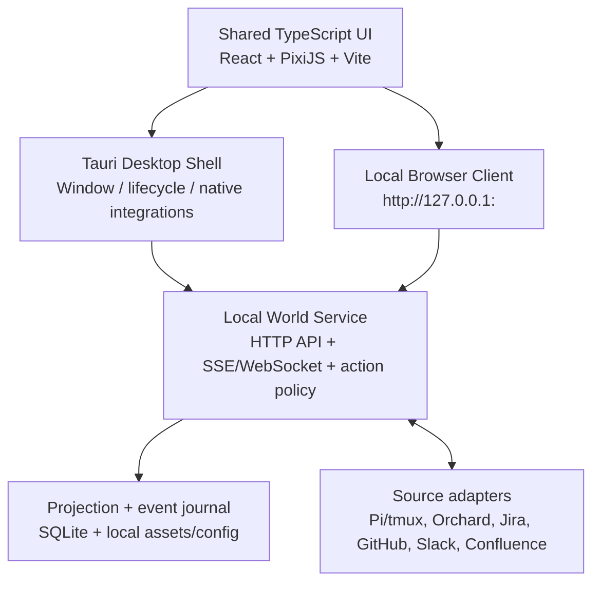

# Guildworld — Product Vision & Implementation Handoff

> **Status:** Implementation-oriented product brief, not an assertion that the system already exists  
> **Version:** 1.0 — 2026-10-17  
> **Audience:** Lead implementer / coding agent / product designer / technical architect  
> **Product name:** `Guildworld` is a **working name**, not a branding decision.  
> **Primary reference:** [apple-pi](https://github.com/z3z1ma/apple-pi)  
> **Visual north star:** *“Nostalgic little worlds, rendered with warmth, whimsy, and playful detail.”*

## 0. START HERE — the immutable constraints

**Build a NEW, standalone, locally running application. This is NOT an extension of the Mac notch UI.**

The existing `apple-pi` notch system is deliberately small, beautiful, and valued **as-is**. It is a separate product surface. It must not be visually absorbed into Guildworld, replaced, modified, reorganized, or coupled to the new game's lifecycle. The new app may **consume existing stable status data or documented interfaces** from `apple-pi` and Pi/tmux, but must not write to the notch's state/preferences, alter its asset pack, depend on its window, or require changes to its UI. If a future bridge truly requires a change to `apple-pi`, document a separate proposed opt-in contract and seek approval before touching that repo. No implicit synchronization of theme choices or positions between the two products.

**Hard requirements — confirmed by product owner:**

1. The product is a **persistent, cozy, living, game-like second-order simulation of real engineering work**. AI agents are visible as characters; work from external systems is rendered as quests, objects, places, and events. It must support actual observation and meaningful control, not only decorative animations.
2. The same semantic world supports **both a stewardship/management view and optional embodied, playable exploration**. There is *one* set of characters, places, tasks, and history. Different views are alternative perspectives on that state, not parallel copies of the simulation.
3. The entire aesthetic is **themeable**. Theme packs transform environments, characters, UI, audio, names, ambient detail, and narrative framing while preserving the same underlying world semantics, interaction vocabulary, camera grammar, and work behavior.
4. The flagship art direction is **cozy, whimsical, retro-inspired pixel art with a storybook sensibility**; a miniature diorama with soft maximalism, lo-fi comfort, and nostalgic warmth. The [Witchbrook Steam page](https://store.steampowered.com/app/1846700/Witchbrook/) is a strong *mood reference*, not artwork to copy. Original assets are mandatory.
5. There is a **Guildmaster** corresponding to an Orchard/chief-of-staff Pi session supervising individual workers and parties of other Pi sessions in tmux, with capability to delegate and reconcile their work. Use actual Pi/tmux state and integration affordances rather than simulating a fake agent backend.
6. Semantic places include coordination (Guild Hall), work intake (Jira Quest Board), communication (Slack Town Square), knowledge (Confluence Library), build/review (GitHub Forge), and agent skills/tools/permissions (Armory). Names change under other themes; function does not.
7. Target a **Tauri desktop app**, with architecture that can also serve **the same frontend via an authenticated localhost browser app**. Desktop is the initial packaging and experience target; browser support can follow as a separate milestone without a second UI codebase.
8. **Do not sacrifice efficiency for cosplay.** A real command, keyboard shortcut, inspector panel, and direct navigation must remain available for important tasks; walking to a building must not be required to do basic work.

**Non-negotiable safety / integrity constraints — proposed implementation guardrails:** no invented progress; no silent privileged actions; no agent shutdown when the UI closes; no broad unbounded local command interface; no credentials embedded in themes or the frontend; no confusing a gamified reward with verified external completion.

### Decision status convention

- **Confirmed vision**: endorsed product behavior above and through the conversation.
- **Recommended default**: implement unless a design spike demonstrates a better equivalent.
- **Open decision**: implementer proposes an ADR with trade-offs; must not silently convert an assumption into a product requirement.
- **Future**: intentionally deferred, not an excuse to put incompatible architecture in v1.

---

## 1. Product thesis

**Guildworld is a themeable living work-world that makes software engineering with AI agents feel like tending an intimate, persistent little society.** A user can zoom out and steward the guild, or step in and inhabit it, while quests, inhabitants, interactions, and artifacts continue to correspond to real work in Jira, Slack, Confluence, GitHub, and Pi/tmux.

The value is not XP bars pasted on enterprise tools. The value is **spatial legibility, delegation, awareness, genuine agency, and emotional delight**. A software engineer already supervising several coding agents needs to understand which agent owns what, who is blocked, where evidence lives, and what deserves human attention. A coherent town and recognizable cast can make those relationships intuitive at a glance.

### Emotional objectives

- **Delight:** opening the app feels like opening a tiny world, not another dashboard.
- **Comfort:** a warm, gently animated place to return to during real work.
- **Attachment:** characters have persistent identities, outfits, routines, and little personal details.
- **Clarity:** urgency, idle time, waiting for input, and completion are visibly different.
- **Agency:** interactions actually assign work, ask questions, inspect evidence, and trigger gated operations.
- **Presence without pressure:** the world may live and move without requiring constant attention.

### Product positioning / anti-goals

- Not a replacement for Jira, Slack, Confluence, GitHub, Pi, tmux, or the notch.
- Not a fake autonomous village whose invented behaviors are presented as facts about real agents.
- Not a requirement to physically move your avatar to click a PR.
- Not a metrics treadmill that incentivizes more messages, commits, tickets closed, or token consumption.
- Not a new generalized agent framework unless an existing capability demonstrably cannot meet a requirement.
- Not a single hardcoded fantasy game with a few recolored UI controls.

### Three experiential principles

1. **One world, many distances.** Stewardship and embodied play are different lenses over one model.
2. **Actual work, evocative presentation.** Metaphor enriches truth rather than concealing it.
3. **Meaning stays stable; vibe changes completely.** The same contract functions in fantasy, anime, or office-city worlds.

---

## 2. Target user and daily experience

**Primary persona:** technically sophisticated engineer orchestrating several Pi sessions, often with a chief-of-staff session, switching between implementation, research, reviews, team coordination, and project documentation. Advanced users must retain fast access to underlying processes, code, and sources.

### Ordinary day narrative

At startup the town has remembered its decorative state and reconciled actual Pi workers. In a Guild Hall, the Guildmaster is at a table; idle heroes rest, busy heroes go about work, a blocked worker signals attention. A new Jira work item appears on the town's work-intake board. The user opens it, inspects source context and dependencies, and asks the Guildmaster to propose a party. With approval, the backend delegates real work to actual sessions. The game shows people taking up their posts, while a real activity trail reports the assignment, execution, requests for input, and outputs.

A PR becomes available for review in the Forge. The user opens the real diff or existing `apple-pi` review experience—not a fictional summary that hides changed lines. They review, approve changes or request revisions as authorized. On verified completion, the quest state updates; the village may celebrate gently, and the achievement record points to the actual Jira/PR evidence. In the evening the user can walk around, speak to an agent, inspect the library, or just enjoy the ambience without needing another workflow.

### The hierarchy of interaction

1. **Stewardship:** default working mode; a broad view into agents, tasks, blockers, sites, and activity.
2. **Place/room focus:** zoom or transition into a building's interior where more detailed scene-level interactions happen.
3. **Embodied exploration:** optional user-controlled avatar, speaking to the same characters and triggering the same domain actions.
4. **Inspector / keyboard surface:** accessible from any view, enabling immediate inspection, commands, search, and fast travel.

**Important correction to earlier exploration:** the Mac notch is **not** a tier, mode, entry point, launch control, or companion component of this product. Leave it entirely orthogonal.

---

## 3. World model — semantics first

### 3.1 Stable places (not fantasy-specific IDs)

Use semantic identifiers internally. Never persist `guild_hall` when you mean `coordination_hub`.

| Canonical place ID | Domain purpose | Fantasy flagship | Anime / academy concept | SF office-city concept | Suggested live data |
| --- | --- | --- | --- | --- | --- |
| `coordination_hub` | Agent supervision, parties, delegation | Guild Hall | Club Headquarters / Command Room | Ops Loft | Orchard, tmux status, party topology |
| `work_intake` | Assignment queue / project graph | Quest Board | Mission Board | Sprint Wall | Jira issues, epics, blockers |
| `communications` | Conversation and collaboration | Town Square | Academy Courtyard | Cafe Plaza / Atrium | Slack channels, mentions, threads |
| `knowledge` | Documentation / research / memory | Great Library | Study Hall / Archive | Research Loft | Confluence, linked docs, local wiki |
| `build_review` | Branches, PRs, tests, delivery | Forge | Prototype Lab | Build Garage / Shipping Bay | Git/GitHub, CI checks, review surfaces |
| `capabilities` | Skills, tools, model profiles, authorizations | Armory | Equipment Locker | Tools Lab | Pi profiles/skills/permissions |
| `home_commons` | Idling, comfort, cosmetics | Inn / Cottages | Dorm / Lounge | Apartment / Break Room | Optional local aesthetic state only |
| `expedition` | Optional visualization of multi-step project work | Wilderness / Dungeon | Field Assignment | Project Site | Epics, subtask graph, party execution |

**V1 default:** deliver `coordination_hub`, `work_intake`, and `build_review` as meaningful functional scenes; represent the other sites as recognizable but possibly limited destinations. The complete town should be designed for expansion. Resist implementing six shallow connectors to claim feature completeness.

### 3.2 Stable actor types

- **Operator:** the real human; may have an avatar, but UI commands remain outside avatar mode.
- **Supervisor:** an Orchard/chief-of-staff *root Pi session* with `reportsTo` relationship to workers.
- **Hero:** a persistent, root-level Pi session in tmux with a stable identity and actual session lifecycle.
- **Summon / familiar:** a temporary scoped subagent or in-process worker; may be visible if and only if the source can expose its lifecycle. The current tmux publisher explicitly excludes those workers—do not invent them from main-session state.
- **Ambient NPC:** a fictional decorative character with no agent/process mapping. Its fictional nature must be clear in the model.
- **Party:** logical association of real sessions to an assignment, with explicit leader, membership, work scopes, and lifecycle (distinct from the supervisor's actual session hierarchy).

**Important:** whimsical class labels such as Sage, Artificer, Sentinel, Scout, Scribe, or Guildmaster are presentation identities or assigned specializations—not assertions about technical permissions or existing Pi built-in agent names. Do not infer access scopes, capabilities, or identities from sprite costume.

### 3.3 Canonical entities (suggested model)

- `SourceLink`: connector kind, external ID, URL, last sync, ownership, visibility.
- `Agent`: stable external session ID; root/summon/decorative kind; supervisor; actual process status; cwd, tmux locator; activity signal; source provenance, age, and permissions. Display profile stored separately.
- `Assignment`: intended goal, source task(s), responsible party/agent, assigned time, lifecycle, approvals.
- `Quest`: normalized work item with source, source status, dependencies, priority, result links, validation policy, and human-readable summary. Actual provider remains authoritative.
- `Party`: member IDs, supervisor ID, intended responsibilities, start/end, associated quest IDs.
- `Artifact`: repository/branch/commit/PR/build/check, linked to quest and agent, with verifiable status and source URL.
- `KnowledgeItem`: source document or local note, title, access scope, links, freshness.
- `AttentionItem`: user-action-needed event with severity, owner, age, source, acknowledgment status.
- `Place`: semantic location and interaction affordances, optionally a bound data source.
- `PresentationIdentity`: theme-independent stable character identity, chosen cosmetics and labels.
- `WorldPlacement`: entity ID, canonical place, local coordinates/anchor, decorative occupancy, animation override if any.
- `WorldEvent`: time-ordered source-linked domain event, validated against a schema.
- `PlayerState`: avatar position, chosen theme, last view, camera, and optional home decorations.

**Separation of concerns:** real external state is never overwritten by decorative game state. Example: dragging a hero to a chair changes their local pose only; it does **not** change the Pi session's actual working directory, status, assignment, or supervisor.

### 3.4 Truth and freshness

Every fact shown as work state must distinguish:

1. **Observed:** confirmed by a source record (e.g., tmux `busy`, GitHub CI check `success`).
2. **Inferred:** reasoned from current tool trace, declared assignment, or reliable mappings, visibly identified as an inference where relevant.
3. **Decorative:** fiction-only animation or ambiance, never reported as actual work.
4. **Stale / unavailable:** no current evidence, so UI must stop implying live state.

A working animation like “typing at a desk” may represent `busy` cosmetically. A label “researching architecture” requires stronger evidence (e.g. declared role/assignment/tool event). `agent_settled` is **not** equivalent to task completion; a PR open is **not** equivalent to merged; a Jira ticket moved to Done is **not** proof of verified deployment. Always link to evidence and surface ambiguity.

### 3.5 Status and behavioral projection

Actual root session statuses from `apple-pi`: `busy`, `idle`, `waiting`. Additional UI-only states derived from liveness/reconciliation: `stale`, `stopped`, `unknown`. `completed` belongs to an **assignment/quest**, not to the Pi process just because it became idle.

| State / signal | Game expression | User action |
| --- | --- | --- |
| `busy` | At an activity station, reading, crafting, or generic working loop | Inspect activity; don't interrupt by default |
| `idle` | Relaxing, strolling, sitting, resting | Ask, assign, inspect |
| `waiting` | Clear but gentle attention bubble | Inspect actual prompt, route to real input surface |
| `stale` / `unknown` | Visibly uncertain/ghosted status, not confidently active | Diagnose source connectivity |
| `stopped` | Absent or resting portrait with stopped label | Offer reconcile/reopen if safe |
| Assigned to a quest | Contextual activity indicator / travel toward appropriate place | Inspect real assignment |
| PR awaiting review | Workpiece ready at Forge, real review card | Review actual evidence |

Idle world animation may continue locally. Do not show a hero “running tests” solely because it is in the Forge.

---

## 4. Dual-mode experience: one world, two perspectives

### 4.1 Shared interaction invariant

Both modes must operate on **the same entity IDs, snapshot, domain commands, and events**. Opening a quest in either view must show identical source state and offer equivalent commands. A hero's location, outfit, assignment, and relationships must match. A theme change may restage sprites but must not create/destroy agents, quests, approvals, or parties.

### 4.2 Stewardship view (the working default)

- Town overview: readable buildings, paths, characters, activity pulses, attention indicators; mouse pan/zoom or trackpad equivalents.
- Selecting a building focuses that space and exposes context via an unobtrusive inspector.
- Selecting an agent shows identity, supervisor, verified state, associated tasks, last trustworthy activity, process controls with confirmations, and “Open in tmux.”
- Selecting a quest shows source link, dependencies, possible owner/party, status, relevant artifacts, and actions.
- Party composition via roster, drag/drop if useful, and keyboard-accessible alternatives.
- A single compact attention inbox: waiting for human, failed checks, blocked dependencies, stale worker.
- Direct search/command palette, keyboard shortcuts, fast travel, and detail cards.

### 4.3 Place / room view

- Zoom/transition from the town into a location's interior with coherent coordinates and identity.
- Ambient details reflect the function of the site; data remains real.
- Agent-to-agent interactions may be expressive animations **only if the underlying causal event is known**, otherwise decorative idle behaviors.
- Room objects provide alternative entry points to the same task-specific inspector (map table, bookshelves, anvil, notice board).

### 4.4 Embodied view (optional, not second app)

- One operator-controlled avatar enters and walks in the same world; avatar movement affects only local presentation state.
- Familiar directional movement (keyboard/controller as later option), pathfinding, object interaction, NPC conversation, camera-follow.
- Talking to a real hero maps to ask/inspect/steer actions through the same command gateway as stewardship view; chat text is not sent until explicitly submitted.
- Action affordances must be accessible by clicking and the command palette without physical navigation.
- “Step out / zoom out” returns to the stewardship camera in one action, restoring focus.
- Work continues while the user wanders; animations do not imply the agent is obliged to respond immediately.

### 4.5 Camera grammar and scene technique (recommended)

For first implementation, prefer **consistent 2D 3/4-top-down / pseudo-isometric composition**, with layered tilemaps and depth sorting; do **not** assume a full 3D engine or build a literal seamless continuous zoom into every interior. A short animated zoom/crossfade plus scene swap is acceptable **if it feels continuous** and preserves spatial context. True 3D camera movement, free rotation, and distinct camera geometries per theme are out of scope.

Layers: ground -> water/terrain -> obstacles -> NPC/player actors (Y-sorted) -> front-facing roofs/foliage occluders -> lighting/weather FX -> interaction highlights -> accessible HTML overlay. Establish pixel scale, scene anchor conventions, tile collision and draw order in an early spike.

**Test the two primary views using identical data:** one agent in `busy`, one `waiting`, one `idle`, one real quest with blockers, one PR awaiting review. Verify the same facts are visible in both views.

---

## 5. Themed world engine

### 5.1 Theme definition

A theme is **not a CSS file** and not a replacement for world semantics. It is a versioned asset-and-translation package that gives the same places, actors, UI states, props, sounds, and world events a new cohesive presentation.

**Shared across all themes:** entity IDs; semantic place graph; anchor map and collision topology (at least within a compatible layout family); pathfinding rules; perspective/camera grammar; input behavior; core actions; accessibility and state hierarchy; API contracts; real work permissions.

**Theme-specific:** sprites, animations, environments, architecture, decorations, ambient props, lighting, weather styling, soundscape, UI ornament, fonts (subject to license), names/flavor text, idle behaviors, particle effects, NPC decorative lore, and room dressing. UI density must remain usable in every theme.

### 5.2 First three theme packs

1. **`storybook-fantasy` — flagship, full fidelity.** Warm, whimsical, deeply detailed miniature town; crooked roofs, winding paths, lanterns, overgrown plants, magical libraries, blacksmith, cozy homes. Storybook pixel diorama, not generic medieval HUD.
2. **`anime-academy` — architectural proof.** Expressive characters, club headquarters, courtyard, study rooms, workshop/lab, lively emotes, soft colors. Not restricted to one anime visual treatment; initial pack can define a coherent subset.
3. **`sf-office-city` — architectural proof.** A mini San Francisco-inspired neighborhood: small loft offices, cafes, streetcar hints, fog, windows glowing at dusk, waterfront, makerspace, atrium, research studio. Should feel cozy and lively, not sterile corporate software.

Ship *one* polished flagship theme before investing deeply in the others. Build at least two deliberately different **thin** packs early to prove the theme schema is not a fantasy-only abstraction.

### 5.3 Example semantic translations

| Core object/event | Storybook fantasy | Anime academy | SF office-city |
| --- | --- | --- | --- |
| Supervisor | Guildmaster | Club Captain | Studio Lead |
| Research worker | Sage | Scholar / Analyst | Researcher |
| Builder worker | Artificer | Inventor | Engineer |
| Verification worker | Sentinel | Guardian | Reviewer |
| Docs worker | Scribe | Archivist | Writer |
| Scout/triage worker | Scout | Recon Lead | Investigator |
| Ticket assigned | Signed quest scroll | New mission card | Sprint task posted |
| Party formed | Adventuring party | Project squad | Delivery pod |
| PR created | Workpiece on the anvil | Prototype delivered to lab | Build ready for review |
| CI failure | Forge flame sputters | Warning light in lab | Red build monitor |
| Worker waiting | Thought bubble / bell | Emotive attention bubble | Desk light / chat ping |
| Work completed | Modest lantern celebration | Small confetti flourish | Team high-five / chime |

The action labels can expose original enterprise terminology as subtitled metadata (e.g. “Forge · Pull Request #328”) to prevent loss of clarity.

### 5.4 Theme pack contract (illustrative, not final TypeScript API)

```ts
interface WorldThemeManifest {
  schemaVersion: 1;
  id: string;
  displayName: string;
  description: string;
  author: string;
  license: string;
  engineCompatibility: string;
  cameraProfile: "shared-3q-topdown-v1";
  semantics: {
    places: Record<CanonicalPlaceId, {
      displayName: string;
      shortName: string;
      subtitle?: string;
    }>;
    roleLabels: Partial<Record<CanonicalRoleId, string>>;
    eventLabels?: Record<string, string>;
  };
  palette: Record<string, string>;
  typography: { ui: string; decorative?: string; fallback: string };
  scenes: Record<CanonicalPlaceId, SceneAssetRef>;
  actorAtlas: Record<CanonicalRoleId, SpriteAtlasRef>;
  ui: { frames: Record<string, string>; icons: Record<string, string> };
  audio?: Record<string, string>;
  effects?: Record<string, string>;
}
```

This is a manifest *shape*, not a mandate that themes eagerly load every place. Use lazy asset loading and typed validation. Build mapping completeness checks for required roles, scenes, status icons, and core interaction elements. Missing optional cosmetic assets should gracefully fall back; missing required semantics should fail validation, not crash at runtime.

### 5.5 Theme swap behavior

- Theme switching should leave real agents, quests, parties, selections, and underlying command history untouched.
- Preserve semantic location, actor identity, camera focus, and inspector selection. Rehydrate sprite rigs at equivalent anchors.
- Allow switching in stewardship view initially; later support room/embodied hot-swap once asset lifecycle handling is reliable.
- A theme must not execute arbitrary code or declare backend command permissions. Start with data-only packs; signed/modded themes are future scope and need explicit trust design.
- Worlds with different scene geometry can be future *layout packs*; do not pretend unlimited layout freedom is compatible with identical pathfinding unless the pack explicitly declares and validates a new compatible topology.

### 5.6 Art bible — `storybook-fantasy`

**Mood:** cozy, whimsical, retro-inspired, nostalgic, escapist, miniature, slightly dreamy, storybook. More craft and intimacy than spectacle. “Nostalgic little worlds, rendered with warmth, whimsy, and playful detail.”

**References:** approved generated exploratory concept art in `references/` and the general feel of *Witchbrook*; neither is a source asset to trace or resell. Produce **original tile sets, character rigs, props, and UI**. Protect readability in dim light and when scaled down. Do not assume Steam screenshot usage rights.

**Visual rules:**

- Warm twilight and lamp light; lavender dusk, moss and teal foliage, golden windows, gentle peach/pink highlights. Restrained palettes per environment with accent discipline.
- Architecture should be distinctive and imperfect: uneven stones, asymmetrical doors, hand-built timber, unusual but believable rooflines.
- Environments feel inhabited: cups, letters, flowers, pets, hanging signs, rugs, uneven shelves, paper piles, cobblestones, water reflections.
- Characters are small and expressive: clear role silhouettes, readable outfits, consistent proportions and origin points across animation frames.
- Soft maximalism: dense environmental storytelling **around** focused paths and hotspots; avoid visual clutter on critical task elements.
- Lo-fi comfort: slow breathing cycles, tiny sparks, page turns, wandering birds, smoke, rain and seasonal foliage; never use constant flashing activity indicators.
- Avoid thick chrome, gigantic golden frames, saturated magical combat VFX, or heavy RPG status bars obscuring work.
- Use modern text rendering for dense engineering facts and code; decorative pixel type is best reserved for headings, labels, and UI chrome.

**Proposed production starting units (validate against prototypes):** 16×16 base tiles; actors roughly 24×32 or 32×32 source pixels; 4-direction movement cycles initially; integer pixel scaling and nearest-neighbor sprite filtering; tightly constrained subpixel camera jitter; optional UI at device-independent resolution. The 3/4 angle should be consistent across town and rooms and across themes. Larger detailed assets should follow the same apparent pixel density. Evaluate 32-pixel tile alternatives in the art spike before committing to all environments.

**Audio:** subtle, non-invasive loops; birds/water/tavern sounds where appropriate; audible feedback for meaningful user actions only; independent volume/mute and reduced stimulation options. Never gate productivity on audio.

**Accessibility:** keyboard parity for essential interactions, contrast overlays, reduced motion/particle settings, scalable text, accessible HTML semantics for critical controls, alternatives to color-only status, pause ambient motion option.

---

## 6. Gameplay and concrete user stories

### 6.1 Core loop — real quest end to end

1. Source sync discovers a Jira issue; normalized work item and provenance are stored; board updates with an unobtrusive indicator.
2. User opens quest; sees real summary, source link, status, priority and dependencies, with “last synced” context.
3. User asks Guildmaster to suggest a plan/party. Existing Orchard may provide a suggested division of labor. Suggested actions are distinguished from committed actions.
4. User confirms delegation. Backend validates worker/role, workspace, resource bounds and authorization; uses real Pi/tmux supervisor mechanics, records correlation ID and result.
5. Workers execute in tmux independently of the GUI. State reconciliation and available events update live projection. UI never fabricates tool-specific activity.
6. Blocking questions or failed checks create `AttentionItem`s in the Guild Hall and relevant scene, with deep links to exact source.
7. Actual Git branch/PR and CI metadata populate a Forge artifact card. User opens true diff or existing review tool; decisions are explicit and auditable.
8. Verified provider status changes complete the workflow. Show a modest cosmetic celebration and a durable history entry backed by source links.
9. User can replay what happened in a human-readable timeline even after closing and reopening the application.

### 6.2 Interaction verbs (shared command vocabulary)

`inspect`, `ask`, `propose_assignment`, `assign`, `form_party`, `move_to_place`, `follow_agent`, `open_source`, `open_tmux`, `open_review`, `equip_capability`, `cancel_request`, `acknowledge_attention`, `fast_travel`, `enter_room`, `exit_room`, `toggle_embodiment`, `change_theme`.

Classify verbs into **local presentation only**, **read-only external**, **local process mutation**, or **remote mutation**. Never use the same broad action executor for all four without authorization gates.

### 6.3 Party and role model

A party is a **coordination model**, not a requirement to start several processes. Guildmaster may assign a single hero or assemble multiple with roles such as researcher, implementer, verifier. Before launch, show a plan containing desired output, ownership, worktree policy, likely tool access, cost/time limits if available, and approvals needed. Allow the user to decline or edit.

Don't force a fixed class taxonomy on the underlying Pi capability catalog: display roles and capability profiles separately, derived from actual available agent definitions/skills where possible. A hero may wear an Artificer costume and use a researcher tool profile; this is allowed but must be shown honestly in detail panels.

### 6.4 Progress and rewards

- Celebrate **verified outcomes and useful human judgment**; do not assign XP for noisy activity, number of commits, generated tokens, or continuous work.
- Cosmetics, home decoration, gentle seasonal collectibles and lore are good rewards; essential tools/permissions must not be locked behind points.
- Real deadlines and serious production incidents require neutral/serious presentation overrides; don't trivialize an outage as a cute dungeon boss.
- Let a user turn off scores, achievements, or celebrations entirely without degrading operational value.

### 6.5 First-class failure states

Disconnected Slack/Jira/GitHub, stale tmux record, worker crash, orphaned party, session restart, duplicate session ID, diverged worktree, inaccessible repo, CI failure, permission denial, expired token, timeout, missing asset, app sleep/wake, offline startup. Each must produce a clear state and recovery action; none may silently turn into a false “quest completed” animation.

---

## 7. Integration with `apple-pi` — observe first, command carefully

### 7.1 Source-of-truth findings from repo (verify again at implementation time)

- [`docs/tmux-sessions.md`](https://github.com/z3z1ma/apple-pi/blob/main/docs/tmux-sessions.md): root Pi sessions inside tmux atomically publish JSON state to `~/.pi/agent/state/tmux-sessions/<sessionId>.json` (overridden by `PI_TMUX_STATE_DIR`) with `schema`, `sessionId`, `pid`, `status`, `cwd`, `sessionName`, `paneId`, `windowId`, `paneTty`, `tmuxSocket`, `reportsTo`, `startedAt`, `updatedAt`. Status values `busy|idle|waiting`; **subagents and `pi_exec` workers are excluded**. Correct liveness requires matching process and pane, not file existence.
- Same doc: `components/tmux-sessions/sidebar/agents.py list` offers the current live list after liveness checks; it should be used as a reference for correctness rather than reimplementing naive PID probing. Respect tmux server boundaries and environment overrides.
- [`skills/orchard/SKILL.md`](https://github.com/z3z1ma/apple-pi/blob/main/skills/orchard/SKILL.md): an Orchard chief-of-staff session uses a charter, ledger threads, mailbox, supervised tmux workers started with `pi --session-id ... --reports-to ...`; identifies orphan/stopped workers and reopens histories. Guildmaster maps naturally to this existing model.
- [`docs/tasks.md`](https://github.com/z3z1ma/apple-pi/blob/main/docs/tasks.md): durable session mailboxes; `mailbox_send`, packaged `pi-send.mjs`, background tasks and monitors. Use documented addressing and send semantics rather than typing arbitrary keystrokes into panes.
- [`docs/subagents.md`](https://github.com/z3z1ma/apple-pi/blob/main/docs/subagents.md): in-process/public subagents have distinct lifecycles; they are not the same as root tmux workers. Surface only if explicitly instrumented/observed.
- [`docs/browser-pages.md`](https://github.com/z3z1ma/apple-pi/blob/main/docs/browser-pages.md): actual git-backed review tools (`review_code`, `review_markdown`, `review_ledger_task`, `explain_change`) serve token-protected local browser pages. Integrate by opening existing authorized review surfaces; do not duplicate or bypass evidence integrity. Verify activation options and service lifetime.
- The notch has its own Swift app, distinct scene assets, vibe config stored under `~/.pi/agent/state/notch.json` and its own lifecycle. **Do not consume or mutate notch preferences as the new app's state.** Existing notch vibes (office/cozy/nature/anime/ocean/fantasy) are inspiration only, not a plugin protocol.

### 7.2 Recommended adapter boundary

Treat `apple-pi` as **an external system with a versioned read API**, even if initial access is through its documented JSON records/CLI. Place all interpretations behind a `PiRuntimeAdapter` (for liveness and metadata) and `OrchardCommandAdapter` (for vetted commands), never in Pixi scene code. Ship fixture-based adapter tests and a no-Pi demo provider.

**V1 read path:** safely obtain the session list using supported tooling/environment; read ledger-linked assignment information only with clear ownership, parser validation, and source provenance. Do not scrape the notch UI. Prefer structured source data over terminal OCR or free-text inference.

**Write path:** propose an explicit, narrow bridge for asking a pre-existing Orchard to plan or start workers. Sending a message is a real mutation and must have explicit user approval and bounded payload. Do not assume `apple-pi` exposes a generic RPC with structured ack; design a request envelope + acknowledgment protocol on *Guildworld's side* and spike compatibility with actual mailbox behavior. If an Orchard cannot return machine-readable delivery confirmation, display “request sent / awaiting acknowledgement,” **not** “party started.”

**Process lifecycle:** never create duplicate `sessionId`s, reuse external Pi's documented commands, validate unique IDs and trusted paths, avoid unescaped shell interpolation, and never kill a worker just because the world is closed. Distinguish process termination from assignment completion. Use per-process permission checks and confirm destructive session operations.

### 7.3 Integrations and their authority

| Adapter | Initial scope | Authoritative system | Caution |
| --- | --- | --- | --- |
| Pi/tmux | Enumerate agent state, supervisor hierarchy, jump to process | Live Pi/tmux | Liveness reconciliation, multiple tmux servers |
| Orchard | Read charter/thread metadata where authorized; send narrow supervised delegation requests | Existing Orchard and mailbox | No fabricated ack; charters govern autonomy |
| Jira | Read assigned issues/epics/dependencies; optional updates later | Jira | Rate limiting, statuses vary by project |
| GitHub/Git | Read repo, PR, checks, branches, linked artifacts; review launch | GitHub and local git | CI is not a guarantee of correctness |
| Confluence | Read/search docs and link to sources | Confluence | Permission scopes and rich content sanitization |
| Slack | Read/search relevant channels/mentions and messages | Slack | Privacy, noisy events, thread context |

Ship minimal permissions and progressive connection. **Do not write to remote systems by default.** Local demo with mock adapters is mandatory for art development and testability.

---

## 8. Technical architecture — Tauri + localhost without two apps

### 8.1 Recommended architecture



**Recommended default:** one shared Vite-built client runs inside the Tauri webview in desktop mode and as an ordinary SPA in the browser. Both use a typed `WorldClient` API abstraction. A dedicated **local world service** owns file/process access, polling/events, credentials, SQLite, authorization, and external connectors. Desktop can supervise/launch the service; browser connects to a user-started local instance. The GUI is disposable: closing it must not end Pi/tmux work.

**Native shell vs shared service:** Tauri v2 is an excellent desktop packaging shell for a standard SPA; PixiJS handles sprite/tile render, React handles inspectors, dialogs, detailed content, keyboard/action surfaces. Use a sidecar/local service if it materially enables browser support and protects separation. Implementer should spike Rust-native service (e.g., Axum/Tokio/SQLite) **versus** a TypeScript/Node companion using real macOS packaging constraints and Pi installation assumptions. Decide by ADR after validating startup/restart, signing, CPU, and browser security. Do not force a heavy polyglot toolchain purely for elegance.

**Pragmatic delivery:** get Tauri to render a shared web UI against a mock local service first; do not block the entire product on standalone browser shipping. Production Tauri can use bundled assets and normal Tauri custom protocol; an authenticated localhost API is separate from the *Tauri localhost plugin*, which carries additional security risk and is not required for this architecture.

### 8.2 Why desktop and browser are both possible

The client is ordinary HTML/CSS/JS/WebGL, so the UI can be shared. What the browser lacks is raw OS access, tmux control, secure file reads, and privileged launch operations. A local backend provides those capabilities through a narrow authenticated API. Tauri can package both UI and local runtime; a browser can only operate while the local runtime is running. **A standalone remote-hosted website without a companion backend is a different product and is not a current requirement.**

### 8.3 Data and event flow

```text
external evidence (tmux, APIs, git, mailbox)
  -> adapter normalization + schema validation
  -> append observed event (id, source, timestamp, correlation, privacy class)
  -> reconcile canonical entities + projection state
  -> publish snapshot/event delta to clients
  -> render appropriate theme-specific scene + UI

user intent in any view
  -> typed semantic command
  -> auth/permission policy + precondition + idempotency check
  -> adapter-specific execution and recorded outcome
  -> observe authoritative result/ack
  -> update journal/projection; client receives delta
```

**A command acknowledgment means accepted/executed by the adapter, not that external work succeeded.** Model eventual consistency explicitly, especially for mailbox dispatch, remote Jira transitions and PR reviews. Correlate intent -> dispatch -> ack -> observation using stable IDs.

### 8.4 Contract examples (illustrative)

```ts
type SourceKind = "pi" | "orchard" | "jira" | "github" | "slack" | "confluence" | "local";
type AgentStatus = "busy" | "idle" | "waiting" | "stale" | "stopped" | "unknown";

type WorldEvent = {
  id: string; schemaVersion: 1; seq: number;
  occurredAt?: string; observedAt: string;
  source: SourceKind; sourceEventId?: string;
  entityType: string; entityId: string;
  type: string; payload: unknown;
  correlationId?: string; confidence: "observed" | "inferred" | "decorative";
  visibility: "private" | "workspace" | "shared";
};

type WorldCommand = {
  idempotencyKey: string;
  commandType: "ask_agent" | "propose_party" | "send_orchard_brief" |
    "open_review" | "open_tmux" | "assign_quest";
  targetId: string;
  params: unknown;
  expectedRevision?: number;
  userInitiated: boolean;
};
```

Proposed endpoint pattern:

- `GET /api/v1/bootstrap` — service version, supported commands, feature flags, session auth bootstrap.
- `GET /api/v1/world/snapshot` — full current projection with revision and sync freshness.
- `GET /api/v1/world/events?after=<seq>` or `GET /api/v1/world/stream` — ordered deltas plus resync guidance when client falls behind.
- `POST /api/v1/commands` — narrow typed actions, idempotency key, precondition checks, audit record and a pending/succeeded/failed result.
- `GET /api/v1/actions/<id>` — action progress and authoritative acknowledgment.
- `GET /api/v1/themes` and `GET /api/v1/themes/<id>/manifest` — validated local theme packages.

Need not implement every endpoint in the first milestone; **do** choose stable envelope conventions, timestamp units, IDs, resource versioning, and error semantics before UI/adapters proliferate.

### 8.5 Storage and persistence

- SQLite (recommended) for source references, normalized snapshots, event journal, assignment/party associations, acknowledgments, local cosmetics, player positions, scene state, and migration version.
- JSON manifests and bundled asset packs for theme content.
- Keychain/OS credential store or existing connector-managed auth for secrets; never SQLite plaintext passwords or theme JSON tokens.
- Event journal is **not** guaranteed to capture every action that happened while local service was offline. Startup reconciliation restores current external truth and marks unobserved history gaps. Never fabricate intervening events.
- Use incremental adapters, bounded retention, migrations, and privacy-aware export/delete. Track origin and last verified timestamp for all external records.
- Support safely reopening after Tauri crash, sleep/wake, CPU spikes, Pi restart, or tmux server restart.

### 8.6 Rendering and performance

- PixiJS (suggested v8 family) for scenes, sprites, atlases, animated props, depth sorting, particle budget, collision highlights, and camera transformations.
- React for cards, diff navigation, forms, chat, inspector, settings, themes, and accessible action affordances; never render a code diff as unreadable pixel glyphs.
- Layer camera-scene state and React UI state; event subscriptions must be cleaned up on theme or scene transitions.
- Use atlas batching, scene culling, texture memory limits, lazily loaded rooms, a low-motion low-power mode, and throttled background rendering. Aim for smooth interactive response and modest idle battery impact, not permanently rendering 60fps while minimized.
- Surface local debug overlays for FPS, event throughput, scene identity, adapter sync ages, active sprite count, and failed theme assets (only in dev mode).

### 8.7 Local security posture

The local backend is privileged relative to the browser. Treat malicious web origins, XSS inside Jira/Slack/Confluence content, compromised themes, and OS user boundaries as real risks.

- Bind to `127.0.0.1` (and IPv6 loopback only if intentionally supported), never `0.0.0.0` by default; use a dynamically allocated port with authenticated discovery.
- Authenticate every privileged HTTP/WebSocket/SSE request; session tokens must be per launch or suitably rotated and not leaked in logs, URLs, source maps, referers or static page content.
- Enforce Origin/Host checking, explicit CORS allowlist, anti-CSRF measures and private-network request assumptions; never enable `Access-Control-Allow-Origin: *` on a privileged API.
- Separate viewer/read-only roles from control privileges if browser access is enabled; do not assume any local webpage deserves tmux access.
- No arbitrary `bash`/file-read endpoint. Use allowlisted commands and trusted path validation. No shell-string concatenation.
- HTML/Markdown content from external tools must be sanitized; external hyperlinks retain provenance. Do not permit script execution from theme data or external documents.
- Tauri commands and plugins must follow least-privilege capability scopes; avoid blanket filesystem/shell permissions. User-facing approvals for destructive operations are enforced server-side.
- Sensitive work data must not be sent to third parties for cosmetic simulation/agent personality enrichment without explicit user consent and clear scoping.

Reference docs: [Tauri frontend setup](https://v2.tauri.app/start/frontend/), [sidecars](https://v2.tauri.app/develop/sidecar/), [capabilities](https://v2.tauri.app/security/capabilities/), [localhost plugin warning](https://v2.tauri.app/plugin/localhost/), [PixiJS Application](https://pixijs.com/8.x/guides/components/application).

---

## 9. UI, navigation, and the feeling of a living world

### 9.1 Initial scene composition

A small, polished village/town with strong silhouette landmarks, winding walkable paths, water, trees, buildings with unique roofs, a central gathering place, and visible worker activity. It should look convincing even with adapters disconnected using a **clearly labeled Demo World** mode. Build one exceptionally charming Guild Hall interior first. Let users naturally recognize the library or forge without requiring labels on every building.

### 9.2 Main UI anatomy

- **Primary canvas** dominates. No permanent enterprise dashboard obscures half the world.
- **Thin status rail / attention affordance** shows count and severity; expands into actionable items.
- **Contextual side inspector** gives source-backed details about selected agent/quest/place/artifact.
- **Command palette** for `Go to Guild Hall`, `Find PR`, `Ask Sage`, `Show waiting heroes`, `Change theme`.
- **Mode toggle** for embodied enter/exit; maintain scroll and selection continuity.
- **Theme picker** with live thumbnail and stable data preview, distinct from Mac notch vibe selector.
- **Settings** for auth scopes, local service, data retention, accessibility, motion, audio, original-source launch behavior.

### 9.3 Microinteraction policy

- Animation for **confirmed source events** may occur once, then settle to an ambient persistent state.
- Decorative animations should never interfere with buttons or communicate false urgency.
- Use subtle audio/visual feedback for successful local commands; source-reported completion only after authoritative confirmation.
- Low frequency or no celebration for production incidents; serious context should remain respectful.
- The user can turn off gamification notifications while keeping status and alerts.

### 9.4 Data visual explanations

Every object that maps to external work should have an easy “Reveal source” operation. Examples: clicking a Jira parchment opens ticket details; hovering an anvil artifact shows `repo#PR` and check status; selecting a hero opens actual Pi session state, original `paneId`, and latest trusted activity. Avoid opaque “level 27 developer” labels in place of real facts.

---

## 10. MVP / delivery sequence — vertical slice before breadth

**Do not start by fully illustrating three towns or integrating four SaaS apps.** Prove the projection, real Pi bridge, one usable scene, one coherent quest flow, and theme substitution first. Milestones have exit tests and should be independently demoable.

### Milestone 0 — Decisions and infrastructure spike

Deliverables: new repository; ADR on Rust vs Node world service and packaging; shared Vite/Pixi/React client; Tauri shell; mock backend; capability model; sample event schema; art-pipeline spike; scripts for independent local service startup. Demonstrate Tauri UI and browser UI rendering the **same mock projection**. Document what is production viable vs prototype.

**Exit:** close either UI with no adverse effect on another; no changes to `apple-pi`; fake `busy/idle/waiting` statuses render identically across desktop/browser.

### Milestone 1 — Living Guild Hall / actual read-only Pi

Implement: scene/tile rendering, camera/inspector, hero identities, read-only Pi/tmux adapter, correct freshness, supervisor topology, live events/snapshot diff. No mutations. Avatar support can initially be mock movement, not full dialogue.

**Exit:** real root Pi sessions match authoritative liveness; waiting indicator appears; stale/dead session is handled; app closes without touching any tmux session; fixture replay works offline.

### Milestone 2 — Theme engine proof

Implement: data-only manifest, semantic IDs, storybook-fantasy Guild Hall, two thin alternate theme packs (academy and SF-office), valid asset fallback, persisted theme choice **inside Guildworld only**. Visual regression fixtures.

**Exit:** switching all three themes changes world/character/UI presentation while roster, status, party, camera focus, source links and actions stay identical; invalid packs fail safely.

### Milestone 3 — Stewardship and embodied continuity

Implement: town overview -> Guild Hall interior -> user avatar control -> return; selection preservation; NPC approach, object hotspots, fast travel, command palette, keyboard accessibility.

**Exit:** inspect/ask affordance on same hero in both views yields same state; no mandatory walking for basic actions; room transitions don't duplicate agent identities or lose pending statuses.

### Milestone 4 — Real delegation through Orchard

Implement: observe Orchard; propose party/assignment; narrow, user-approved mailbox-based command dispatch; acknowledged/pending/failed command lifecycle; correlation/audit; session ownership and worktree safeguards.

**Exit:** launch a supervised Pi worker through the documented mechanism in a safe test repo; identify it in live tmux; record assignment; handle no-ack/crash/reopen honestly; prevent duplicate dispatch via idempotency key.

### Milestone 5 — One end-to-end quest and Forge

Implement: Jira read-only initial sync, quest board, links to assignment, GitHub/PR/CI read surfaces, existing review launch, completion reconciliation. Begin with fixtures if credentials are missing and clearly label demo mode.

**Exit:** real or staging Jira issue -> approved delegation -> observed Pi activity -> real PR/check metadata -> human review -> verified final provider status; every step offers a real source link; no invented completion.

### Milestone 6 — Town completeness and optional SaaS expansion

Implement: Confluence Library, Slack Square, Armory capabilities, activity filters, richer decorative world and personal home, permissions/configuration, better error handling, export/backup, richer thematic variants.

**Exit:** at least one substantive real interaction per additional place; no fake interactive controls; external permissions and freshness visible; no API sync that leaks irrelevant private content.

### Milestone 7 — Hardening and distributable desktop

Implement: macOS app signing and packaging, service lifecycle, migrations, dev diagnostics, performance tuning, optional localhost shipping, onboarding, asset-license audit, safe onboarding for users without Pi/Jira/GitHub.

**Exit:** reproduce cold install, upgrade, offline startup, corrupted theme, tmux restart, macOS sleep/wake; security checks pass; first-run demo is coherent.

### Explicitly deferred

Multiplayer/shared town sync; remote cloud hosting; distributed agent-host orchestration; AI-generated characters with open-ended personalities; arbitrary downloaded executable theme mods; global economy/marketplace; true 3D; VR; fighting mini-games; battle rewards tied to developer productivity; mobile; changing `apple-pi` notch behavior; automatic remote mutations without permission policy.

---

## 11. Acceptance criteria / test matrix

| ID | Required proof | Test |
| --- | --- | --- |
| `N-001` | Notch orthogonality | New app runs and exits with no diff to `apple-pi`, notch files/config or behavior; notch can be independently started/stopped. |
| `A-001` | Real Pi session visibility | Start multiple known Pi/tmux root sessions; roster shows correct IDs, supervisor and status. |
| `A-002` | Liveness integrity | Kill pane/process, restart tmux, use another server; stale records never remain marked live. |
| `A-003` | Honest state | Busy/idle/waiting cannot be conflated with quest done, test pass or deployment success. |
| `A-004` | Control authorization | Unapproved party spawn, arbitrary shell, unauthorized remote write, or destructive agent stop fail closed. |
| `W-001` | Single world model | Switch stewardship -> embodied -> stewardship; same agent/quest/entity IDs and authoritative statuses. |
| `W-002` | Practical ergonomics | Open any quest/PR/agent from command palette without avatar movement. |
| `W-003` | Resilience | Close UI, continue agents; relaunch and reconcile with no fake event replay. |
| `T-001` | Real theme interchangeability | Swap flagship/academy/SF while world behavior, selection, status, commands and source IDs are unchanged. |
| `T-002` | Manifest guardrails | Bad/missing assets produce visible fallback/error and never crash or gain privileges. |
| `I-001` | Quest evidence | Jira -> assignment -> session -> PR -> verification can be traced via canonical source links. |
| `I-002` | Eventually consistent commands | Dispatch states `proposed/pending/acknowledged/failed` are distinct; retry is idempotent. |
| `S-001` | Local API protection | Non-local origins and unauthenticated cross-origin/browser calls cannot control agents. |
| `U-001` | Accessibility | Major actions usable by keyboard; color not sole status signifier; readable inspector text and reduced-motion mode. |
| `P-001` | Responsiveness | Scene pan/inspect smooth with representative load; minimized/background view does not waste significant resources. Define quantitative budget from profiling. |
| `D-001` | Both clients | Shared frontend demonstrably runs as Tauri desktop and in localhost browser against the same service, even if browser packaging ships later. |

### Suggested automated tests

- Schema validation and migrations: stale/unknown event types, out-of-order deltas, duplicate IDs, invalid manifests.
- Golden event-stream fixture replay: snapshots and UI state converge identically after reconnect.
- State-machine invariants: dispatch never equals completion; unknown is not success; no command without typed policy.
- Adapter mocks: inaccessible credentials, revoked Slack/Jira scopes, GitHub rate limits, no tmux server, duplicate session ID.
- Visual regression: three themes at town/room scale, low-resolution and Retina, with status badges and overlays.
- E2E user flows: pan/zoom, enter room, embody, inspect hero, return, switch theme, open source, ask Guildmaster.
- Authorization checks: CSRF, origin, CORS, websocket auth, injection strings in ticket titles, malicious theme manifests, arbitrary path attempts.
- Performance and memory: many idle sprites, frequent event bursts, 30+ agents, minimizing app, reloading scenes repeatedly.

---

## 12. Proposed repo structure (one possibility)

```text
guildworld/
  README.md
  docs/
    PRODUCT_VISION.md
    architecture/
      adr-0001-runtime.md
      world-ontology.md
      agent-integration.md
      security-model.md
      camera-and-navigation.md
      theme-pack-spec.md
    design/
      art-bible-storybook.md
      references/
    plans/
      milestones.md
  apps/
    desktop/                 # Tauri shell, native lifecycle
    web/                     # Shared SPA entrypoint (or unified frontend app)
  packages/
    contracts/               # API schemas, enums, event/command types
    world-client/            # API + subscriptions (browser/Tauri shared)
    world-model/             # Pure projections, selectors, tests
    renderer/                # PixiJS scenes, camera, character layers
    ui/                      # React inspectors, palettes, dialogs
    themes/
      storybook-fantasy/
      anime-academy/
      sf-office-city/
  service/                   # Chosen local service runtime
    adapters/
    orchestration/
    persistence/
    api/
  fixtures/
    sessions/
    workstreams/
    themes/
  tests/
    e2e/
    security/
```

**Repo layout is suggested, not dogma.** Prefer fewer packages if they reduce early friction. Keep `contracts`, adapter interfaces, and rendering separate even in a small monorepo. Do not modify `apple-pi` to conform to this layout.

---

## 13. Open architectural questions and recommended defaults

| Topic | Recommended initial default | What to validate |
| --- | --- | --- |
| Project/repo boundary | Standalone repository | Zero notch diffs; clean setup |
| Frontend | React + TypeScript + PixiJS + Vite | SPA works unchanged in Tauri and Chrome/Safari |
| Desktop | Tauri v2 on macOS first | Signing, asset URI, service lifecycle |
| World service | Separate local backend with typed API | Rust vs Node after small packaging spike |
| Web client | Same SPA via authenticated loopback | Browser API auth, first-run service discovery |
| Initial world visual camera | 3/4 top-down pseudo-isometric 2D | Original art, sorting, interior transitions, hitboxes |
| Theme scope | Shared geometry/camera, complete visual swaps | Two thin contrasting packs prove neutrality |
| World persistence | SQLite projection + event journal | Backfill/reconciliation and migrations |
| Agent state adapter | Read existing documented tmux state/CLI | liveness under restarts, multiple tmux servers |
| Agent delegation | Orchard mailbox and explicit acknowledgment | Envelope compatibility, approval, retry safety |
| SaaS connections | Read-only first, per-provider scopes | Auth method available to local standalone app |
| PR review | Open existing git-backed review UI where possible | Trust, URL lifetime, no duplicate reviewer logic |
| Theme-specific map changes | Future explicit layout-pack extension | Pathfinding/collision contract |
| Product name | Temporary `Guildworld` | Branding later |

**Unknowns that require implementation research, not design speculation:**

- Can the existing Orchard return dependable structured correlation/ack events without a new Pi extension? What is the lowest-impact supported protocol?
- What exact local auth mechanism should protect cross-client control endpoints in installed and dev configurations?
- Should the world service be long-lived after the desktop window closes, or start on demand and reconcile? Agents **must** remain independent either way.
- How should user-approved operations handle multiple independent Orchards / work and personal profiles / tmux servers?
- What source-specific auth and scopes are feasible for Jira, Slack and Confluence outside the ChatGPT environment?
- Which precise tile scale and projection best reproduce the requested storybook feel **with production sprite workloads**?
- How much real agent activity granularity is currently emitted without modifying `apple-pi`? If only `busy`, display only that as factual.

The implementer should record ADRs for the first three questions before making risky irreversible decisions.

---

## 14. Implementation instructions to the receiving agent

**Work as an architect and incremental implementer, not as a prompt-driven theme renderer.** First inspect the linked `apple-pi` docs and source contracts at the actual commit available when starting. Verify assumptions; the documentation cited here is a **snapshot of integration behavior**, not permission to rewrite the package.

1. Set up a separate repo/project. Record the explicit no-touch rule for notch and `apple-pi` in `AGENTS.md`.
2. Produce a short `IMPLEMENTATION_PLAN.md` broken into testable vertical slices; put each slice's acceptance evidence next to it. Flag deviations and open decisions.
3. Build a smallest-functioning prototype with mocked agents/events and one cozy room, rather than spending weeks on integrations or giant art assets.
4. Spike one actual Pi/tmux read path and liveness reconciliation; prove that the observed state is not invented.
5. Prove theme neutrality with the same world fixture viewed in two visually divergent packs **before** proliferating fantasy-specific code.
6. Establish a typed command gateway and permission model before exposing mutation operations.
7. Implement a tiny, real end-to-end demo with evidence-linked Jira/PR data and guarded Orchard delegation.
8. Demonstrate both stewardship and embodied interactions acting on **one** state store and command API.
9. Capture screenshots and a short walkthrough of each milestone, plus API traces for each real action.
10. Keep the product feeling like a cozy game: tiny living environments, gentle idle routines, deeply considered sprites, and disciplined information presentation. Ask for artistic review at the first room before rolling out more scenes.

### First two-week acceptance demo (proposed target; duration illustrative)

- Open a standalone Tauri window with a polished **single Guild Hall** and an intentionally minimal town frame.
- Show 3–6 fixture heroes, then toggle to real Pi/tmux observations with clear labels.
- Click a hero: actual status and external source location appear; open the tmux session safely.
- Show a fake quest-board item clearly marked fixture/demo; in a controlled integration environment, load a real Jira item if configured.
- Move from overhead view to the same room in embodied avatar view, select the same character, and return.
- Switch between fantasy and a dramatically different office-themed thin pack; camera, identity, coordinates, interactions, and statuses remain stable.
- Run the same frontend as a localhost browser SPA with mocked world events and demonstrate server auth for read/control.
- Close the UI and prove no Pi worker was terminated and the notch remains unchanged.

This is the **confidence-building prototype**, not the finished app. Stop to review the feel of the world and architecture before building the other towns.

---

## 15. Asset references and provenance

- **Owner-provided inspiration:** the original `apple-pi` notch screenshot and the owner's confirmed art-language description. The notch image establishes the emotional success of agent sprites; it is not a proposal to transplant its UX into this app.
- **Mood reference only:** [Witchbrook on Steam](https://store.steampowered.com/app/1846700/Witchbrook/), particularly the cozy life-sim framing, inhabited town, intimate interiors, whimsical pixel-art world, and inhabitants with routines. Reinterpret the sensibility with original art and a distinct identity.
- **Conversation concept:** `references/approved-storybook-concept.png` — latest Witchbrook-influenced concept the owner endorsed as a **general vibe**, not a production-ready composition or literal screen specification. It is a design moodboard with illustrative labels. Other exploratory art is optional and should not be taken as precise UI acceptance criteria.
- **Canonical technical references:** [apple-pi docs](https://github.com/z3z1ma/apple-pi/tree/main/docs), [Orchard](https://github.com/z3z1ma/apple-pi/blob/main/skills/orchard/SKILL.md), [Tauri v2](https://v2.tauri.app/), [PixiJS](https://pixijs.com/).

**Rights:** No scraping/importing proprietary game sprites or scene compositions as production assets. Use self-created, appropriately licensed, or commissioned originals; keep asset provenance and licenses in the theme manifest or an asset ledger.

---

## 16. One-page North Star / success definition

> You open an independent desktop game window and find a tiny, charming, populated town that feels like a storybook you can inhabit. Its people are your real Pi agents. The Guildmaster has real work to coordinate. Quests are real tickets. Books connect to real documentation. Forge artifacts correspond to actual branches, CI, and PRs. You can watch from above or walk in as a character. Everything is readable, truthful, and useful; nothing forces you to play a navigation mini-game to get work done. Change the entire world to an anime academy or a foggy SF creative neighborhood, and the identities, tasks, commands, and work history remain exactly the same. Close it and your actual agent work continues. Meanwhile, the original `apple-pi` notch remains perfectly untouched, in all its simplicity.

### Definition of done for the first credible product

The owner can run this new Tauri app on a Mac, recognize real Pi sessions and real engineering sources, assign and follow a bounded task through actual infrastructure, find every piece of evidence, inhabit the same world as their agents, switch themes, and trust that the world never lies about what is happening. It must feel pleasant enough to visit when nothing urgent is happening and efficient enough to use when there is.

**Build the living work-world—not another pixel dashboard, and not a new notch.**
