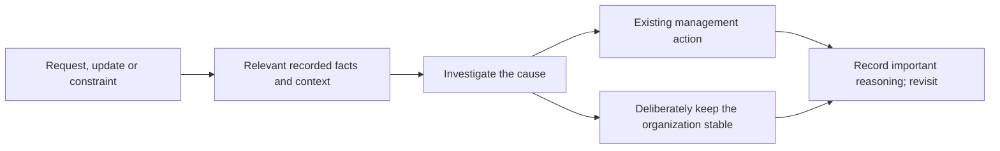

# Teach managers to adapt from evidence, not a compulsory objective

## Decision requested

Approved and committed as 04f3a320 (16/16 hunks seen): native organization/manager guidance, the scripted manager demonstration, and matching documentation. This is the last source increment in tickets 01–17. Code approval does not restart the shared runtime, migrate the live database or refresh existing sessions; those remain separate rollout steps.

## The change in judgment

Every top-level Pi session learns the five inspection instruments—`org_waits`, `org_work`, `org_communication`, `org_expertise` and optional `org_fitness`—and `link`. A managing role learns to consider adaptation during operator requests, planning/implementation, incoming reports or escalations, constrained work and sweeps. It inspects relevant facts, investigates the cause and uses existing management tools—or deliberately stays stable.

For example, repeated questions may show unclear decision authority rather than a shortage of managers. Changing authority or assignments can help; hiring a manager is one option, not a prescribed response. The charter removes fixed-percentile staffing and hire-on-wait prescriptions while preserving existing handover, send-home, reconciliation and sweep lifecycle conventions.

Staffing uses relevant recorded experience plus context and capacity. Read/edit calls show experience, not certified skill. Reporting manager, task owner and decision authority are distinct roles. Loose coupling suits parallel people, tight coupling one strong owner, and risk an independent challenger.

Fitness and scenarios remain optional when a dollar comparison helps. The guidance sets goals for judgment, not an all-tools checklist, forecast prerequisite or automatic optimizer. Managing-role gating is unchanged; every person's organization section still teaches inspection and relationship recording.

## What the scripted demonstration proves

An actual managing-role faux session uses native tools against a spawned isolated runtime. Its predetermined responses make the transition observable; they do not prove autonomous organizational judgment.

| Stage | Observable condition or action |
|---|---|
| Before | Ready unowned task, separate blocked decision, idle person with indexed relevant read experience |
| Inspect | `org_work` exposes ready/blocked work; `org_expertise` exposes the person's recorded experience |
| Act | Native `assign` gives the ready task to that person |
| After | A second `org_work` shows the task held rather than ready/unowned; the unrelated decision remains blocked |

The test retains task/person references and asserts both the change and the unchanged blocker. It adds no telemetry, stored summary, new management action or evaluator.

## Verification boundary

Author evidence: six relevant suites (roles/work/coordinator/organization/inspect/org-work) passed 60/60 with `--maxWorkers=2`; Node and web typechecks, loader, Biome on three files, whitespace and context lint on 160 files passed. Nine before/after hashes stayed stable; package dry-run includes charters.ts. The known coordinator fixture close-notice warning accompanied a passing suite. These are author checks, not independent endorsement.

Lucette's final Standards/Intent report (`t-c36ec8d0`) clears all nine paths with no confirmed defect. Her independent current six suites passed 60/60, with Node/web typechecks, loader, Biome on three files, whitespace and context lint on 160 files; nine before/after hashes match the final author snapshot, including the documentation clarification of which roles receive which prompt sections. Maeve's fresh cold read found no framing blocker; source implementation is distinct from final verification/rollout, and fan-in choices have no prescribed hierarchy. That is clarity evidence, not technical execution.

Agnieszka separately ran eight cross-slice suites (fitness/scenarios/peer-history/cost-history/communication/participation/work-recovery/World build consistency): 124/124 passed with `--maxWorkers=2`. All nine checked hashes matched before and after this run. Earlier slices and author runs retain their separate attribution; counts are not added together as a larger suite.

The source/demo checks claim no full suite, installed-tarball test, native CLI end-to-end, paid model/real teammate launch or pi_exec composition proof. Subsequent explicitly authorized [live rollout](rollout.md) verifies the replacement daemon, socket/command and schema 29, not autonomous management. The separate pre-execution composition failure was not repaired by this guidance change. [Historical limits](peer-history-sign-off.md)—unknown callers, initial reporting ancestry and deleted assignment spans—remain explicit, as do measurement exclusions and timestamp/observation conventions.

## Completion and rollout

Source review and operator approval are complete. All nine committed blobs match independent checked hashes; final bounded checks are complete. Explicit rollout authority was then obtained and the replacement runtime/schema 29 verified separately from source/scripted proof. The operator subsequently reloaded the root session; refreshed native tools/guidance are present and a live `org_work` call succeeded. Colleagues are home and load current code on their next opening.
