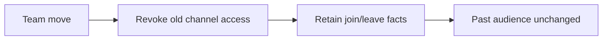

# Approve org_communication for commit

## Decision

Approve this reviewed increment for commit: read-only communication inspection, explicit escalation identity, and the operator-approved participation facts needed to keep past counts stable after ordinary team moves. Recommendation: approve. This gives managers evidence, not an efficiency score or a restructuring controller.

## Terms and scope

- **Organization:** agent sessions connected by reporting relationships. A root session has no manager.
- **Thread/audience:** a conversation and the participants who belonged to it when a message was posted. This includes mail, meetings, task threads and team channels.
- **Pair:** two people counted together regardless of which one sent the message. Both must have belonged to the organization at message time.
- **Window/cutoff:** message counts cover `[since, until)`, including the start but excluding the end. Open requests are a separate snapshot at the cutoff (`until`, or now), even if they began before the window.
- **Decision target:** the person named as the target of an open `requires_decision` link. An escalation target is an eligible thread participant other than its creator.

The tool requires `since` and accepts an optional `until`. It covers the caller's organization, narrowed to a person or manager's subtree when requested.

## What the manager sees

- Person pairs and teams (grouped by the person's manager at message time), with counts over a named window.
- Threads with the most messages, as references without transcript bodies.
- Open decisions requested of each person and explicit escalation threads whose latest author is not that target.

A message to a thread with two other eligible participants contributes two person-pair counts, but one thread-message count. These are audience-based counts, not proof of delivery or reading. People and team membership are judged historically. Root sessions represent their own team when they have no manager.

## Preserve history without preserving access

The shared participation writer commits current access and its join/leave event together, using a savepoint inside or outside an existing transaction. Thread creation, invitations, channel reconciliation, task participation and temporary-peer cleanup use it. Repeated joins do not create extra facts. Joining later does not import earlier messages; leaving does not erase prior audiences.

Migration 28 seeds only surviving known joins and records when complete participation tracking began. Earlier departed audiences cannot be recovered. The returned boundary describes audience provenance only: it is not a certificate of complete peer history or message retention.

## Escalation is explicit

The native escalate tool now records thread kind escalation, retaining ordinary participant/delivery/read behavior. An ordinary mail subject saying Escalation is not enough. Older subject-only mail is left unclassified rather than guessed.

A requester retiring does not withdraw its unanswered request. The pending indicator uses eligible noncreator participants and the latest author, not semantic analysis of whether another reply is needed. Fitness operator-demand accounting and Agent World's attention reader recognize the new kind. The committed Electron bundle has been rebuilt and checked; source tests alone were insufficient.

## Verification and limits

Lucette's final verification: the contents of 25 reviewed paths stayed unchanged during the checks; 94/94 tests passed across 12 focused files with two workers, plus 4/4 in the separate Agent World build/workplace run. The extension loader, Node/web typecheck, explicit-path Biome and context lint (154/154 context files) passed. Waylon independently tested atomic join/leave failure, nested transactions, invitation behavior, migration/rejoin and cleanup rollback. No full-suite, immutable-commit, packed installation or live-rollout claim.

Existing [ticket 15](tickets/15-keep-history-on-peer-disposal.md) limitations remain: a temporary peer is an agent started for a `pi_exec` program and discarded afterwards; its identity, messages and assignment history can still disappear, and attribution to its caller is incomplete. Audience changes and messages use millisecond timestamps. All audience changes at a message's timestamp are applied in their recorded event order; this does not establish whether each change preceded that message within the millisecond. Audience counts are not receipts. Point membership queries skip irrelevant cost/prompt facts while compute/question callbacks keep their full ordered replay.

## Approval boundary and next step

Approve to commit the reviewed source, tests, docs, contexts and generated Electron bundle, or leave corrections to make first. Unrelated role, learning and task-retrospective changes are excluded. This page does not authorize or claim a live runtime restart. After this increment, the next approved ticket completes fitness as one optional instrument, named org_fitness; later tickets complete economics, scenarios, retained peer history, the org command and manager guidance.
