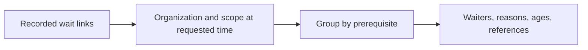

# Approve org_waits for commit

## Decision

Approve the read-only `org_waits` tool and its reviewed ownership fixes for commit. I recommend approval: managers can see explicit blockers, shared dependencies, elapsed waits, and recently resolved waits with evidence references, without a diagnostic score or automatic intervention.

This change also implements the operator-approved organization field on links. It preserves who recorded a link while keeping it resolvable after a temporary recorder is deleted. It does not complete the later peer-history ticket.

## Two-minute focus

Read the wait projection in `components/session-state/src/inspect.ts`, historical ownership in `fitness.ts`, and link ownership in `links.ts` with migration27 in `schema.ts`.

## Terms used below

- **Organization/root:** a reporting tree of agent sessions; its root is the session with no manager. A merge occurs when one root takes a manager in another tree.
- **Wait link:** a recorded `blocks` or `requires_decision` relationship from waiting work or a person (the source) to its prerequisite (the target). The recorder is whoever created the link; resolving it marks the wait ended.
- **Task holder/target owner:** a person assigned to the task at the moment being inspected; for a person target, that person is the owner.
- **Window/cutoff:** `[from,to)` includes the start and excludes the end. The cutoff is the end used for the open-wait snapshot. Times in the examples are elapsed hours.
- **Temporary peer:** an agent started for a `pi_exec` program whose session record is deleted when the program releases it.

## 1. Observe waits, not diagnoses

Open waits are a snapshot at the requested end. Recently resolved waits use their resolution time and duration. Source task holders identify who waits; a recorder is a fallback, not automatically the waiter. Two people share a team here if one manages the other or both have the same non-null manager. A wait is classified as cross-team only if at least one target owner is known and no waiter shares a team with any target owner. This is an observation, not a claim of inefficient coordination.

The tool is registered with the existing workplace tools. Expertise still answers who knows what now and intentionally uses today's roster; it is not historical accounting.

## 2. Keep three meanings of ownership separate

| Case | Result |
| --- | --- |
| B joins A at hour5; B completed $50 work at hour1 | A's earlier [0,4) still earns $0 |
| B has ongoing work losing $5/hour; A queries [0,6) | A incurs only $5 after the join |
| The former root retires after joining | Its outstanding obligations remain |
| Cancelled task still has an unresolved source wait; recorder retires | The wait remains visible at the cutoff |
| Unrelated task has an invalid goal file | Fitness never opens it |

Current task operations follow the current organization root. Historical task value, delay and waits follow structural ancestry at the relevant moment. Active-person membership remains distinct. Fitness task eligibility is established before pricing; only owned work relevant to the requested window has its goal read. Its wait snapshot uses the broader eligible set, not only priced work. Inspection retains its established broader task scope, including internal steps.

Task close and link resolution timestamps have millisecond precision: a join at the same timestamp counts. This is not exact event-sequence ordering across those facts.

## 3. Keep link ownership after recorder cleanup

New links atomically store an originating organization and the unchanged recorder. Resolution follows the stored organization's current root after a merge. Task/person/organization endpoints are checked against the recorder's organization; within-org resolution remains convention-based.

Migration27 adds a nullable column. Legacy links use surviving endpoint/recorder evidence. When none survives, manual resolution reports unknown ownership rather than inventing it. Pre-rule cross-org rows are not cleaned out of historical views. Endpoint checks are not a general confidentiality sandbox: agents retain shell access, and external/thread/message references do not gain a new comprehensive ACL.

## 4. Checks and limits

Lucette's final settled-tree run: inspect, fitness, links, work, coordinator, work-recovery, cost-history: **80/80** with two workers. Loader, Node/web typecheck, and explicit-path Biome passed; reviewed file hashes stayed unchanged across that run. The unreachable-runtime close-notice warning was non-failing fixture stderr. Tendai independently passed44/44 and reproduced pre-join historical invariance after the fix.

No full suite, installed-package execution, or live-daemon restart is claimed. The runtime will need a restart to load code and apply migration27; this sign-off does not claim or perform rollout.

Existing ticket15 limitations remain: peer cleanup can lose assignment and manager history, and temporary-peer compute/operator demands are not yet fully attributed. The new artifact-only link-resolution regression is fixed, not deferred.

Unrelated role, notebook-learning, and task-retrospective edits are outside this code approval. No implementation or commit beyond this reviewed increment is represented by this page.

## Next step

Approve this change to commit the reviewed increment, or leave comments to address before committing. Approval covers this code, not a live-runtime restart or the remaining implementation tickets. After the commit, the next planned feature is `org_work`, which shows where work stands; the known peer-history limitations remain in ticket 15.
