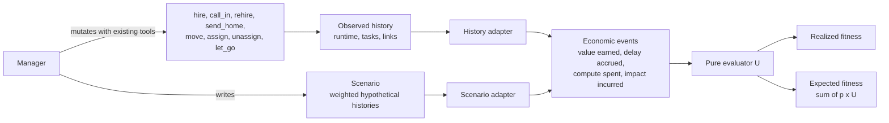

# Spec: fitness-driven self-organization

**Approved by the operator on 2026-10-26.** This spec turns the settled map ([map.md](map.md)) into buildable decisions. Build it through the tickets in [tickets/](tickets/), in dependency order; the first two (Record when tasks open and close, and Value and cost of delay on tasks) can start at once.

**Approved 2026-10-26 with four clarifications, now applied:** impacts record what happened, never avoided losses; unmarked values are unattributed, not confirmed; no blanket $0 rule for fixes, only no double counting; scenarios compare from the same decision point and starting work state. **Earlier in that review:** realized and expected fitness are now literally one evaluator over one representation of economic events, fed by two adapters; candidate organizations can be compared only on the same opportunities, valuations, and horizon, and the manager's forecast is named as the part that does the real work; the value of work is an input the organization may estimate but never an action it optimizes; defects no longer reverse a task's whole value: any link can carry a dollar impact, and only incurred impacts are charged; the runtime records when a task becomes an obligation and when it closes, so history can be reconstructed; "waste" is now spend on dropped work, a fact, not a judgment; time is counted in hours. Two points are the author's synthesis; they are marked **(synthesis)**.

## Problem Statement

The operator runs an organization of lasting Pi sessions: people with roles, managers, assignments, and mail. Managers staff and reorganize by judgment alone. Nothing tells anyone whether the organization as a whole produces value efficiently, whether a hire or a move made things better or worse, or where time and money go. Implementers produce visible output, but most of the role catalog (reviewers, skeptics, architects, writers, product people) creates value by changing what is likely to happen, and nothing can weigh that. The manager charter names signals such as fan-in (how many reports, questions, escalations, and decisions reach one manager) and affinity (who has done the most similar work), but nobody can measure them. Because the organization cannot see its own effectiveness or compare its possible shapes, it cannot improve itself, and every change of structure is an unchecked opinion.

## Solution

The organization gets one scalar **fitness** in dollars. One pure evaluator, U, adds up economic events: value earned when work completes, delay accrued while work is outstanding, compute spent, and losses incurred. Two adapters feed it. The history adapter turns what really happened into events, which gives **realized fitness**. The scenario adapter turns a manager's **scenario**, a few weighted hypothetical histories of what a candidate organization would do with the same opportunities over the same horizon, into events, which gives **expected fitness** as the probability-weighted sum of U. Every role counts only through how it changes those outcomes: fewer losses, less dropped work, less delay, better work chosen. There is no per-role score.

Managers observe the organization and the links between its work, read realized fitness, compare candidate organizations by their scenarios, change the organization with the manager tools they already have, record the scenario they acted on, and later see it beside what was realized. The evaluator scores forecasts; it does not make them. The quality of morphogenesis rests on the manager's forecasts, and the record of forecast errors is what keeps them honest. How a manager searches is left to the manager, and keeping the organization stable so its people keep building context is a legitimate choice. The operator sees the same numbers through `/org`.

**Worked example.** A one-person organization owns one task, "Fix flaky test": value $50, cost of delay $5 per hour. The task becomes an obligation at hour 0 and completes at hour 3.5. The person spends $3 of compute in hours 0 to 2 and $2 in hours 2 to 4.

| Window | Earned value | Delay | Compute | Fitness |
| --- | --- | --- | --- | --- |
| Hours 0 to 2 | $0 | $10 | $3 | -$13 |
| Hours 2 to 4 | $50 | $7.50 | $2 | +$40.50 |
| Hours 0 to 4 | $50 | $17.50 | $5 | +$27.50 |

The two windows add up to the whole: -$13 + $40.50 = +$27.50. Had the task never completed, every window would show only delay and compute, so an idle organization with valuable outstanding work scores negative.

Terms used below:

| Term | Meaning |
| --- | --- |
| Root | A person with no manager; it holds the manager tools, as managing roles do. |
| Sweep | A manager's regular check of its organization against the directory and its threads (manager charter). |
| Window | A past time range `[from, to)` over which realized fitness is computed. An event at time t belongs to the window when from <= t < to, so an event at a boundary falls in the later window. |
| Hour | The unit of time for cost of delay and for the fitness rate, counted fractionally. Agents work in hours, not days. |
| Horizon | How far ahead a scenario looks, such as "8 hours". |
| Obligation | A task the organization is responsible for. It starts when the runtime records the task for the organization (when it is created with `ledger_add`, `take_task`, `assign`, or `hire`) and ends at its completion or cancellation. A task created before this record existed starts when it is first recorded (taken, assigned, or closed). |
| Completion | The one event at which a task earns its value: an ephemeral task is archived after its last assignee finishes; a ledger task moves to `.ledger/history/` with `Status: done`. A cancelled ledger task (`Status: cancelled`) earns nothing and stops accruing delay. An ephemeral task has no cancellation. |
| Economic event | One fact the evaluator adds up, at a time: value earned, delay accrued over an interval, compute spent, or impact incurred. |
| Impact | A dollar loss or gain recorded in a link's data, such as the damage a defect actually caused. It is `incurred` (it happened) or `estimated` (a guess); only incurred impacts are charged. An impact is an economic assertion with its recorder as provenance, not a proven fact. It must never be an avoided loss (that belongs in a scenario) and never repeat value or cost already counted. |
| Scenario | A forecast: a horizon, the organization it assumes, the opportunities (the external work available, with valuations), and a few outcomes, each a probability and a hypothetical history. Probabilities sum to 1. |
| Spend on dropped work | Compute and delay already counted, on tasks that were later cancelled or superseded. A fact, not a judgment of waste: a skeptic's investigation that caused a cancellation may be the best work done. |
| Fan-in | How many reports, questions, escalations, and decisions reach one manager. |
| Forecast error | Realized fitness over a prediction's horizon minus its expected fitness; positive means the organization did better than forecast. It measures forecast calibration, not the causal effect of a mutation. |
| Departure | A person let go (`let_go`); it stops being a member at that time, and a rehire makes it a member again. |
| Mutation | A change to the organization made with existing manager tools, alone or as a short sequence. |
| Link | A recorded relationship between two existing things, such as "task A waits on thread B". |
| The brief | The operator's original design essay, verbatim in [source.md](source.md); his later [thesis.md](thesis.md) wins where they differ. |

## User Stories

### Fitness

1. As the operator, I want the organization to have one fitness number in dollars, so that I can tell whether it produces more value than it costs.
2. As the operator, I want fitness judged against the work the organization is responsible for, so that an idle organization with valuable outstanding work scores negative.
3. As the operator, I want fitness over two adjacent windows to add up to fitness over their union, so that history can be compared and divided without contradictions.
4. As the operator, I want fitness shown as a total and as a rate per hour, so that I can compare windows of different lengths.
5. As the operator, I want fitness for a window I choose, so that I can look at any period.
6. As any person, I want to read my organization's fitness, so that I can see how my work affects the whole.
7. As a manager, I want fitness broken into contributions with their source (which task earned value, which task accrued delay, which person spent compute, which link carried an impact), so that I can find where value is produced and where cost and delay build up.
8. As a manager, I want to narrow the contributions to my own subtree, so that I can explain my part without a separate subtree score.
9. As a manager, I want each task's delay charged once however many links explain it, so that three blockers do not triple the cost of one wait.
10. As a manager, I want each task's delay split into queued (unassigned and not waiting), waiting (an open wait link), and in progress, with the open waits and their age beside it, so that I can tell work that needs people from work that needs a decision.
11. As a manager, I want the breakdown to show spend on dropped work (compute and delay on tasks later cancelled or superseded), as a fact and not as a verdict, so that I can judge whether stopping that work was worth what it cost.
12. As a manager, I want compute counted for the people who were members when they spent it, so that a later move or departure does not rewrite history.
13. As a manager, I want value earned once when a task completes, so that several assignees finishing does not multiply it.
14. As a manager, I want delay to start when work becomes the organization's obligation, not when someone is assigned to it, so that unassigned backlog counts.
15. As the operator, I want historical fitness to be the same before and after a task is archived, so that the history adapter reads recorded facts, not the current state of files.
16. As the operator, I want to see how much outstanding and completed work has no value yet, so that I know when the fitness number is incomplete.
17. As the operator, I want the cost of my attention kept in the model but shown as unmeasured until there is an honest measure, so that waiting for me is never mistaken for my time.
18. As the operator, I want the number of interruptions (questions put to me, mail and escalations to me) shown beside fitness, so that I can see the demand on me without a false price.
19. As the operator, I want an idle person to cost nothing in fitness, because an idle session makes no model calls, so that only real spend counts.

### Value of work

20. As a manager assigning work, I want to write a value and a cost of delay in the task's `task.md`, so that fitness knows what the work is worth and how fast it loses worth.
21. As a person taking work with a written goal, I want to estimate the value and cost of delay of my own task, so that self-started work counts too.
22. As the operator, I want to correct any task's value by editing its `task.md`, and have past windows restated under the corrected value, so that fitness reflects our best current understanding.
23. As the operator, I want to see which values are marked as agents' estimates and which are unattributed, so that I know how much of the number rests on the organization's own guesses, without the file pretending to prove who confirmed a value.
24. As the operator, I want the value of work treated as an input to optimization and never as something the organization improves by changing, so that raising estimates or splitting tasks can never look like a better organization.
25. As a manager, I want value and cost of delay in dollars, so that they combine with compute cost without conversion.
26. As a manager, I want the charter to tell me that splitting an outcome into tasks does not increase its value, and that no value may be counted twice (for example a fix that restores value already credited), so that neither inflates fitness.

### Links

27. As a person, I want to record that my task waits on another task, a thread, or a person, with a short reason, so that the organization can see what blocks me.
28. As a person, I want to record that my task requires a decision from someone, so that decisions that hold up work become visible.
29. As a person, I want to record that my task produced a commit, a PR, or a file, so that later readers find what the work became.
30. As a person, I want to record that a check run or review verifies a piece of work, so that the evidence is linked to what it checks.
31. As a person, I want to record that a task, thread, or decision supersedes an earlier one, so that stale work and decisions are marked, without changing anyone's fitness.
32. As a person, I want to record that my task fixes a defect in earlier work, so that the cause of remediation is known.
33. As a person, I want to put a dollar impact on a link, marked incurred or estimated, so that a real loss (or gain) is charged where it happened without a rule that guesses its size.
34. As a reviewer, skeptic, or other advising role, I want to record a finding on a task, and the task's owner to accept or reject it, so that accepted findings become evidence of my effect without earning dollars of their own.
35. As a person, I want a waiting link on a task to resolve on its own when that task completes, so that I do not have to clear it.
36. As a person, I want to resolve any other link by hand, optionally with a word such as `accepted` or `rejected`, because only I know when a person or thread has really answered.
37. As a person, I want to link any existing entity (task, person, thread, message, commit, PR, file, check run, the organization), so that one tool covers every relationship.
38. As a maintainer, I want relation words to come from one defined list, each with a one-line meaning, and adding a relation to be adding one line to that list, so that links mean the same thing to everyone and the vocabulary grows easily.
39. As a person, I want a link I infer rather than know marked inferred, with my confidence, so that a guess never reads as a fact.
40. As a person, I want to attach structured data to a link, so that numbers such as an impact or a scenario are machine-readable.

### Scenarios and prediction

41. As a manager, I want to change the organization with the tools I already have (hire, call in, rehire, send home, move, assign, unassign, let go), so that there is no second way to reorganize.
42. As a manager, I want to make any organizational change on my own judgment and then report it with my reasoning, so that the organization adapts without waiting for approval.
43. As the operator, I want each reported change to state the diagnosis, the actions, and the expected fitness, so that I can read and correct it.
44. As a manager, I want to write a scenario for a candidate organization and get its expected fitness from the same evaluator that computes realized fitness, so that I can compare "current team" with "plus a reviewer" in one currency.
45. As a manager, I want a scenario's outcomes to carry probabilities, so that a role that lowers the chance of a loss or of dropped work shows its value even in outcomes where nothing went wrong.
46. As a manager, I want candidate organizations compared only from the same decision point and starting work state, on the same opportunities, valuations, and horizon, so that no organization looks better because it was forecast easier work or a better start; a product role may still choose differently among the same opportunities.
47. As a manager, I want a scenario to include anticipated work and a horizon I choose, so that long-term roles (a technical writer, an architect) and roles that change which work is chosen (product) can win a comparison.
48. As a manager, I want a scenario that reproduces an observed history to evaluate to exactly that history's realized fitness, so that I can trust that expected and realized fitness are the same function.
49. As a manager, I want the reasons and evidence behind my probabilities linked from the scenario, so that others can check how I forecast.
50. As a manager, I want to record a scenario as a prediction before I make the change it forecasts, and later see it beside the realized fitness over its horizon with the forecast error, so that optimistic forecasts are caught and forecasting improves.
51. As a manager, I want a prediction whose valuation basis has since changed to be marked as such and not scored, so that a repriced task does not make a forecast look right or wrong.
52. As a manager, I want to see accepted and rejected findings per task and per person, so that I can estimate in a scenario how much a role lowers losses or dropped work.
53. As a manager, I want to choose my own search strategy, including keeping the organization stable, so that the substrate does not force one theory of self-organization.
54. As a manager, I want to judge a person or role by how its presence changes the whole organization's expected fitness, including how roles complement each other, so that a reviewer who prevents defects elsewhere is not scored as useless and two identical skeptics are not counted as twice one.

### Surfaces and teaching

55. As the operator, I want `/org` to show fitness, its rate, its contributions, valuation coverage and provenance, delay by state, spend on dropped work, impacts, findings, interruptions, open waits, and predictions with their observations, so that I can inspect the organization without asking a manager.
56. As a manager, I want the charter to teach the loop (value work, record links, read fitness in the sweep, compare candidate organizations with scenarios, record the scenario before acting, mutate or deliberately not, look at the prediction later), so that self-organization is part of how managers work.
57. As a manager, I want the charter to keep fan-in as guidance ("when fan-in repeatedly constrains progress, consider whether changing authority, assignments, or reporting would improve expected fitness"), so that a known signal still prompts a look.
58. As a manager, I want the charter to carry the brief's principles (cheapest change first is not a rule; restraint is valid; reporting manager, task owner, and decision authority are separate roles that may coincide; loosely coupled work suits parallel people while tightly coupled work suits one strong owner, and riskier work adds an independent challenger; people improve by accumulating context, so stability can be the best choice), so that judgment has guidance without fixed thresholds.
59. As a view (tmux, Agent World), I want to read fitness and links from the same database the tools read, so that every surface shows the same numbers.
60. As a reader of the docs, I want `docs/organization.md` and `docs/session-state.md` to describe fitness, scenarios, links, and the new tools, so that the contract is written where the rest of the organization is.
61. As a maintainer, I want `docs/boundaries.md`, which rejects a structured hand-off record between people and work records other than tasks, to say that links are neither, so that a later reader does not remove them as a regression.

## Implementation Decisions

### One evaluator, one representation, two adapters

- Fitness is computed by one **pure evaluator** U over a list of **economic events**: value earned at a time, delay accrued over an interval at a rate, compute spent at a time, and impact incurred at a time. U knows nothing about the database, scenarios, or roles ([Roles and expected fitness](decisions/24-roles-and-expected-fitness.md)).
- The **history adapter** turns the recorded history of one organization into economic events. The **scenario adapter** turns each outcome of a scenario into economic events. Realized fitness is U over the history adapter's events in a window; expected fitness is the sum of probability times U over each outcome's events.
- **Partition invariance** holds in U itself: for any events, U over `[a, c)` equals U over `[a, b)` plus U over `[b, c)`. It is tested on U independently of either adapter.
- A scenario that reproduces an observed history yields the same events, and therefore the same fitness.
- Fitness is also shown as a rate per hour.
- Realized fitness for any past window is recomputed each time from recorded facts and the current `task.md` valuations. There are no snapshots and no fitness table ([Record of mutations and outcomes](decisions/23-record-of-mutations-and-outcomes.md)).

### The history adapter's events

| Event | Produced when |
| --- | --- |
| Value earned | A task's full value, once, at its completion |
| Delay accrued | Cost of delay per hour for each valued task while it is an obligation and not closed. Charged once per task however many links explain it, and split by state: queued (unassigned, no open wait), waiting (an open wait link), in progress (assigned, no open wait) |
| Compute spent | Each member's model cost increase (`cost_changed` events), at the time it happened, for people who were members then (rebuilt from joins, departures, and rehires). A session's first cost observation is a baseline, not spend |
| Impact incurred | A link whose data carries an `incurred` impact, charged at the impact's time (or the link's creation). `estimated` impacts are listed, not charged. Every impact is listed with who recorded it |
| Operator attention | Part of the model at $1 per minute, but **unmeasured**: shown as unknown and not produced as an event until an honest measure of the operator's time exists. Waiting for the operator already shows as delay |

- **Recorded facts, not current files.** The runtime records when a task becomes an obligation for an organization (at creation through `ledger_add`, `take_task`, `assign`, or `hire`) and when it closes (`done` or `cancelled`), each once. The history adapter reads those records, so fitness for a past window is the same before and after a task is archived. A task created before these records existed starts when first recorded. `Created:` lines are not used.
- Idle people cost nothing: an idle session makes no model calls. Overstaffing shows when extra people work, as cold-start, coordination, and conflict compute.
- No separate penalties for messages, meetings, context rebuilding, or rework; their effects show in compute, delay, and recorded impacts ([thesis.md](thesis.md) section 3).
- `supersedes` and `fixes` change no fitness by themselves: supersession is a relationship, and a defect's cost is whatever impact is recorded, not a rule that reverses the original task's value. A fix task is valued like any task, under one rule: the same value is never counted twice. A fix that only restores value already credited adds none; a fix that enables new behaviour or stops an ongoing loss may.
- **Impacts record what happened, never what was avoided.** A reviewer's finding that prevented a $500 loss improves the outcomes of a scenario; it never becomes a +$500 incurred impact. An incurred impact must not repeat value or cost already counted. The substrate does not verify impacts; it lists each with its recorder.
- **Spend on dropped work** is explanation, not an event: the compute and delay already counted, attributed to tasks later cancelled or superseded. Compute per task is attributed from each person's focus history and marked as an estimate.
- Local evaluation is the marginal change to global fitness. There is no separate score per person, team, role, or subtree; contributions narrowed to a subtree explain, they do not score.

### Value is an input, never an action

- A task's value and cost of delay are two header lines in its `task.md`, beside `Status:`: `Value: $50` and `Cost of delay: $5/hour` (`/day` is also read and converted). Whoever creates or assigns the task writes them; the operator corrects them by editing the file ([Source of useful value](decisions/22-source-of-useful-value.md)).
- The task tools that create or add work (`take_task`, `assign`, `call_in`, and `rehire` with a goal, and `hire`) accept an optional value and cost of delay and write them into the new `task.md`, marked as the writer's estimate: `Value: $50 (estimated by Name)`. A value without the mark is **unattributed**, not confirmed: a mutable file cannot prove who removed a mark. Fitness reports the shares of value marked as estimates and unattributed **(synthesis: the review asked to keep valuation an input the organization cannot game, without an approval system; a mark in the file is the smallest visible signal, and it claims no more provenance than it has)**.
- **Invariant:** the value of work is an input to optimization, not an action of it. Changing estimates is never evidence that the organization improved. Repricing restates history, as the operator ruled (2026-10-25), so before-and-after comparisons always use one valuation basis; predictions keep the valuations they assumed and are not scored when those change.
- A task with no readable value is **unvalued**: it earns nothing and accrues no delay, and fitness reports how many outstanding and closed tasks are unvalued and their share; any unvalued work marks the number incomplete. Unvalued is not `Value: $0`. A readable value with no readable cost of delay has a cost of delay of 0.
- Value conservation is a rule for people, taught in the charter, not enforced: splitting an outcome allocates its value among independently useful results and never duplicates it. Fitness is only as trustworthy as these estimates; the docs say so.

### One links table with a defined vocabulary

- A forward migration adds one `links` table ([New runtime facts](decisions/06-new-runtime-facts.md), [Minimal physical form](decisions/18-minimal-physical-form.md)). Each row holds: from entity, to entity, relation, reason, optional JSON data, who recorded it, asserted or inferred, a confidence for an inferred link, when it was created, when it was resolved, and an optional resolution word (such as `accepted` or `rejected`).
- An entity is a kind plus an id: task (task id), person (session id), thread (thread id), message (thread message id), commit (SHA), PR (URL), file (repository-relative path), check run (a test or CI run, by its command and time or its CI URL), organization (the root's session id).
- **One defined vocabulary.** Relation words come from one list in the package, each with a one-line meaning; `link` accepts only listed words, and adding a relation is adding one line to the list, with no other code. The list starts with `blocks`, `requires_decision`, `produced`, `verifies`, `supersedes`, `predicts`, `fixes`, and `finds`. Recognized behaviour is deliberate and small: `blocks` and `requires_decision` are waits (open waits, delay state, resolved on their own when their target task completes, never on cancellation); `predicts` holds a scenario; `finds` is a finding on a task, resolved `accepted` or `rejected` by its owner and read as evidence, never as value. On any link, an `impact` in the data (dollars, `incurred` or `estimated`, optional time) is read by fitness.
- Any person records a link as inferred, with a confidence, when it infers the relationship. There is no background job that infers links.
- The runtime writes links, because it is the database's only writer; a new runtime command records or resolves a link. A wait whose target is a person or thread is resolved by hand; there is no detection of answers.

### Scenarios and predictions

- A scenario names its horizon, the organization it assumes (people and roles, as text), its **opportunities** (the external work available: existing and anticipated tasks with their valuations), and its outcomes. Each outcome is a probability and a hypothetical history over those opportunities: which tasks are pursued, their obligation and close times and status, compute, and impacts. Probabilities must sum to 1; a scenario that breaks this is refused.
- **Comparison invariant.** `fitness` compares scenarios only when they share the same decision point (the time they forecast from), the same starting work state (the obligations open and closed at that time), and the same opportunities, valuations, and horizon, and refuses otherwise. Organizations differ in how they perform from the same start on the same opportunities; a product role may pursue a different subset of them. Forecast error measures calibration, not the causal effect of a mutation.
- The evaluator scores forecasts; it does not derive them. The manager supplies the probabilities. The scenario can link the reasons and evidence behind them (findings, past outcomes, threads).
- A prediction is a recorded scenario: a `predicts` link from the message that states the mutation to the organization, holding the scenario. Its creation time is when it was recorded and cannot be set; the charter teaches recording it before the mutation. `predictions` shows its expected fitness beside the realized fitness over `[t, t+H)` and the forecast error. Until `t+H` has passed it is pending. When a valuation in the scenario differs from the current one, it is marked "valuation changed" and no error is reported. A `predicts` link whose data is not a readable scenario is listed as unreadable with its raw data.
- Accepted and rejected `finds` links are listed per task and per person as evidence for scenarios. The substrate computes no base rates (such as escape rates with and without review); managers derive them from links and history.

### Tools and command

- **`link`, for every person:** record a link, or resolve one by id with an optional resolution word.
- **`fitness`, for every person (read-only):** given a window the caller states (`since`, optional `until`, default now), realized fitness for the caller's whole organization: the total, the rate, contributions with their source, an optional narrowing to a subtree, valuation coverage and provenance, the unmeasured attention term, the interruption count, delay split by state, spend on dropped work, impacts, findings, and open waits with their age. Given one or more scenarios instead, the expected fitness of each and the U of each outcome, compared only under the comparison invariant. It reads the database read-only, as `directory` does.
- **`predictions`, for every person (read-only):** the organization's recorded scenarios with their observations.
- **`/org` for the operator:** `/org <since>` shows the same fitness and predictions.
- The evaluator and both adapters are one module beside `components/session-state`; every surface calls it.
- Mutation needs no new tool. Managers make every change on their own judgment and report it ([Autonomy ladder](decisions/05-autonomy-ladder.md)). There is no patch object, approval tier, threshold, or prescribed search ([Hill-climbing loop](decisions/20-hill-climbing-loop.md), [Margins and thresholds](decisions/15-margins-and-thresholds.md)).
- The interruption count is questions opened to the operator (`prompt_opened` events of members) plus messages members sent in mail threads the operator takes part in, in the window **(synthesis: these are the interruption facts the database keeps)**.

### Charter and docs

- The manager charter (`<manager>` section) teaches: value every task you create or assign, and never count the same value twice, whether by splitting work or by valuing a fix that only restores value already credited; record the damage a defect actually caused as an incurred impact, and never record an avoided loss as one; record links when work waits, produces, verifies, supersedes, fixes, or finds; read fitness in the sweep; compare candidate organizations with scenarios on the same opportunities, in which every role counts only through how it changes outcomes, with the evidence linked; record the scenario before the mutation; mutate with the existing tools, or deliberately keep the organization stable; report each change with its diagnosis, actions, and expected fitness; look at the prediction later. It keeps fan-in as guidance, in the words of user story 57, and carries the brief's principles, without fixed thresholds.
- The `<org>` section tells every person about `link`, `fitness`, and `predictions`.
- `docs/organization.md`, `docs/session-state.md`, `docs/boundaries.md`, and the README catalog are updated to match.

## Testing Decisions

- Good tests assert observable behaviour: what a tool returns, what the database holds after a command, and what fitness a known history or scenario produces. They do not assert internal query shapes.
- **Confirmed seam 1, the workplace:** faux Pi sessions with the session-state bridge against a spawned runtime and a temporary state directory, as in `components/session-state/tests/work.test.ts` and `workplace.test.ts`. It covers task open and close records, `link` (an unlisted relation refused and accepted once added to the list, record, resolve with a word, a wait resolving when its target task completes, a wait on a person staying open after that person posts), value and cost of delay written by the task tools with their estimate mark, `predicts` links holding scenarios, and `fitness` and `predictions` as people call them.
- **Confirmed seam 2, fitness without a live runtime:** the evaluator over hand-built economic events, and both adapters over a temporary state database and hand-built scenarios. It covers:
  - **partition invariance** of the evaluator for any events, including an event exactly at a boundary;
  - **earned once:** a task with several assignees earns its value once; a cancelled task earns nothing;
  - **reconstruction:** an unassigned ledger task later assigned, completed, and archived gives the same fitness for an earlier window before and after the archive;
  - delay from obligation, including unassigned backlog, and an idle organization with valued outstanding work scoring negative;
  - one delay charge per task with several open waits, split by state;
  - compute by membership at the time it was spent, with a first observation as a baseline;
  - incurred impacts charged and estimated ones only listed; `fixes` and `supersedes` alone changing nothing;
  - spend on dropped work attributed to a cancelled and a superseded task;
  - unvalued work kept apart from `Value: $0`, and the share of estimated value;
  - restated history after a valuation change, and a prediction marked "valuation changed";
  - a scenario reproducing an observed history equal to its realized fitness; a two-outcome scenario equal to the weighted sum; probabilities not summing to 1 refused; scenarios with different opportunities, valuations, or horizons refused for comparison;
  - a pending prediction, and a forecast error once the horizon has passed.
- Prior art: the session-state suites (`work.test.ts`, `workplace.test.ts`, `relations.test.ts`) and their helpers (`startRuntime`, `tempStateDir`, `query`).
- The package-load smoke test gains `link`, `fitness`, `predictions`, and `/org`.
- Per the operator's test policy, only the relevant test files run, with limited concurrency.

## Out of Scope

- Verification of outcomes, and a definition of a "verified" outcome ([What counts as a verified outcome](decisions/13-verified-outcome.md)).
- Deriving forecasts: the evaluator scores scenarios the manager writes. No prediction model, simulation engine, per-role outcome model, or base rates computed by the substrate.
- Controlled organization experiments and any measurement of a mutation's causal effect ([Organization experiments](decisions/17-organization-experiments.md)).
- A measure of the operator's attention time; the term stays unmeasured.
- Automatic value reversal for defects or supersession; only recorded impacts move fitness.
- A valuation approval system, valuation-change tracking, file watchers, and fitness snapshots.
- A reinforcement-learning or bandit controller, and any learned policy beyond managers improving their own forecasts.
- Per-person, per-team, per-role, or per-subtree fitness scores, and any credit for findings.
- Org patches, approval workflows, hysteresis thresholds, and a prescribed intervention order.
- Detection of when a person or thread has answered a wait.
- Agent World and tmux drawings of fitness; they read the same data later.
- Decision authority that widens tool permissions.

## Further Notes

- Authority for intent: the operator's thesis ([thesis.md](thesis.md)), then the brief ([source.md](source.md)) where the thesis is silent, then the operator's reviews of this spec (2026-10-25 and 2026-10-26) and [Roles and expected fitness](decisions/24-roles-and-expected-fitness.md).
- The storylines that shaped the spec, and what the function favours for each kind of work, are in [scenarios.md](scenarios.md).
- Every decision traces to a ticket in [decisions/](decisions/); the map's "Decisions so far" lists them.
- The organization improves in two ways: by mutation (hiring, moving, assigning) and by development (people accumulating context and working relationships). Fitness does not assume all improvement comes from structure; a manager may judge that stability is the best move.
- The first version's limit, stated plainly: the substrate can evaluate hypothetical futures, but their quality depends on managers writing credible ones. Forecast errors over time are the evidence that improves them; learning from them is not automated.
- The state database is context, not authority, for behaviour; the [signals research](research/01-signals-from-existing-history.md) is background only.
- The session-state runtime is a long-lived daemon. The new migrations and commands take effect only after it restarts, and readers must check that new tables exist before reading them.
