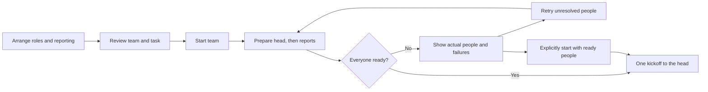

# Org chart and team setup

Status: proposed first-class Workplace feature; no Org implementation or live organization changes yet.

## Decision

Approve building the Org tab described below. Your three choices are included: **plan before starting**, **move across teams and split branches**, and **give the whole tree a shared channel**.

The main additional recommendation is a work-safety rule: **a reporting change must not strand unfinished assignments outside their task's organization.** Show the blocking work and require completion or an explicit handoff first, rather than silently changing or dropping it.

## Terms used here

- **Organization:** one independent reporting tree. Its **head** has no manager; another independent head means another organization.
- **Branch:** a person and everyone who reports to them, at any depth. Moving a branch keeps its internal reporting lines.
- **People at home:** existing teammates whose Pi processes are stopped, not people removed from the organization.
- **Task organization:** a task keeps its recorded organization head as its reference. Its current organization is the tree that head belongs to. Moving an individual assignee does not move that reference or reassign the work.

## One canvas, separate teams

Org sits beside Chat and Mail and shares their light/dark palette, avatars, compact status and profile pane. Show independent reporting trees, including people at home. The human operator is not invented as a Pi session or universal manager. Former/departed people stay outside the editable organization.

- Click a real person to open their existing profile, without reading or acknowledging their conversation.
- Pan, zoom, fit and collapse branches. Routine status updates keep the viewport and layout steady.
- Drag onto an eligible manager to propose a reporting change. A manager's branch travels with them. Highlight valid targets; also offer a Reports to control without dragging.
- Use a marked **Make independent** target to split a branch. Dropping on ordinary empty canvas changes no reporting line.
- Keep roles and capabilities truthful. New team heads use managing roles; moving a nonmanaging role to the top does not grant it manager tools.

## Build the team for the work

**New team** creates a clearly labelled draft. Choose a head role, repository and task; add positions from the actual role catalog, including several of one role; arrange their reporting lines. Show each role's mandate and whether it manages, writes or advises.

For example, assemble a coordinator, two implementation engineers, three selected quality roles and an architect. Planned positions open role/goal details, not invented personal biographies or hire dates. Optional names become real only when hired.

Support existing people too. Selecting a manager includes their branch. An existing person staged into an unstarted team still belongs to their live team until the change commits; show that distinction. Review which people will be hired, moved or called in, and each person's real goal before starting.

Drafts survive switching tabs. Closing/reloading discards unstarted plans, like the application's existing drafts. Reusable saved team templates are outside this pass.

## Start once, show what actually happened

Validate roles, managers, directory, identities, cycles and work blockers before opening processes. Prepare the head before reports so their tasks belong to the intended organization. Each new person gets real work context; avoid fake waiting assignments.

Before Start team, staged existing people stay in their current teams. After Start team, preparation is progressive, not one all-or-nothing transaction: when a planned manager is ready, commit the corresponding existing branch move or prepare its new report, then continue downward. Revalidate every move. Each applied change is live immediately; a later failure keeps those people and reporting changes intact. The progress view names what moved and what remains pending. This ordering also keeps newly assigned goals in the correct organization.

Use ordinary lasting-person starts with their automatic opening prompt withheld. Establish reporting and channel membership, then send **one automatic kickoff to the head** when the intended team is ready. Reports receive concrete work through the head's existing assignments and correspondence; the setup action does not launch every person's model at once.

This is not a universal pause: normal live mail and deliberate Chat/terminal instructions retain their existing behavior. Show someone already active rather than interrupting them or claiming they remained paused.

If startup is partial, show actual people, connections and failures. Retry under the same identities without duplicate goals or roles. A dropped connection means uncertain outcome, not confirmed failure. Reconcile receipts and actual incarnations before retrying. Default to waiting for the full team; offer **Start with ready teammates** only as an explicit choice after reviewing failures. Keep kickoff idempotent. If the operator started with a subset and a later retry makes more people ready, notify the head once through its whole-team channel with a mention and the new people's IDs/roles. That is an ordinary readiness update, not a second kickoff. Closing the app does not delete people already created or roll back their work.

## Reporting changes preserve work

Changes go through an explicit operator-authorized runtime path. Existing agent `move` stays limited to its own organization. A confirmed boundary-changing move names the branch, old/new heads, channel changes and any blockers. Revalidate against current state before committing; stale drags must not move unexpected additional reports.

| Action | Result |
| --- | --- |
| Reparent inside one team while someone works | Keep tasks, focus and running work; change reporting and channels. |
| Move an entire organization under another head | Carry its people and original head together, so its task ownership remains connected to them; preserve historical records. |
| Split or transfer part of a team | Permit when unfinished assignments remain valid in the resulting organizations; otherwise show work requiring handoff. |
| Self/cycle, incapable manager, departed person or stale structure | Refuse with an actionable reason; keep the real chart unchanged. |

For example, Maya holds unfinished work belonging to Team A. Moving Maya alone to Team B would leave her assignment outside the task's organization. Finish the work, or explicitly unassign Maya and assign that same task to someone remaining in Team A through the existing work commands. The task's goal, files and recorded organization stay the same; changing its assignee is the handoff. Moving the task itself needs a separate work decision, not a reporting gesture. Moving Team A's head and everyone under it into Team B keeps the original head with its people and tasks, so it does not create that separation.

Splits must survive reconnect/call-in: a recorded null manager means intentionally independent, not permission for an old launch flag to reattach the person. Prompt identity, management capability and close notices follow the recorded structure. No move changes role, known hire date, task ownership or past history silently.

## Channels and person actions

Create a whole-tree channel whose ordinary membership follows the head's full branch, including people at home. Preserve history, cursors, audience events and explicit invitations. Keep existing manager/direct-report channels. The operator observes or explicitly joins through the current controls.

If an independent head moves under another head, retain its channel for its branch and add the branch's people to the larger team's channel. On a split, a branch keeps its existing local manager channel and that conversation history. It gets a separate whole-tree channel if its head has none, or reuses that head's existing whole-tree channel. Messages from the old organization's whole-team channel stay there; splitting does not copy or erase them. Structural edits reconcile ordinary membership while preserving explicit invitations.

Put **Send home / Call in** in person actions, using existing lifecycle behavior and busy-turn confirmation. Home keeps the person's reporting position and channel membership. Permanent departure remains a separate handoff operation.

## Delivery and proof

First make the actual Org entry usable with real trees/profiles and planned-role manipulation, labelling unconnected actions honestly. Then connect tested runtime reporting/channel operations and controlled startup. Keep the operator's chance to try the canvas ahead of supporting ceremony.

Acceptance:

- Several independent, nested and sleeping-person trees work in the real Electron host; Chat/Mail, drafts and read state retain their contracts.
- Drag and keyboard operations share validation. Cross-team moves, merges and splits preserve identity, work, hire dates and reconnect behavior.
- Planning opens no processes. Startup creates the intended people, structure and channel, with one head kickoff; failures/retries duplicate neither people nor assignments/kickoffs.
- Both themes exercise real chart states: profile, draft, valid/invalid drop, pending operation and failure. Check rendered geometry as well as behavior.
- Use focused tests with one worker and isolated state. No live validation hires/messages or full suite. Announce any required live daemon activation separately.

## Existing foundations

The world snapshot already supplies multiple roots and dormant people; lifecycle supplies recruit/wake/close; the API supplies roles/profiles. Runtime `start` already accepts an empty opening prompt; head-first setup preserves task organization. This avoids a new launch runtime, scheduler or people/task store.

Runtime `transfer` currently refuses cross-organization moves and has no operator split path. Hello currently reseeds a null manager from a launch flag, which needs a first-admission fix. `work.ts` resolves task ownership through its recorded root, grounding the handoff rule above. `channels.ts` currently covers only manager/direct reports, so whole-tree channels are a separate runtime change.

These paths were read, not exercised with live Org actions. Deniz's read-only startup investigation independently confirmed held starts; source review narrowed its mail claim to replayed startup mail, not arbitrary live mail.
