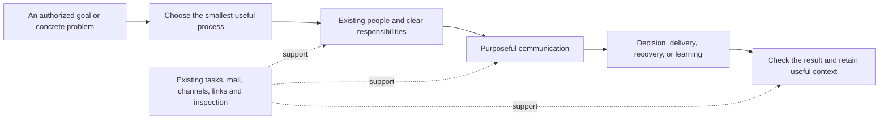
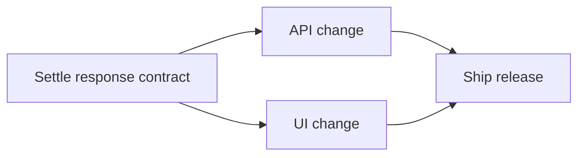

# Give the organization a practical process handbook

**Planning status:** approved with notes on 2026-10-30; the role-related revisions below apply those notes. This document records the portfolio, first delivery set, and evaluation plan. The operator subsequently authorized implementation, controlled exercises and incremental commits; [task.md](task.md) now owns execution scope.

**Delivery sequence:** begin with [Help and decide, the first delivery increment](#deliver-in-coherent-increments), and apply the [validation requirements](#validate-usefulness-as-well-as-packaging) as each increment is delivered.

**Recommendation:** add seven agent-selectable process skills first: **peer consultation, decision review, tiger team, handoff, incident response, operating review, and retrospective**. Together they cover getting help, deciding, delivering across boundaries, transferring responsibility, recovering service, correcting constraints, and learning. Keep a wider candidate portfolio visible rather than implementing the whole catalog at once. Develop the roles alongside the processes: today's catalog is a starting point, not a ceiling.

**Already settled:** agents may select these processes within their assigned work and existing authority. Explicit `/skill:<name>` invocation remains available. Existing operator-only engineering workflows keep their current entry policy.

The unit of value is a better decision, a delivered result, a working handoff, or a tested improvement. A meeting, a channel, or a long report is not the result.

## Extend the existing handbook, not the runtime

The package already ships nineteen skills and the necessary people, task, communication and inspection tools. Code review already gathers independent findings before a shared challenge. Diagnosis already uses competing hypotheses. Implementation already gives builders separate ownership and retains one integration owner.

The missing layer is a reusable set of organizational processes around that engineering work.



A **skill** owns a recurring outcome. A **communication pattern** is a method it uses. Independent first assessments, challenge and response, or a receiver confirming a handoff do not each need another top-level skill.

These are choices, not stages of a mandatory pipeline. A direct question or one capable owner is often enough. Running a process does not imply hiring, creating a channel, changing reporting lines, or invoking every adjacent process.

## A release example shows the boundaries

Suppose an API and UI change need an agreed response contract before a release can ship. The API owner favors one contract; the UI owner favors another.



Arrows mean **must finish before**. The contract task affects **three distinct downstream tasks: API, UI, and release**. Release is one task reached through two paths, not two units of demand. Keep the dependency relationships; count the task once.

- **Decision review** gets the relevant evidence and objections to the person authorized to choose the contract. It ends with a decision, or an explicit unresolved question and its next owner.
- **Tiger team** is useful if the cross-team delivery needs concentrated joint ownership. It connects the existing builders directly and names who proves the assembled release works. It does not take their technical decisions through a managerial relay.
- **Handoff** succeeds when the receiving owner can use and operate the result, not when someone sends a link to a green build.
- A routine retrospective remains a short closeout. A deeper **retrospective** is useful if something consequential or recurring deserves investigation.

If one owner can settle the contract and build the change safely, that owner can simply do the work. If service is actively failing, **incident response** takes priority over completing a decision workshop.

## Deliver seven distinct processes first

Start from the responsibilities and perspectives the work needs, then find or author the roles that can carry them. The names below are defaults, not fixed headcounts or a limit to today's catalog. Proposed new management jobs are distinguished below from existing roles. A process responsibility such as chair or incident lead does not change a person's standing role or grant new tools. The chair owns a usable result; the decision owner holds the relevant authority. They can be the same person.

### 1. Peer consultation: unblock an owner without taking over

**Trigger:** a concrete problem is stuck and outside perspectives could help. A known factual question still belongs in ordinary mail; a contested consequential choice belongs in decision review.

- **People:** the problem owner and relevant peers; default lenses are `principal-engineer` for feasibility and `paradigm-outsider` for alternatives.
- **Pattern:** the owner states the problem, attempted approaches, and the help needed. Peers clarify before advising, then discuss alternatives with each other before the owner evaluates them. The owner keeps responsibility for the choice.
- **Communication:** one bounded group-mail exchange. A separate assignment is appropriate when a peer must investigate or build something, not merely because they joined the discussion.
- **Done:** the owner chooses a next action with a checkable prediction, or names the information or authority still missing. Advice and tested findings remain distinguishable.
- **Exercise:** an owner asks how to handle an uncertain dependency. Peers must answer one another's reasoning; the owner must select a next probe rather than receive disconnected essays.

### 2. Decision review: expose disagreement and reach an accountable choice

**Trigger:** meaningful alternatives, conflicting stakeholder needs, or a costly-to-reverse choice. Use existing `code-review` for a change's correctness and `interrogate-to-design` for its operator-led design interview.

- **People:** the authorized decision owner, affected owners, and independent challenge. Choose the challenge from the decision's actual risk: for example `vp-of-product` for purpose, `chief-architect` for system consequences, `staff-security-engineer` for trust, or `technical-due-diligence-partner` for irreversible commitments. Use `scientific-skeptic` when the evidence itself is disputed, rather than as a substitute for every specialty. The proposed `product-manager` can own an authorized product decision while these advisors challenge it.
- **Pattern:** establish the question, constraints, decision authority and required evidence. Gather first positions independently; then put conflicting claims into one shared exchange. Challenge assumptions with evidence or a discriminating test. The decision owner chooses; agreement by headcount is not proof.
- **Communication:** initial positions go privately to the chair; challenge and answers use group mail. The final decision goes to affected owners, with a reference in the governing task or existing ADR convention where appropriate.
- **Done:** a choice, reasons, material dissent, accepted uncertainty, next owner and conditions that would reopen it. If required evidence or authority is absent, record that limit instead of manufacturing agreement.
- **Exercise:** a minority finds a counterexample to the popular option. The result must address it, not average the recommendations. A missing critical reviewer must remain visible.

### 3. Tiger team: deliver one cross-team outcome

**Trigger:** a bounded result crosses ownership boundaries and normal handoffs are failing or too slow. Ordinary independent tickets stay with `implement`; the tiger team supplies joint delivery ownership, not another coding method.

- **People:** an accountable delivery lead, the actual affected owners and verification. Defaults: the proposed `engineering-manager` for bounded team delivery, `implementation-engineer` for building, and `quality-engineering-director` for verification design. Use `director-of-engineering` when commitments across teams need its broader authority; testing execution can sit with `test-and-ci-operator`.
- **Pattern:** agree the result and how the integrated result will be demonstrated. Negotiate capacity with the managers who own it. Give work owners direct contact and explicit seams; reconcile only real conflicts. Keep one integration owner.
- **Communication:** use existing task threads for assignments. Add group mail for active cross-owner decisions, or a topic channel when shared context must outlive the exchange. Pin current context when it materially reduces catch-up.
- **Done:** the assembled outcome is verified and accepted, or the undertaking is explicitly stopped with remaining work owned. Return borrowed capacity through the responsible managers. Closing the group neither deletes people nor rewrites reporting lines.
- **Exercise:** two components pass alone but fail together. The lead must find and resolve the integration seam before declaring delivery. One unavailable contributor tests whether the group can replan without silently waiting forever.

### 4. Handoff: transfer usable responsibility, not documents

**Trigger:** work, operational responsibility, or essential knowledge is moving to another owner. This supplements native assignment and departure mechanisms; it does not replace their authority or cleanup rules.

- **People:** outgoing and receiving owners; use an unfamiliar reader where comprehension matters. Use `new-team-member` for a cold read, `developer-experience-lead` or `skeptical-first-time-user` for actual first use, and `technical-writer` when retained context needs work. The actual receiving domain owner still accepts the responsibility; these views do not substitute for that owner.
- **Pattern:** identify what changes hands, current state, evidence, unresolved risks and the next action. The receiver reconstructs the operating model and performs the smallest meaningful use or check. Resolve the gaps and state who now owns what.
- **Communication:** the relevant task thread, with the receiving owner and responsible manager when assignments must change. Use ordinary prose and existing artifacts, not a new handoff record type or schema.
- **Done:** the receiver explicitly accepts the bounded responsibility and demonstrates enough understanding or capability to continue. If acceptance fails, retain a named owner and make the unresolved handoff visible. Sending a message alone completes nothing.
- **Exercise:** the brief omits a necessary setup step. The receiver must expose the omission before acceptance. Also test an unavailable receiver; silence cannot transfer ownership.

### 5. Incident response: restore service with controlled coordination

**Trigger:** active harm or disruption needs coordinated response now. `diagnosing-bugs` remains the technical investigation method; incident response owns priorities, safe concurrent action, status and continuity.

- **People:** an incident lead, people authorized to operate the affected system, and communication support as needed. Defaults: the proposed `service-owner` for continuing accountability, `principal-site-reliability-engineer` for advice, and `implementation-engineer` or `release-engineering-lead` for authorized changes. Bring in security, database or distributed-systems expertise when the failure warrants it. An advisory role does not gain write access by receiving an incident responsibility.
- **Pattern:** state impact, immediate objective and operational authority. Start safe work with available responders; add perspectives as needed. Coordinate system changes through the operational owner, preserve evidence and reassess mitigations against user impact. Explicitly transfer command when the lead changes.
- **Communication:** one clear response conversation, current incident state in the task bundle, and a distinct stakeholder update path when needed. Choose update timing from the actual incident, not a universal meeting schedule. If the affected communication system itself is unavailable, state the limitation and use an already available operator-approved route.
- **Done:** observed recovery against the stated condition, with remaining risks and follow-up work owned; or an explicit continuing-incident handoff. Root-cause certainty may follow recovery. Incident status never grants new production or external-communication permission.
- **Exercise:** responders propose conflicting changes while a stakeholder asks for status. Preserve one operational change owner and truthful updates. A handoff during the incident must leave no ambiguous command.

### 6. Operating review: change a real constraint, or deliberately leave things alone

**Trigger:** a manager needs to understand stalled delivery, competing commitments, slow decisions, or a changed operating situation. A requested recurring review may use reminders, which are session-local and can be cancelled by lifecycle changes. Keep the follow-up in the task; a timer is not durable scheduling. The skill does not create an autonomous scheduler.

- **People:** the responsible manager and people who own or experience the suspected constraint. Use the manager who owns the work: `coordinator` for operator-wide flow, the proposed product/team/service managers for their domains, or `director-of-engineering` for cross-team trade-offs. Use `performance-engineering-lead`, `infrastructure-cfo`, `staff-engineer-simplicity` or `scientific-skeptic` when the suspected constraint warrants that view.
- **Pattern:** start from the relevant inspection lens, narrow to concrete cases, and ask those involved what the records miss. Distinguish facts from hypotheses. Choose an authorized intervention, a discriminating observation, or no change. State what later evidence would show whether it helped.
- **Communication:** direct discussion with the affected owners; use an existing team channel for shared context and addressed mail for decisions. Keep staffing authority with the managers who hold it.
- **Done:** a bounded decision, its rationale and evidence, and any follow-up owner/check. Reinspection is an observed follow-up, not retroactive causal proof.
- **Exercise:** high communication accompanies successful delivery, while another task waits on a decision. The review must not punish the active group, mistake idle status for spare capacity, or count a shared dependent task once per path. Include a case where no intervention is justified.

Use `progress`, `bottlenecks`, `coordination` and `experience` according to the question. `economics` and `predictions` are optional when their premises fit. The process adds judgment around these instruments, not a productivity score or automatic reorganization rule.

### 7. Retrospective: turn experience into a tested improvement

**Trigger:** a significant completed effort, incident, surprise, or recurring failure deserves more than the short closeout already required by the handbook. Ordinary closeouts stay lightweight.

- **People:** those who did and received the work, including affected owners. Default facilitation: `coordinator`; add a `scientific-skeptic` when the explanation is disputed. A separate facilitator helps when the process owner's decisions are central to the event.
- **Pattern:** collect observations before interpretations, then consider what to change. Separate demonstrated causes from plausible stories. Preserve useful practices as well as failures. Choose changes with owners and ways to check them.
- **Communication:** participants first contribute their own observations, then discuss competing accounts in one shared thread. Put task-specific learning in the existing retrospective; promote reusable knowledge to its actual documentation or wiki owner under the existing authoring rules.
- **Done:** a concise account that distinguishes facts, explanations and open questions, with accepted actions or a reason to make no change. Record promised follow-up separately from an improvement actually observed. The same person cannot manufacture another person's acceptance.
- **Exercise:** a successful rerun follows an unexplained failure. The retrospective must retain the uncertainty instead of inventing a cause, and assign any useful follow-up without rewriting unrelated standing policy.

## Develop the jobs and processes together

The catalog currently has **32 roles, but only two managers**: `coordinator` and `director-of-engineering`. Most of the others advise. In particular, `vp-of-product` and `quality-engineering-director` do not have management capabilities despite their titles. The first draft named 14 roles; that exposed both an overly generic choice of critics and missing continuing ownership. It does not establish how often anyone actually contributes.

Recommend adding three distinct management jobs with the first delivery set:

| Proposed role | Continuing obligation | Why the existing job is different |
| --- | --- | --- |
| **`product-manager`** | Carry an authorized product outcome through discovery, priority choices, delivery acceptance and learning from use; coordinate its assigned people. | `vp-of-product` challenges whether a bet is worthwhile. Advice is not ownership of taking that bet forward. |
| **`engineering-manager`** | Own a team's capacity, delivery commitments, integration and ability to sustain the work. | The director resolves cross-team and portfolio trade-offs; the coordinator owns operator-wide flow. Routine team ownership need not travel through either. |
| **`service-owner`** | Own an assigned service's health across releases, incidents and corrective work. | SRE supplies reliability advice; release engineering owns a rollout. Someone must carry the continuing obligation after the response ends. |

These roles would write and manage through the existing capabilities. Their mandates must state what they own, what others own, and when they escalate. Authoring a role neither hires a person nor inserts another layer in the reporting tree. A flat team remains appropriate when it works. Preserve existing advisors; senior-sounding titles are not a reason to flip their capability flags.

Also investigate **`research-lead`** for programs of inquiry that span investigators, experiments and continuing commitments. It has a real candidate consumer in discovery and the experiment cycle below, but a bounded source lookup still needs no research department.

Run the inverse check as well: **what work would make an overlooked role valuable?** The [role-to-process audit](role-process-map.md) maps all 32 current roles. It identifies several kinds of omission:

- **Already served:** `code-review-specialist` enters through the existing review skill. A new wrapper would add little.
- **Missing invitation:** accessibility, first-use, developer-experience and writing perspectives improve decisions and handoffs when those risks matter.
- **Missing process:** chaos, due-diligence and experimental perspectives suggest the further candidates below.
- **Legitimate specialization or overlap:** a rare role may matter enormously in one case; a frequently named generalist may still be the right choice. Usage counts alone justify neither forced participation nor removal.

This is a design check, not a quota or a second routing registry. During the live exercises, examine repeated concentration: is it useful generality, a missing job, poor discovery language, duplicated roles, or a neglected risk? Let that evidence change both the skill and the catalog. Add another role when a meaningful recurring responsibility calls for it; merge or narrow a proposed one that cannot demonstrate a distinct job.

## Keep a wider candidate portfolio visible

These are direction for the portfolio, outside the first delivery set. Promote one when its distinct value is demonstrated; merge it into an existing owner if a separate skill adds little.

| Candidate | Distinct trigger and pattern | Owner and expected result | Boundary against overlap |
| --- | --- | --- | --- |
| **Pre-mortem** | Before a consequential commitment, independently imagine specific ways the plan could fail; work backward to present assumptions and warning signs. | Plan owner, relevant domain risks and `scientific-skeptic`; accepted mitigations, checks, or explicitly accepted risks. | Focuses on failure mechanisms before commitment; decision review chooses between options. A later threat-modeling variant belongs with the appropriate security discipline. |
| **Prioritization** | More worthwhile work than current commitments can support; compare outcomes, constraints, dependencies and the cost of deferral. | Authorized portfolio owner, `vp-of-product`, affected delivery owners; an explicit accepted/deferred/stopped set with reasons. | Chooses work, while operating review diagnoses its flow. Uses existing tasks and optional economic evidence, not another backlog or compulsory dollar estimates. |
| **Release readiness** | A real deployment or launch needs a coordinated go/no-go judgment. | Authorized release owner, `release-engineering-lead`, verification and operational owners; decision against concrete release/rollback/support evidence. | Adds operational acceptance across owners; it neither reruns every code-review finding nor grants deployment permission. |
| **Discovery workshop** | The group disagrees about whose problem matters or whether it is worth solving. Gather observations independently, challenge the problem framing, and select a useful inquiry or experiment. | Problem owner, `principal-ux-researcher`, `end-user-customer-advocate`, `vp-of-product`; an evidence-backed problem or a concrete plan to resolve uncertainty. | Existing research/prototype skills supply evidence and experiments. Agent opinions do not stand in for real customer evidence; the existing design interview starts from a different need. |
| **Onboarding** | A person joins an area or responsibility and needs to become effective there. Orient through current sources and a representative task, then check understanding in use. | Receiving manager, experienced colleague and newcomer; a person ready for the agreed responsibility, with remaining gaps explicit. | Handoff transfers a bounded responsibility; onboarding builds context and capability. It does not duplicate native startup notices or create work merely to justify someone's identity. |

The role audit also opens three further possibilities. They remain outside the first seven-skill delivery set:

| Candidate | Distinct outcome and useful people | Existing method to reuse |
| --- | --- | --- |
| **Failure exercise** | Observed limits and improvements from a controlled fault, using `chaos-engineering-specialist`, SRE and the affected domain experts. | Run incident-response methods against an authorized isolated scenario; preparation differs from managing a real outage. |
| **Due diligence** | Evidence about the liabilities, security, ownership cost and exit options of a dependency, vendor, protocol or data format; use `technical-due-diligence-partner`, `infrastructure-cfo`, security and maintenance perspectives. | Feed decision review rather than take over its choice. First check whether an optional reference there is enough. |
| **Experiment cycle** | Resolve a consequential assumption through a discriminating experiment, then continue, change direction or stop; a proposed `research-lead` owns the inquiry with relevant investigators and independent challenge. | Reuse research/prototype methods; general uncertainty reduction differs from diagnosing an existing bug. |

## Reuse communication patterns without creating more bureaucracy

| Pattern | Why its sequence matters | Initial consumers |
| --- | --- | --- |
| Independent first positions | Makes it possible to see disagreement before the leading view shapes everyone's answer. It cannot guarantee independent model errors. | Decision review, retrospective observations; already present in code review |
| Clarify, consult, return the choice | Separates understanding the problem from defending an immediate solution. | Peer consultation |
| Challenge and answer in one place | Lets participants respond to the same claim and evidence instead of sending disconnected reports to a manager. | Decision review, incident alternatives |
| Direct collaboration with one integration owner | Preserves local authority while making the assembled result someone's responsibility. | Tiger team |
| Receiver demonstration and acceptance | Exposes missing operational knowledge before responsibility is considered transferred. | Handoff, incident command transfer |
| Separate action coordination from stakeholder updates | Protects responders' attention while keeping affected people informed. | Incident response |
| Observe, interpret, act, check | Prevents activity measures or a plausible story from becoming an unsupported intervention. | Operating review, retrospective |

A pattern library is useful as authoring guidance, not as another runtime layer or mandatory reading stack. Initially, keep each skill's essential sequence in that skill and reuse `handbook-writing` for common staffing, authority and closeout conventions. Extract shared references only where the same method truly serves multiple skills.

Human facilitation techniques are inspiration, not a literal simulation. Keep the useful order of thinking and exchange; leave human room layouts, minute-by-minute schedules, fixed group sizes and compulsory rotations behind. Roles remain lasting jobs rather than temporary hats assigned by the process.

## Make selection, authority and interruption behavior explicit

Every new description must make its trigger and outcome recognizable from the model-visible catalog. Distinguish close neighbors: consultation versus decision, diagnosis versus incident coordination, code review versus release readiness, handoff versus onboarding. An ordinary question or small solo task should remain ordinary.

The shared authoring guidance will be updated to recognize both operator-started and agent-selected processes. The distinction is **how a process is selected**, not whether skills may describe real teamwork. The existing seven explicit-entry engineering workflows remain unchanged; [the inventory names them](inventory.md).

Within a process:

- Select people with relevant experience and establish current availability before making their work a dependency. Ordinary participants can collaborate directly; staffing and assignment changes stay with authorized managers.
- Establish decision ownership and escalation conditions. A chair facilitates; process membership grants neither managerial authority nor access to unrelated history.
- Reuse the governing task and useful existing conversations. Invite people before expecting them to see retained context; request channel attention explicitly. Joining a conversation alone accepts no work.
- Keep a resumable current state in the existing task artifacts and, where useful, a pinned message. It should be possible to name the current owner, next action and unresolved questions after an interruption.
- Treat unanswered requests, missing evidence and failed execution as visible limits. The owner can replace a nonessential consultation, seek an authorized replacement, narrow the work, or stop. Preserve any missing critical perspective in the result.
- Close the actual assignments and handoffs separately from the discussion. Archive a bounded discussion only after recording its conclusion; leave useful standing context available. Releasing process capacity is not permission for permanent departure.

Operator sign-off occurs at a real authority boundary: a product or policy choice reserved to the operator, new risk or scope outside the assignment, or an action needing consent. It is not a mandatory vote on every within-scope judgment. Use the existing sign-off skill and tools when that boundary is reached.

## Ship ordinary skills through the existing package

Proposed first paths:

```text
skills/peer-consultation/SKILL.md
skills/decision-review/SKILL.md
skills/tiger-team/SKILL.md
skills/handoff/SKILL.md
skills/incident-response/SKILL.md
skills/operating-review/SKILL.md
skills/retrospective/SKILL.md
```

Each is prose-first and model-discoverable, with explicit invocation also available. Include goal, selection boundary, needed perspectives, accountable owner, communication sequence where order matters, completion evidence and interruption/closeout rules. These are authoring requirements, not a new metadata schema or rigid document template.

Update the closest existing owners:

- `skills/handbook-writing/SKILL.md`: the agreed selection policy, minimal shared conventions, and the two-way check between process needs and role responsibilities.
- `roles/product-manager.md`, `roles/engineering-manager.md`, `roles/service-owner.md`: the proposed management jobs, with distinct obligations and ordinary writing/management capabilities. Further roles follow demonstrated process needs rather than a closed list.
- `README.md` and `docs/organization.md#processes`: the catalog and process mental model.
- `tests/package-load.mjs`: explicit discovery and invocation expectations for the adopted skills.
- `THIRD_PARTY_NOTICES.md`: provenance for adopted external material; check licensing before importing wording or assets.

The manifest already includes `skills/` for discovery and publication. Add a supporting reference only for a real optional branch or reusable method. Add executable composition only when a particular procedure needs exact fan-in or accounting that prose does not provide reliably. Role additions use the existing catalog and capability model. No process registry, workflow engine, scheduler, new tool, UI, or database migration is proposed.

## Validate usefulness as well as packaging

**Before delivery**, each adopted skill must pass all three layers:

1. **Package checks.** The existing loader finds its name without diagnostics and with the intended invocation policy. The package dry run contains the skill and every linked support file. Relative references resolve. Role discovery and focused capability checks cover each added job and preserve the existing advisors' posture.
2. **Selection and cold reading.** Give a fresh reader the actual descriptions and realistic requests without naming the expected skill. Check the correct match, the close-neighbor distinction, and a case that needs no process. Read the body to identify who decides, what permission is needed, and how completion is checked. Check that a new management role carries its distinct responsibility rather than merely relays messages or duplicates another manager; also test a case where it is unnecessary. This is evidence about comprehension, not a general selection guarantee.
3. **A small live exercise.** Run the skill through actual people, assignments and conversations on a controlled repository-local scenario. Use the counterexample stated above, inspect the resulting evidence and unresolved limits, and correct observed failures. A scripted tool trace alone does not prove that agents followed the process.

Live exercises are implementation work and require an agreed target and authorization. Use isolated state and disposable work where needed; keep tests serial on this shared machine. Exercises must not operate production systems, send external messages, change ownership of existing live work, or consume private source material merely to simulate a scenario. Real failure injection stays inside the controlled exercise.

A single successful exercise supports that case, not a claim of universal benefit. Record coordination cost and useful output separately. Compare simpler approaches when the process appears to add ceremony; reduce or merge a skill that does not earn its place. Keep the evidence in the task bundle rather than adding a second evaluation service.

## Deliver in coherent increments

| Increment | Work | Completion evidence |
| --- | --- | --- |
| **1. Help and decide** | Update shared authoring guidance; add peer consultation and decision review, with the product-management job. | Descriptions route the two differently; a real exchange produces an owned next step or evidence-based decision, including dissent. |
| **2. Deliver and transfer** | Add tiger team and handoff, with the engineering-management job, reusing implementation and explanation methods. | An integrated result reaches a receiving owner; component-only success and document-only transfer both fail the exercise. |
| **3. Recover safely** | Add incident response and the continuing service-ownership job. | Conflicting responders, status requests and command transfer remain controlled; recovery is verified and follow-up remains owned. |
| **4. Improve operations** | Add operating review and retrospective. | Observations remain distinct from explanations; interventions and no-change decisions have evidence; follow-up has an owner. |

Update packaging, catalog and evidence with each increment. Use focused checks for the changed surfaces. Keep the existing skills intact unless a concrete overlap needs a small, explicit cross-reference. No full engineering-skill rewrite is part of this plan.

The wider candidates can be reordered or expanded from actual demand and the role audit. The proposed order is a delivery sequence, not a runtime dependency graph or a requirement that users run the skills in that order.

## What is established, and what still needs proof

**Established by source inspection:** the current skill catalog, packaging/discovery mechanism, invocation distinction, existing collaboration patterns and available runtime capabilities. See [inventory.md](inventory.md) for repository evidence.

**Operator review:** the initial seven-skill portfolio and delivery plan were approved with notes to develop roles alongside processes and investigate the inverse relationship. The revisions above apply those notes: three proposed management jobs, a complete role-to-process audit, more specific specialist selection, and a wider candidate portfolio. These additions have not been independently cold-read or live-exercised.

**Proposed judgment:** this portfolio addresses useful recurring organizational problems with distinct enough outcomes to merit first-class skills. Its selection language, effectiveness and cost need the exercises above.

**Not performed during planning:** no new skill implementation, live process trial, production action, loader validation of new skills, or claim of improved organizational productivity.

Primary human-process references were read directly: [GitLab's decision ownership](https://handbook.gitlab.com/handbook/people-group/directly-responsible-individuals/), [Google SRE incident management](https://sre.google/sre-book/managing-incidents/), [Troika Consulting](https://www.liberatingstructures.com/troika-consulting), and [What, So What, Now What](https://www.liberatingstructures.com/what-so-what-now-what). We borrow bounded mechanisms, not whole policies. For example, decision ownership does not remove our requirement to preserve reasons and uncertainty. Human guidance is not evidence that these agent processes work; [source-notes.md](source-notes.md) records that distinction.
