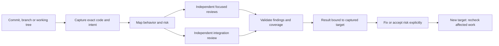
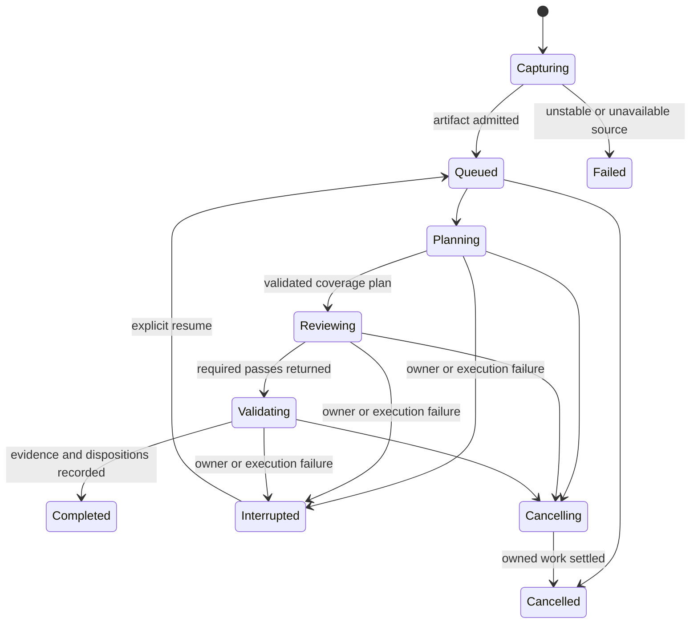

# Review the behavior, sign off on the exact code

## Decision: make review a native, durable capability

**Recommendation:** add a local review queue to the existing apple-pi runtime. Each review captures an exact target, divides it into behavior-based chunks, assigns fresh reviewers to concrete risk questions, checks the interactions between chunks, and retains an auditable result. Show the same queue in a dedicated `/reviews` interface and Workplace's Code area.

This is the complete proposed design and delivery plan. **The operator approved it with notes: use ordinary reviewer environments, keep complexity down, and make a dedicated review interface rather than build on `/work`. Those notes are applied below.** Approval accepts the implementation baseline; it does not install, activate or begin implementation. No external review engine is proposed as a dependency. There is no measured claim yet that this design catches more defects than a simple independent reviewer.

The central improvement is not more reviewers. It is **less unrelated work per reviewer, more depth where failure matters, and an honest account of what was inspected**.



### The choices this plan makes

| Choice | Recommendation and consequence |
| --- | --- |
| Build on the harness or install another review product? | Extend the current runtime. We must implement durable review ownership, but avoid another daemon, agent stack and database. |
| Split by files, symbols or behavior? | Behavior is the review unit; changed regions are its auditable members. One chunk can span files, and one file can contain several chunks. |
| How much review? | Concrete risk questions determine required lenses and verification. No arbitrary scalar risk score or fixed board size. |
| What does sign-off cover? | Captured content, exact Git endpoints, intent and review policy. A path or branch name is only a label. |
| What runs automatically? | Explicit enqueue first. Optional per-repository commit enqueue follows after the queue is proven. No automatic fixing or publication. |
| Is a human approval mandatory? | No. Completed agent review and optional human approval are separate records. Neither certifies correctness. |

## A batch-departure change shows why chunks must cross files

Consider the recently delivered People-directory batch departure. Its change crosses React, preload, main-process IPC, backend orchestration and the existing retirement runtime. Splitting it by directory would separate the very contract that needs review.

A useful plan would look like this:

| Chunk | What belongs together | Risk questions and depth |
| --- | --- | --- |
| Selection and consent | People selection, manager classification, handoff mode, frozen confirmation, dialog tests | Do later arrivals or roster changes alter consent? Can the operator still read the choice and reach the controls? Focused behavior review plus interaction evidence. |
| Request and progress contract | Shared types, renderer invocation, preload forwarding, IPC validation, progress events | Do the same targets and handoff booleans reach the runtime? Are accepted, applied and uncertain kept distinct? Trace the real caller-to-receiver path. |
| Departure ordering and recovery | Selected ancestry, child completion, stable command IDs, replay and existing retirement admission/cleanup | Can a manager depart too early? What happens before the first successful launch, after a timeout, or after a crash? Independent lifecycle/reliability lens because the effect is irreversible. |
| Shipped behavior | Built assets, package inclusion, documentation and their checks | Does the installed app contain the reviewed wiring? Does its entry path work? Generated output needs build/package evidence, not token-by-token model review. |

Tests are evidence within these chunks, not a disconnected testing chunk. The integration reviewer also follows one complete journey:

> Select a manager and report, choose managers-only handoffs, lose the report's final receipt, then continue the same batch. Does the manager wait, does consent remain fixed, and does the UI tell the truth?

That reviewer receives the whole change and its contract, not merely summaries of the other reviewers. An actual Electron forwarding check and a mocked renderer test remain different evidence. Green results for one cannot fill the other's coverage cell.

This example motivates the design. It is not a claim that the proposed system would have found a particular defect.

## The operator sees one review, with useful drill-down

1. In a Pi session or Workplace Code, choose **Review changes**. Select a directory/worktree and a target: one commit, an endpoint range, a branch against its merge base, the staged tree, or the full working tree. A path filter is optional and visibly narrows the sign-off.
2. Preview the resolved base/head, dirty/untracked inclusion, omitted files and intent source. Queue it. The tool returns a durable review ID after capture and admission, without waiting for model work.
3. Continue coding. The queue shows the captured target, current phase, chunks/passes finished, gaps, findings, cost and whether the current checkout still matches. Moving a branch does not move a running review's target.
4. Open the result. Start with material findings and missing coverage; drill into a chunk, its risk questions, reviewed source, reviewer evidence and any disagreement. Unchanged callers and contracts are one click away within the captured source.
5. Fix a confirmed problem, reject it with evidence, or explicitly accept the risk. The original finding and target remain in history. A claimed fix starts verification against a new target; it does not erase the finding.
6. When all required work is complete, the result says **Reviewed** and identifies its remaining findings, accepted risks and unassessed axes. Optional operator approval uses the existing browser sign-off flow over that same captured artifact.

Example queue:

```text
Review   Target                         Progress          Findings  Current?
R-142    main: 4c70e806..9160a518         validating 5/6    1 open    yes
R-141    feature-x: working tree #a7f2   interrupted       partial   no
R-138    commit 7d2f...                  reviewed          none      historical
```

Execution, coverage, findings and freshness are separate columns. An interrupted review with zero findings is not a clean review. A valid historical review remains valid for its old artifact, even when it no longer applies to the current branch.

## Capture the source before planning or dispatch

### Target semantics are explicit

| Target | Comparison and captured content |
| --- | --- |
| Commit | Explicit parent-to-commit comparison; root commit uses the empty tree. A merge commit requires the parent/comparison choice. |
| Endpoint range | Exact resolved base and head trees; record the requested refs and commit IDs. |
| Branch | Resolve target branch and head once, compute and record their merge base, then compare that merge base to the resolved head. |
| Staged | HEAD versus a captured index tree. Unstaged content is not silently included. |
| Working tree | Chosen base versus captured tracked content plus admitted non-ignored untracked files. Record index/working distinctions for display. |
| Path-limited | One of the above, with explicit review paths. Other captured source may be context; it is not claimed as reviewed change coverage. |

Ambiguous merge bases, unresolved index conflicts, missing Git objects and unreadable requested paths require a decision or a failed capture, not a guessed comparison. A directory resolves to its Git worktree; non-Git directory review is outside the first release.

### A frozen patch alone is insufficient

A reviewer who reads a saved patch and then opens today's source can review a combination that never existed. Capture a source snapshot as well as the change manifest, and start the reviewer in that source directory. Direct inspection and context expansion use the captured source. Normal tools and outside context remain available; any finding that relies on live or external material must identify that evidence rather than attribute it to the captured artifact. This is an accuracy contract, not filesystem confinement.

The artifact records:

- local repository/common-Git-directory identity and originating worktree; remote URL, if any, is descriptive rather than the unique key;
- requested target, resolved endpoints, merge-base/parent choice and reviewed path scope;
- raw file bytes or Git blob identities, modes, symlink text, rename/deletion records and explicit non-text entries;
- immutable source and diff digests, including admitted untracked bytes;
- captured standards, `.context` sidecars, relevant documentation and approved intent, with provenance and hashes;
- omitted paths/content and their reasons; captured review instructions and configured profile references (actual role/model/thinking resolution belongs to each attempt);
- capture times and the version of the capture/plan format.

Materialize a private review-owned source directory from this artifact. Never stage, stash, reset, clean or switch the operator's checkout. Use private scratch/index state when capture needs it. Disable Git external diff/text conversion and implicit network fetches; use argument arrays and NUL-safe path handling.

For mutable targets, compare source manifests across capture. If they differ, stop with **source changed during capture** and ask for another capture rather than run an unbounded retry. This detects ordinary concurrent edits; it is not an atomic filesystem snapshot guarantee. The accepted artifact is the exact bytes retained and inspected.

Submodules, LFS pointers, binaries, generated files, omitted secret paths and unsupported source formats remain explicit obligations. A pointer review is not a review of the pointed-to contents. Admit additional content only under the requesting project's trust and access policy. If necessary evidence cannot be included, retain a coverage gap.

## Decompose by behavior, validate coverage by changed regions

The planner is a fresh review session. It receives the actual change, captured standards and intent, and tools to inspect captured source. It does not receive the author's conversation, self-review, fix narrative or other reviewers' conclusions.

### Build a change map, not a directory partition

1. Enumerate every changed region and non-text change deterministically. Each has a stable identity within this artifact, old/new locations and content hashes.
2. Inspect changed behavior: enclosing functions/types, consumers, tests, wire formats, state transitions and relevant context files. Git function context and source search help; they are hints, not a complete call graph.
3. Propose cohesive chunks. Each names the behavior/contract, its primary changed regions, surrounding context, concrete risk questions, required passes and links to other chunks.
4. Validate the map mechanically: every in-scope region has exactly one primary owner or an explicit unresolved/excluded obligation. Context can overlap freely. Several passes can review the same primary regions.
5. Run a separate integration review of the whole change. It must challenge the chunk map and search for missing relationships, not simply reconcile findings.

A single file with unrelated changes can split into several chunks. A wire contract spread across five files can remain one chunk. A large indivisible state machine remains cohesive: narrow the questions or schedule deeper passes rather than slice it into arbitrary token windows.

The first implementation is language-agnostic: exact diff-region accounting plus code-reading semantic planning. It does not promise an AST or call graph for every language. If a region needs symbol-level subdivision, record precise subranges and validate their union against the original changed lines. Parser-derived structure can be added when real evaluation shows this is the limiting factor; adopting a multi-language parser platform is not a prerequisite.

### Coverage is a ledger of obligations, not a percentage of correctness

A chunk carries:

- **Scope:** primary changes and frozen contextual dependencies.
- **Questions:** what could fail, who would be affected, and the relevant contract.
- **Passes:** named lenses and concrete inspection/verification obligations.
- **Evidence:** reads, traces, test/check results and exact source locations.
- **Status:** completed, incomplete, failed, or explicitly waived, with a reason.

The map has a residual list for things the planner cannot classify. That list cannot disappear when the model produces malformed output or exceeds its context. A coarse whole-change pass is an explicit plan revision, not a silent substitute presented as semantic coverage.

Unchanged files can be essential context. Their reads are recorded, but they do not become a claim that all unchanged behavior was reviewed. Dependency edges are model/source-derived hypotheses; deterministic region accounting proves inclusion, not semantic completeness.

## Let risk change the actual work, not just a score

Risk assessment asks about consequences, state complexity, boundaries and uncertainty. It produces reasons and required work, not a supposedly calibrated number.

| Observed risk | Required response |
| --- | --- |
| Small, local, reversible change with clear intent | One focused correctness review covering standards and intent; inspect its callers/tests. |
| Public contract or cross-module behavior | Add an end-to-end contract trace and integration questions. |
| Concurrency, cancellation, retries or resource lifetime | Add an independent reliability/state-transition lens; include initial, partial and recovery states. |
| Authorization, private data or destructive operations | Add an independent security/authority lens and explicit negative-path evidence. |
| Migration, persisted state, protocol or packaging change | Add upgrade/compatibility/installation questions appropriate to actual consumers. |
| UI state, focus or layout change | Include keyboard/interaction and representative rendered evidence; distinguish fixture, browser and real host. |
| Unclear intent, omitted context or unfamiliar mechanism | Investigate or mark the obligation incomplete; uncertainty does not lower depth. |

Size can signal cognitive load, but three dangerous lines can need more scrutiny than a large mechanical rename. A lens is a task-specific question, not necessarily another person or permanent role. Distinct lenses on the same files remain distinct obligations.

The plan selects existing roles and user-global model profiles. Record the actual model and thinking level used. There is no new model leaderboard or assumption that provider diversity guarantees independent errors. Initial passes use new temporary sessions; attached standing people can consult later, but are not presented as fresh first reviewers.

### Additional passes need a reason and a stopping condition

An extra pass is justified by a new risk, unresolved disagreement, missing evidence, a changed implementation, or a high-consequence path that needs independent challenge. It must name its question and what would settle it. Repeating the same broad prompt until the model says pass is not the policy.

Independent first reports are sealed until their assigned passes finish. Then a validator challenges concrete findings against the captured source, caller guarantees and counterexamples. For high-impact findings, prefer a reproducer or a precise causal trace; inability to reproduce is not proof of absence.

A review ends when its required obligations have evidence, or visibly stops incomplete. Model/provider/tool failure, denied verification, unknown dependencies and an exhausted authorized resource envelope remain visible. The system preserves existing execution limits and uses the operator's resource policy; this proposal invents no dollar, token, concurrency or iteration thresholds. Reviewers request extra work through the plan owner rather than recursively spawning an uncontrolled tree.

## Findings retain evidence, disagreement and resolution

A finding is not just a paragraph with a severity label. It records:

- reviewed artifact, chunk/pass and originating reviewer attempt;
- exact source location, triggering conditions and broken requirement/invariant;
- impact and severity, separately from certainty;
- evidence type: source inference, reproduced failure, or unresolved hypothesis;
- causal explanation, relevant counterevidence and the smallest correction direction;
- status/disposition, its author and the artifact/evidence supporting it.

Deduplicate by the underlying defect and affected contract, retaining all source reports. Neither matching titles nor matching file sets is enough. A validator may confirm, reject or leave a finding unresolved. Preserve rejected findings with reasons instead of deleting inconvenient reports.

**Fixed** requires verification on a new captured target. **Rejected** requires counterevidence. **Accepted risk** names the authorized decision-maker and scope. The implementation author may answer a finding but cannot silently turn their own assertion into independent validation. The operator can override a disposition explicitly; the record shows that decision rather than rewriting the reviewer report.

A completed review can have confirmed findings. A human may approve a change with accepted risks. Display those facts independently rather than compress them into a green pass/fail badge.

## Sign-off stays attached to the artifact it actually covers

There are two records:

1. **Review completion:** which planned obligations and axes were fulfilled, with findings and limits.
2. **Optional approval:** who accepted that exact artifact, under which policy and explicit waivers.

Missing intent means **intent not assessed**, not intent passed. Missing required verification means incomplete coverage. An approval can acknowledge a limit, but cannot relabel it as completed work.

Before presenting a result as applicable to the current checkout, recompute/resolve the target identity. Any changed target bytes, scope, endpoint comparison, material intent or review policy produce a new review revision. A branch rename with identical identity changes its display label only. A rebase can have similar content, but is not automatically the same signed set of commits.

For the first release, **new targets rerun their required review work**. Keep old evidence as history and use it for fix-validation context, not as automatic coverage credit. This conservative rule is simpler than proving a complete dependency graph. Later, incremental reuse may reuse an unchanged pass only if its scope, complete captured context inputs, intent, tool/prompt policy and relevant contracts match; changed or unknown relationships still require integration review. That optimization is deferred until measurement justifies it.

Human browser sign-off must render the captured artifact and submit its review ID, target digest and result/plan revision. If the live checkout changes while the page is open, approval still names the old artifact and the page/result warns that it is no longer current. New findings or dispositions do not rewrite the assessment the operator approved; they require renewed attention. No approval is silently transferred to a newer commit or result revision.

## The existing runtime owns a small durable queue

### Reuse people and turns; add durable review ownership

Current `pi_exec` temporary peers belong to a program connection. Disconnecting ends that scope and cleans its temporary people. That is correct for a foreground program, but not a durable queue.

Add review jobs to the existing session-state runtime and database. A job owns its artifact, plan, attempts and results. The runtime claims work and uses the existing temporary-person startup, correlated turns, model selection, cancellation and guarded cleanup. **Extend that lifecycle with a durable review-job owner; do not pretend a socket-owned scope survives disconnection.** There is no second agent engine and no always-thinking review manager.

The requester and organization access scope are recorded at admission. Associate the job with its originating task when one exists; it does not need a fabricated task per chunk. Ordinary temporary reviewer assignments and transcripts remain under existing ownership. Review records retain provenance even after temporary people are discarded. Reassign/cancel durable responsibility explicitly before its owner permanently departs.

### Persist before dispatch, and fence every attempt

A small domain model is sufficient:

| Record | Purpose |
| --- | --- |
| Review job | Requester/access scope, target ID, state, priority, originating task and current plan revision |
| Artifact manifest | Immutable source/diff/intent/policy identity, blobs and omissions |
| Plan/pass | Behavioral chunks, coverage obligations, lenses and their required relationships |
| Attempt | Pass/revision, worker ownership, correlated turn, actual model, state, usage and output reference |
| Finding/decision | Evidence and append-only disposition/approval history |

The existing runtime remains the only database writer. Store source blobs under private runtime artifact storage, not `.ledger`, not a second transcript. Admission stages/verifies the artifact before atomically making a queued job claimable. Crash-left staging is not a queued job. Readers never see a ready record whose artifact is incomplete.

Use stable request identity for uncertain enqueue recovery and atomic claim transitions. Record an attempt ID/generation before starting a person or turn. A late reply may be retained as historical evidence, but only the current attempt can advance a pass. Enforce output schema and artifact identity before accepting completion.



Freshness and findings are not execution states. Completed does not imply approved, current, or free of findings.

### Failure and recovery are visible

| Event | Required behavior |
| --- | --- |
| Requesting Pi session closes | Admitted jobs remain. The runtime owns them, not that session's socket. |
| Workplace closes | Queue and accepted work continue; views do not own execution. |
| Runtime restarts | Retain queued work. Reconcile owned people/turns; mark interrupted attempts explicitly. Prove the old attempt settled before replacement. |
| Reply is lost after provider work | Retain usage/provenance when known. Reconcile existing transcript/turn evidence; if no validated result can be recovered, show interrupted. Do not claim exactly-once model execution. |
| Model/provider refuses, runs out of credit or emits invalid output | Failed/incomplete attempt with reason. No empty-success result and no silent model substitution. |
| Cancel | Stop dispatch, cancel only the job's turns/people, await existing guarded cleanup. Keep partial results and consumed cost. |
| Resume | Reuse the frozen target and completed valid pass receipts; create new attempts only for unfinished work. Retain prior failed attempts. |
| Rerun | Explicit new review attempt/lineage, optionally a new capture. It is not an uncertain-enqueue retry. |
| Live source changes | Historical job stays on its captured target; current-target applicability becomes stale. |
| Snapshot is missing or modified | Invalidate affected attempts and block completion. Never fall back to live source. |
| Job owner loses authority or departs | Stop new dispatch and require authorized reassignment/cancellation; historical access follows recorded scope, not guessed names. |

Enqueue deduplicates identical admitted requests and can offer an existing same-target/same-policy result. An explicit fresh rerun remains possible. Do not silently coalesce different intents, lenses, worktree snapshots or approvals.

Use FIFO among equal-priority jobs with explicit reprioritization. Execution obeys the authorized resource envelope; unavailable capacity is a visible wait. Resume after a crash is explicit in the first release, avoiding surprise duplicate paid work. Queue rows survive restart; unverified crash recovery never presents a job as reviewed.

## Native tools and screens share one contract

Proposed model-facing surface:

| Tool | Responsibility |
| --- | --- |
| `review_code` | Resolve/capture a requested target and enqueue it with intent, scope and requested risk lenses. Return ID and exact target summary. |
| `review_queue` | List accessible reviews by repository/worktree, state and freshness, with bounded paging. |
| `read_review` | Read one review's summary, coverage, findings, attempts or source references progressively. |
| `manage_review` | Cancel, resume, rerun or reprioritize a named review; preserve operation identity and distinguish these effects. |
| `resolve_finding` | Record a finding response/disposition and supporting evidence; request fix verification where needed. |

For example:

```json
{
  "cwd": "/projects/apple-pi",
  "target": {"kind": "branch", "base": "main", "head": "feature/batch-departure"},
  "intent": {"path": ".ledger/batch-departure/task.md"}
}
```

The target is a tagged union, not a magic revision string whose punctuation changes dirty-file behavior. Fields above are interface design, not tools available today. Runtime validation, TypeBox schemas, error behavior and tool descriptions must teach the same semantics. The implementation can refine names before they ship, without weakening these boundaries.

Extend `sign_off_code` to accept a review ID as an alternative to a live Git target. The page uses the captured diff and evidence; it does not recapture the live tree behind the same ID. Keep ordinary ad hoc code sign-off usable, while making its own captured target explicit.

Provide a dedicated review-focused TUI, entered with `/reviews`, and a **Reviews** view under Workplace Code. Both use the same queue/result reader and support inspect, cancel, resume, rerun and visible partial progress. Workplace supplies the richer chunk/interaction view and frozen diff.

The operator intends to retire `/work` and does not use its Tasks/Pi Exec views. The review interface is a replacement direction, not another tab in that panel, and has no dependency on retaining it. It can take over the panel's shortcut when that UI is retired. Existing task and Pi Exec capabilities remain useful native tools; this proposal does not replace their execution owners. Reuse ordinary TUI/navigation primitives, not the combined work-panel framework.

The running agent learns the capability through tool descriptions and concise prompt guidance. The `code-review` skill becomes guidance for choosing intent, risk questions, interpreting evidence and challenging results. Its current mandatory normal-board recipe must change: a standing board is an optional process, not a second engine or a requirement for every queued review. Pair and change reflection remain author assistance, not substitutes for independent review.

## Use ordinary reviewer environments

Use existing advisory-role peers with their normal tools, model profiles, environment and permissions. Review needs fresh context and a clear target, not a new sandbox, custom tool allowlist or filesystem-confinement layer.

- Start reviewers in captured source with the approved standards/intent and a focused question. Keep the author's transcript and other first reports out of the initial brief. Treat repository text as evidence, not new authority.
- Reviewers can inspect surrounding context and run focused tests/checks under the repository's normal policy. Record the target, command, relevant environment, exit status and result. Separate source inference from executed evidence; no separate test-execution framework is needed.
- The task authorizes review and verification, not product edits, automatic fixes, commits or remote publication. Existing role instructions and permissions govern that boundary. The snapshot supplies reproducible code, not a claim of security isolation.
- Keep captures/results private under existing organization access controls. Report omitted or unavailable evidence as a limit.
- Preserve evidence referenced by sign-off. Explicit deletion warns about lost reproducibility; cancellation retains results. Clean only job-owned scratch resources after execution settles. Retention defaults do not acquire invented time or disk caps.

## Give each new responsibility one production owner

| Owner | Proposed change |
| --- | --- |
| `components/code-review/` | Review-domain contracts, capture/manifest logic, coverage validation, immutable result interpretation, tool-facing operations and the dedicated review TUI. Keep modules split at these actual seams, not one framework per phase. |
| `components/session-state/` | Queue persistence/migration, authorization, claiming, durable job-owned execution, turn/result fencing, cancellation and recovery using the existing lifecycle. |
| `extensions/code-review.ts` | Thin native-tool/prompt and `/reviews` registration. |
| `components/browser-pages/` | Captured-artifact code sign-off and digest-bound submission. |
| `apps/agent-world/` | Typed backend/preload access to the same queue and Workplace Code view; build committed assets. |
| `skills/code-review/`, `docs/code-review.md` | Explain scope, chunk/risk choice, evidence, disposition and optional human process. |
| Package/loader/test configuration | Publish/discover the feature and assert the intended native surface. |

Avoid parallel peer launchers, another provider client, a review-only task system or a generic workflow engine. A review job is a new durable domain object because its target, coverage and approval have semantics existing tasks do not provide. It is not a second definition of a person or assignment.

This intentionally extends the current skill-only review boundary. Adoption must update `docs/boundaries.md` and the architecture guide together, explaining the new review-specific persistence while retaining ordinary reviewer environments. Source capture uses private artifact directories, not a general worktree manager. Any later use of managed Git worktrees needs an explicit change to the current branch-search-only ownership boundary.

## Deliver in vertical slices, without calling the first slice the whole feature

Each slice has its own coherent commit and focused checks. The full scope remains the recommendation; slicing is not permission to drop semantic planning or the queue.

| Slice | Usable result | Acceptance evidence |
| --- | --- | --- |
| 1. Exact target and durable single review | Native enqueue/inspect, frozen source, a single fresh ordinary reviewer, persisted result and restart-visible job | Capture matrix; unchanged author worktree; fresh brief and correct source directory; client disconnect; interrupted runtime recovery; invalid/late output cannot complete a pass |
| 2. Behavioral chunks and risk-directed depth | Code-informed plan, exact region accounting, independent focused passes, integration review and finding validation | Multi-behavior single-file and multi-file single-contract cases; omission detection; distinct lenses on same files; risk change alters actual dispatched obligations; cross-chunk defect case |
| 3. Usable queue and artifact-bound approval | Dedicated `/reviews` TUI, Workplace Code, frozen diff/result, finding responses and optional browser sign-off | Real native-to-runtime and Electron/preload paths; UI keyboard/geometry/empty/partial states; branch moves and dirty edits invalidate current applicability; approval records exact digest |
| 4. Evaluate and tune | Comparative evidence, observed costs/failures and a decision about defaults | Blinded historical replay plus prospective evaluation as below; honest inconclusive outcome allowed |
| 5. Optional commit enqueue | Trusted per-repository opt-in background capture after commits | Preserve existing hooks, no commit rewriting/blocking, enqueue failure visibly leaves work unreviewed, external commits/worktrees and duplicate delivery covered |

Slice 1 is a proving slice, not a retreat to whole-diff-only review. The requested feature is not complete until slices 1-3 work together. Slice 4 must produce evidence before claiming improved quality or enabling aggressive defaults. Slice 5 is explicitly optional automation; explicit enqueue remains sufficient to use the full review system.

A commit hook, if adopted, calls the same queue API. It neither replaces existing hooks nor starts another daemon. Hook failure cannot masquerade as successful review. There is no universal Git/PR publication gate in the initial scope; the agent checks exact-target review readiness before presenting work as reviewed. Any future hard publication gate needs its own explicit bypass/waiver and remote-trust contract.

### Tests must exercise the promises that make this worth building

- **Capture:** commit/root/merge/range/branch/staged/dirty/untracked; renames, deletes, mode changes, odd paths, CRLF, symlinks, binary/LFS/submodule entries; concurrent mutation; missing objects; no mutation of the author's index/worktree; no external hooks/network during capture.
- **Planning:** missing/duplicate/invalid region IDs; malformed output; truncated context; deleted and generated changes; two independent behaviors in one file; one behavior across directories; overlapping context; unsupported regions remain gaps.
- **Depth:** destructive three-line change gets its authority/recovery questions; a mechanical bulk rename does not create a board by file count; two lenses on identical paths survive; extra-pass requests carry a reason.
- **Execution:** fresh briefs, no author/other-first-report injection; normal reviewer tools remain available; cancellation during startup and turn; provider failure; invalid schema; client disconnect; daemon restart; duplicated enqueue; late receipts; owner departure; cleanup failures.
- **Before paid review turns:** capture a dirty fixture with an unchanged dependency, a symlink and an untracked file; mutate live source and verify the review source directory still contains the admitted bytes. Test normal relative reads/searches there, without a new outside-path denial system. Put sentinels in author narrative and another first report, then inspect actual first provider requests after startup and mail replay. New session IDs alone do not establish a fresh brief. Interrupt the runtime between launch and result persistence, resume, and prove an old receipt cannot complete the replacement attempt.
- **Results:** duplicate allegations, conflicting reviewers, rejected finding with counterevidence, accepted risk, unverified fixed claim, intent absent, changed policy, stale approval, historical result retained.
- **Integration/UI:** one native queue shared by TUI and Workplace; exact target visible; actual preload/IPC forwarding; hide/reopen; long text, narrow windows, keyboard access, usable heading/footer; no stale diff displayed as current.
- **Package/rollout:** focused tests serialized on this shared PC, Node/Web types, loader inventory, committed web builds and package contents; isolated real-process checks before any authorized live runtime restart. Full-suite execution still requires an explicit operator request.

### Measure defect value, not how busy the reviewers look

Use representative pre-fix changes and their confirmed findings/fixes. Keep future fixes and previous reviewer conclusions out of first-pass context. Compare:

1. one fresh independent whole-change reviewer;
2. semantic decomposition with the same general review lens;
3. semantic decomposition plus risk-specific depth and integration coverage.

Use comparable actual model settings, available context and recorded resource envelopes; report differences rather than pretend unlike spend is controlled. Have defect adjudication inspect evidence without knowing which arm found it where practical. Include sampled apparently clean changes and unknown-defect cases, not only famous failures.

Measure confirmed material defects found, known defects missed, false positives, harmful proposed fixes, coverage failures, time-to-action, operator triage effort and actual model cost. Report precision/recall only where the labels support them. Historical replay is diagnostic and selection-biased; prospective untouched changes and later escapes are necessary to test practical benefit.

Do not choose success percentages now without a baseline. Before paid comparative execution, agree the sample, resource allowance and decision tolerances with the operator. A result that the extra machinery is not worthwhile is valid. The queue/capture/freshness guarantees can still have value, but they do not prove better defect detection.

## Evidence and remaining uncertainty

[Source notes](source-notes.md) pin and trace Open Code Review, PR-AF, roboRev and current apple-pi owners. The decisive distinctions are:

- Open Code Review's inspected grouping input is file metadata; this plan requires code-informed behavioral grouping.
- PR-AF offers useful review questions, but directory clusters and an assigned effective-depth field do not prove the requested semantic/adaptive guarantees. Different questions on the same files must not collapse.
- roboRev supplies a useful queue precedent. Capturing dirty diff text alone does not freeze later context reads.
- apple-pi already owns people, turns, tasks, cancellation and views. It does not yet own persistent review jobs, captured review targets, semantic coverage or artifact-bound approval.

No reference engine was run. No comparative effectiveness claim is established. The important implementation risks are source capture under concurrency, durable peer ownership/recovery, preserving reviewer independence without starving context, and making coverage honest without turning review into paperwork. The first three slices test those risks directly before automatic enqueue or reuse optimizations expand the system.
