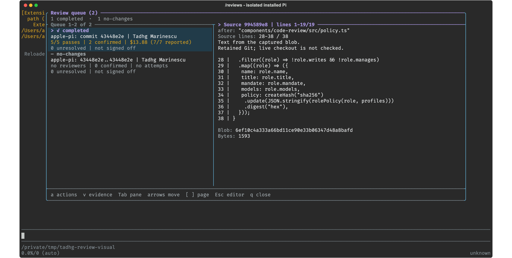
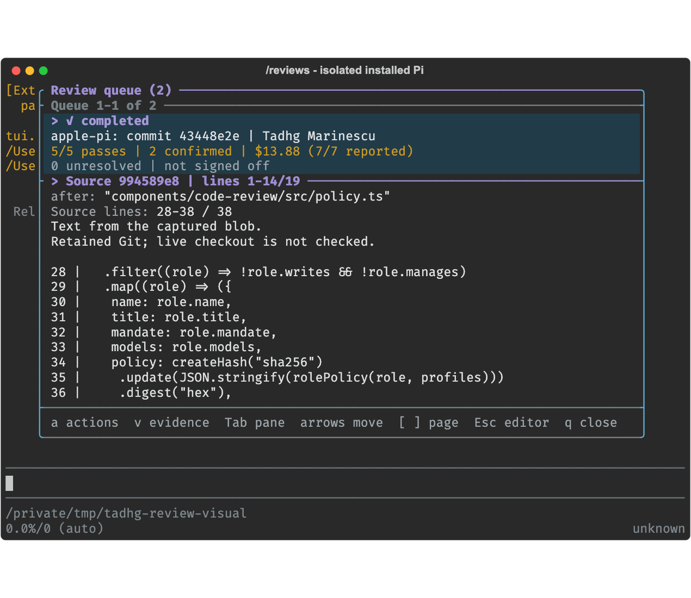
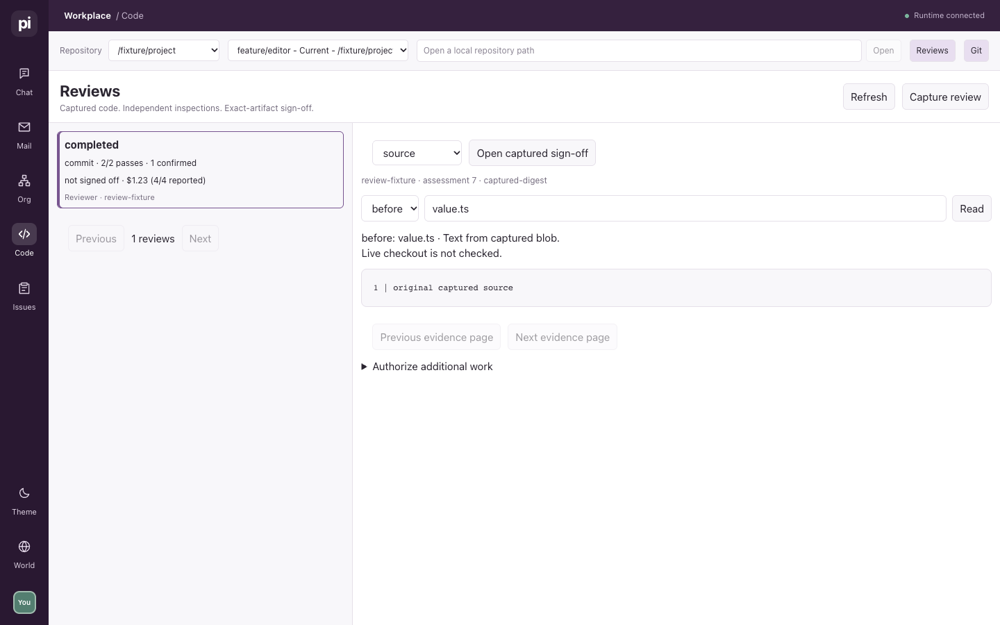
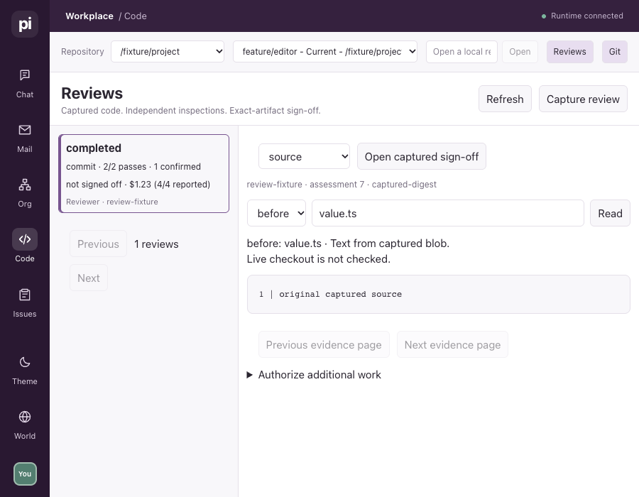
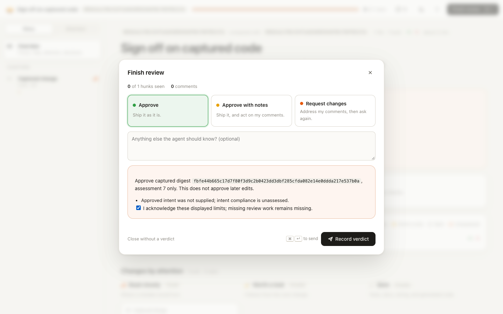

# Implementation evidence

## Capture foundation (in progress)

Implemented personally in `components/code-review/`. At this capture checkpoint no review peers or live runtime changes had been started. This foundation is not the complete first vertical slice and is not exposed as an installed native tool yet.

The public capture boundary has red/green evidence for working-tree, staged and committed targets, scoped region coverage, ordinary Git inspection, retained intent, integrity checks, non-UTF8 obligations, rename records, uninitialized submodules and external-link limitations. Additional fixtures cover root and merge commits, branch versus endpoint ranges, odd filenames/bytes/modes, concurrent mutation, configured Git drivers/filters/monitors, conflicts, ambiguous merge bases, unknown paths and missing references.

- `npx vitest run components/code-review/tests/capture.test.ts components/branch-search/tests/workspace.test.ts --maxWorkers=1`: 32 tests passed in two files. Log: `/tmp/review-capture-final.log`.
- `npm run typecheck`: Node and web passed. Log: `/tmp/review-capture-types.log`.
- Scoped Biome and `git diff --check` passed. Context lint passed for 334 sidecars.
- `npm pack --dry-run --json`: 2,743 files; all three new review source modules included. This is inventory evidence, not installed-package behavior.
- No full suite, paid model turn, runtime activation, native enqueue or UI claim.

### Checkout-scale capture

Captured the unchanged committed HEAD of this repository into private scratch directories, without sending source to a model:

| Acquisition | Files | Regions | Elapsed |
| --- | ---: | ---: | ---: |
| One process per blob | 4,930 | 12 | 353,715 ms |
| Git batch reads/imports, with verification | 4,930 | 12 | 21,376 ms |

The base tree, head tree, complete file-entry list and patch hash matched. These are single local measurements, not a controlled repeated benchmark or a review-effectiveness result. They justified removing a demonstrated subprocess bottleneck; they do not set a performance promise.

Logs: `/tmp/review-capture-benchmark.log`, `/tmp/review-capture-benchmark-batched.log`. Scratch artifacts: `/tmp/review-capture-benchmark.zhuwfU`, `/tmp/review-capture-batched.gVnPKK` (temporary, eligible for owner cleanup).

### A failure caught by stronger verification

`git write-tree` over an empty private index returned the known empty-tree ID without storing that object. An ordinary tree lookup passed, while `git fsck` reported the missing tree in a root-commit capture. A disposable direct Git reproducer established the behavior. `git mktree` with empty input stores the object; the root-commit fixture and capture-wide integrity check now pass.

## Durable admission and review contracts

The runtime now owns capture jobs independently of the requesting socket. It records verified target admission, interruption on restart, explicit same-artifact resume, cancellation, priority and reassignment. Unfinished review ownership participates in the shared departure and cross-organization move guards. At this admission checkpoint no peer execution loop or native tool was wired: admitted jobs remained queued pending the execution increment below.

The semantic contracts account for every changed region exactly once as primary ownership or a gap, retain distinct questions over identical files, require independent work for declared reliability/authority risk, preserve requested lenses, require question-level evidence accounting and retain every reported finding through validation/deduplication. These deterministic checks do not establish the quality of model planning or reported evidence.

`openPeerProgram` now accepts explicit runtime paths and preselected scope/command identities. An isolated test changes ambient state after choosing its runtime, then launches, runs and closes a fake peer against the selected runtime without starting a daemon in the other directory.

- Latest focused cohort: **128 tests in 13 files passed**, one worker, 78.88 seconds. `/tmp/review-admission-final-tests.log` covers admission/recovery, contract checks, peer cleanup, work recovery, attention, reporting moves, departure lifecycle and consumers of the historical-schema fixture.
- Node and web typechecks passed: `/tmp/review-admission-final-types.log`.
- Scoped Biome, whitespace checks and context lint passed; **336 context files**.
- Package dry run: **2,746 files**, including the new contract, operation and runtime-job modules. `/tmp/review-admission-pack.json`. Inventory only; no installed-package or UI build claim.
- Red logs include `/tmp/review-plan-red.log`, `/tmp/review-coverage-red.log`, `/tmp/review-peer-owner-red.log`, `/tmp/review-admission-red.log`, `/tmp/review-responsibility-red.log`, and `/tmp/review-move-red.log`. The first two queue responsibility checks reproduced an admitted owner departure and a reporting move that stranded a review before their shared guards were added.

### Existing cleanup defect encountered

Eight peer-cleanup tests failed on both the implementation tree and unchanged `651d2972` in a detached worktree. `discardProgramPeople` records explicit `discard` file-cleanup receipts, while `cleanMovedBundles` only selected `promote`. Both actions now use the existing cleanup owner; historical `finish` receipts still preserve their source files. The passing cohort retains those historical-source and temporary-process/task-cleanup checks. Baseline log: `/tmp/review-peer-baseline.log`. The scratch worktree and its node_modules symlink were removed normally.

The work-recovery fixture also used a different goal for an allegedly identical command retry. It now retries the original payload and separately asserts that a changed goal is refused. The new migration required the shared historical-schema fixture to remove the review table before declaring an older physical schema; the original lifecycle-row assertions remain intact.

No live daemon or app was restarted. All new socket/process checks used private state and fake peers. No paid reviewer, actual first-provider-input isolation, stale-attempt execution fence, native enqueue tool, `/reviews`, Workplace entry path or artifact-bound approval has been exercised yet.

## Durable review execution checkpoint

Migration35 adds attempt records. Jobs claim priority/FIFO work and use the existing program-peer client, launcher, correlated turns and guarded cleanup. A persisted program ID identifies its review attempt; no extra launcher, daemon, wire-level permission or tool sandbox was added. Ordinary Pi Exec launch behavior remains unchanged.

The worker now runs a code-informed planning request, validated semantic/risk obligations, separate first-inspection peers including whole-change integration, then finding and coverage challenge. The source directory and role policy are recorded; selected model/thinking are observed at turn start. Structured turn results and observed usage are retained before cleanup, including cancelled or malformed results. These data are model claims and observations, not independent proof of semantic correctness. Internal model overhead outside the correlated turn is not invented into its usage total.

- A public-command red step left the job queued instead of completed: `/tmp/review-worker-red.log`. The runtime now executes the pipeline and retains the captured value after the live checkout changes.
- Declared authority risk dispatches a distinct actual pass over the same regions. This uses a scripted planner; it does not establish that a real model reliably identifies that risk.
- Incomplete questions with zero findings remain incomplete. Resume reruns those questions while preserving completed planning. Unavailable role-model policy fails before a review turn is sent. A completed but malformed model response retains observed usage and fails validation rather than becoming a clean review.
- Cancellation retains the observed cancelled turn result and waits for scope/person cleanup. Restart interrupts an active attempt; explicit resume uses a new attempt/person/generation on the same artifact. A scripted obsolete receipt is sent through the replacement peer's real socket; a later fact on that socket proves processing order before assertions show the new attempt remains unfinished.
- Separate child processes run actual AgentSessions on a scripted SDK model with the organization/bridge/peer-turn installers. Captured provider messages include role system sections and ordinary read/bash results: relative source reads, Git comparison and search use the captured checkout. An author-self marker and another first report stay out of first inspections; validation receives the other report as a positive control. This is not every package extension, a live provider, or a model-quality experiment.
- Focused cohort: **108 tests in 10 files passed**, one worker, 69.07 seconds. `/tmp/review-worker-verified-tests.log` covers capture/contracts, queue execution, peer cleanup/history, ordinary onboarding, work recovery and inspection consumers.
- After strengthening the SDK test with ordinary shell/Git/search and a positive role-system-section check, **52 tests in six files passed**, one worker, 46.35 seconds. `/tmp/review-worker-sdk-final.log` also covers the remaining historical-schema fixture consumers. The two cohorts overlap; neither is a full-suite run.
- Final focused recheck after the prompt and provider-input assertions: **20 tests in two files passed**, plus Node/web types, scoped Biome across 13 source/test files and whitespace checks. Logs: `/tmp/review-worker-close-tests.log`, `/tmp/review-worker-close-types.log`. Context lint passed for **338 files**.
- Node/web types also passed in `/tmp/review-worker-types-final.log`. Package dry run: **2,748 files**, including `prompts.ts` and `review-attempt.ts`; `/tmp/review-worker-pack.json`. Inventory only, not an installed-package test.

### Ordinary onboarding baseline correction

The broad cohort found one failure in workplace.test.ts: it expected copied team backscroll. Unchanged ecae1117 reproduced it in a detached worktree (`/tmp/review-worker-onboarding-baseline.log`). The existing runtime already sends a channel/brief pointer. The test now positively checks that pointer and assigned goal, and excludes copied backscroll. Review-specific startup omits that automatic team notice while preserving ordinary tools and membership. The scratch worktree and its node_modules symlink were removed normally.

## Selected assessments and native entrypoint checkpoint

Migration36 records the selected attempt IDs explicitly. Read-only queue and detail projections share a consistent snapshot, retain attempt-scoped allegations and distinguish validator-challenged questions from completed coverage. A challenged inspection gets a new attempt on resume while the unaffected integration result can be retained. Review visibility follows review-owned organizational anchors, including a whole-root merge with no surviving work-task rows.

The SDK fixture calls the real extension's review_code, review_queue, read_review and manage_review tools against the isolated runtime. It admits work, reads unvalidated partial allegations, waits for guarded cancellation, recovers the original admission after the live checkout changes, then explicitly captures a different rerun linked to the first review. The extension is not yet registered in package.json; this is an entrypoint integration check, not a public activation claim.

- Initial reader/challenge/resume/scope failures: `/tmp/review-reader-red.log`, `/tmp/review-reader-coverage-red.log`, `/tmp/review-reader-resume-red.log`, `/tmp/review-reader-scope-red.log`.
- The 87-test reader cohort had one remaining failure: its multi-job fixture returned review_jobs[0] for every enqueue. The helper now follows the exact command's recorded review ID rather than inferring identity from table order. `/tmp/review-reader-final-tests.log` retains that failure.
- Final focused cohort: **88 tests in eight files passed**, one worker, 68.92 seconds. `/tmp/review-native-cohort.log` includes queue/native behavior, reporting moves and historical-schema consumers. The earlier **16-test single-file pass** overlaps this cohort: `/tmp/review-native-tests3.log`.
- Node and web types passed: `/tmp/review-native-types3.log`. Scoped Biome and whitespace checks passed; context lint passed for **340 files**.
- Package dry run: **2,752 files**; new result/read/tool modules and the entrypoint are present. `/tmp/review-native-pack.json`. This is inventory, not installed activation or model-quality evidence.

A stronger recovery case then reproduced loss of that coverage challenge after an intervening failed retry: `/tmp/review-challenge-recovery-red.log`. Current selections had been cleared, so a second resume reused the old challenged report. Migration37 now retains a reuse block on that exact attempt, atomically with the validator's output, before cleanup. The validator input names the attempts it challenges. Final recheck after this correction: **88 tests in eight files passed**, Node/web types and scoped Biome; `/tmp/review-checkpoint-tests2.log`, `/tmp/review-checkpoint-types2.log`. The earlier passing cohort did not cover this extra transition.

## Finding responses and assessment-bound approval checkpoint

Migration38 adds append-only review_decisions under the existing runtime command journal. Each decision uses its command ID. Finding responses retain original allegations and model validation, require counterevidence for rejection and scope/evidence for accepted risk, and distinguish unverified claims from a selected, completed, unchallenged verification question on another captured target. That verification retains the exact attempt, validator, digest, assessment revision and reported evidence. It records the responder's judgment, not automatic semantic proof.

Operator approval requires a settled assessment, verified retained source and an exact digest/revision match. Known limitations need explicit acknowledgment. A later fix does not repair the old snapshot, and a substantive owner response is not hidden by earlier model rejection. Later finding responses stale the old approval while preserving its record. The runtime rechecks authority and assessment identity after asynchronous verification, inside the command transaction.

- The real SDK fixture now calls resolve_finding and reads its decision history after guarded cancellation.
- A real-socket test covers unsupported rejection/risk decisions, stale response refusal, original allegation retention, claimed versus selected new-target fix verification, operator-only approval, required limit acknowledgment, later assessment invalidation and retained-source tampering.
- Focused cohort: **84 tests in seven files passed**, one worker, 74.37 seconds. `/tmp/review-decisions-final-tests.log` covers queue/native/decision behavior and historical-schema consumers. Node/web types and scoped Biome passed: `/tmp/review-decisions-final-types.log`, `/tmp/review-decisions-final-format.log`.
- TypeBox's mapped literal unions inferred never in actual typed callers despite runtime validation working. Explicit literal tuples passed typecheck and behavior checks; the durable context owns this constraint.
- Final post-authority-recheck: **17 queue/native tests passed**, one worker, 53.19 seconds; Node/web types, scoped Biome and whitespace checks passed. `/tmp/review-decisions-close-tests.log`, `/tmp/review-decisions-close-types.log`, `/tmp/review-decisions-close-format.log`.
- Context lint passed for **342 files**. Package dry run contains **2,754 files**, including both new decision modules: `/tmp/review-decisions-pack.json`. Inventory only.

No approval page, live operator sign-off, public extension activation, paid model-quality check or production migration has occurred.

## Review TUI checkpoint

The /reviews entrypoint now mounts a standalone master-detail queue rather than the old combined panel. The shared reader supplies names, plan summaries and identity-based paging under one read snapshot. The panel derives detail/page sizes from its viewport, preserves selection across live reordering and hide/reopen, separates queue/evidence focus and exposes progressive evidence and confirmed mutations. It reports missing stores rather than an empty queue and labels live freshness as unchecked.

- **22 tests in two files passed**, one worker, 60.13 seconds: `/tmp/review-panel-final-tests.log`. The loaded command uses the actual extension loader, SessionManager, database reader and isolated runtime, but a fake TUI. Its single-row pages exercise identity-based selection after a fresh rerun, editor focus, hide/reopen, context reset and explicit scope cleanup.
- Component checks cover wide/narrow/tiny layouts, long text/control characters, page/scroll separation, visible operation outcomes and genuine empty versus unavailable stores. A prior control-character assertion incorrectly rejected a generated ANSI reset from the TUI's truncation helper; the assertion now separates VT styling from raw controls. `/tmp/review-panel-close-tests.log` retains that failure.
- Node/web types and scoped Biome passed: `/tmp/review-panel-close-types.log`, `/tmp/review-panel-close-format.log`, `/tmp/review-panel-final-format.log`. Context lint passed for **344 files**.
- Scoped whitespace check passed. Package dry-run contains **2,757 files**, including all three new UI source modules: `/tmp/review-panel-pack.json`. This verifies inventory, not activation.
- Unknown-operation recovery retains the exact command and payload in memory while this UI context survives. It is not a durable recovery-menu claim; session/context changes and reload clear that map while the runtime journal and admitted jobs remain.

The extension is still absent from the activation list, /work remains installed, and there has been no actual terminal paint, production restart, paid review or Workplace/browser approval claim.

## Combined-panel retirement

The manifest now selects extensions/code-review.ts instead of extensions/work.ts. The old shared manager, Tasks/Pi Exec panels and panel-only tests are removed. The renamed Pi Exec integration suite keeps execution guarantees through native results, the error-result hook, traces and passive activity: serial queueing, saved programs, handled/terminal errors, long output, role authority, correlated peer children, cancellation and cleanup, late results, redacted bound inputs and context resets. Tasks cancellation now uses the native task tool. The shared viewer keys remain because BTW and the tool inspector still consume them.

- **105 tests in six files passed**, one worker, 38.89 seconds: `/tmp/review-retire-final-tests.log`. Five earlier integration failures were incorrect expectations of abbreviated display names; native refs retain pi.read/pi.grep/pi.bash. The passing suite keeps the original runtime cases rather than testing the retired UI.
- Node/web typecheck and scoped Biome passed; package loader passed with exactly one /reviews and no /work or /tasks. Final logs: `/tmp/review-retire-close-types.log`, `/tmp/review-retire-close-format.log`, `/tmp/review-retire-close-loader.log`.
- Package inventory: **2,753 files**, with the review entrypoint and UI sources included and all four retired production modules absent. `/tmp/review-retire-pack.json` is a dry-run inventory, not an installed-package or runtime activation test.
- Context lint passed for **345 files**. Wiki lint passed for **12 pages / 48 links** before the append-only repair log. The historical TUI page retains its old prototype evidence and now points to the new authoritative contract.
- Docs and the code-review skill describe the native queue and optional consultation rather than a mandatory board. Always-present tool guidance distinguishes fulfilling an assigned pass from initiating another review; package loading asserts that guidance exists. This is not an autonomous skill-use or paid-review-quality check.

The package change affects new/reloaded sessions. The already-running production runtime has not been restarted or migrated for reviews; an old store remains explicitly unavailable. No actual terminal paint, paid review, Workplace integration or browser approval is claimed.

## Bound capture preview

The TUI chooses a repository/worktree directory and shows resolved comparison endpoints, trees, digest, scope, intent hash and omissions before queueing. Its temporary capture is removed; durable admission captures again and compares expectedDigest before making work runnable. A changed target is a failed unadmitted request with no reviewer attempts. Empty TUI comparisons stop without enqueue. Native review_code still needs its explicit no-change outcome.

- **50 tests in four files passed**, one worker, 92.09 seconds: `/tmp/review-preview-tests3.log`. These cover real preview filesystem cleanup, digest stability, a changed target between preview and admission, a matching capture that executes, and the loaded /reviews command against an isolated runtime. The UI checks still use a fake terminal.
- Confirmation tests cover scrolling long metadata with fixed controls, tiny-layout refusal, hidden-queue focus, selected directory resolution, cancel/no-change without enqueue, displayed/admitted digest equality and cancellation beside a different overlay. Source inspection established why the ordinary Pi confirm title cannot contain this bounded view; it does not prove actual terminal paint.
- An initial test failed before exercising cleanup because Node's ESM namespace disallowed spying on rm. A test-owned TMPDIR now verifies actual empty scratch storage after success, failure and cancellation. A prose assertion also needed to respect terminal wrapping. Those failures are retained in `/tmp/review-preview-tests2.log`; the final geometry assertions still use actual physical rows and widths.
- Node/web types and scoped Biome passed: `/tmp/review-preview-types3.log`, `/tmp/review-preview-format3.log`. Package loader passed: `/tmp/review-preview-loader.log`. Context lint passed for **346 files**, and scoped whitespace passed.
- Package dry-run includes the new preview source among **2,754 files**: `/tmp/review-preview-pack.json`. This is inventory, not installed operation or activation.

The deliberate cost is two captures rather than a draft-job store or adoption of UI-owned source. No paid reviewer, actual terminal paint, browser approval or production restart was performed.

## Policy-sensitive recovery

- Four regressions reproduced stale planning after role instructions, profile candidates, selection mode or advisory-catalog changes. Each completed with plan revision 1 rather than the required new revision: `/tmp/review-policy-red.log`.
- Current role/profile policy is now part of the exact attempt key before reuse lookup. Resume routes the planner through that same path, retaining its revision only when its selected result remains eligible. A new plan revision requires fresh inspections. Existing unchanged-policy and persistent-challenge recovery controls remain green.
- Startup and real-SDK turn gates verify that a policy change can invalidate work while leaving the observed model itself eligible. Startup sends no review turn. A change during an actual scripted AgentSession turn retains the completed raw result but accepts no current-policy report. Metadata-only reads do not select a model or advance profile-pool counters.
- **73 tests in five files passed**, one worker, 101.45 seconds: `/tmp/review-policy-final-tests.log`. Node/web types, scoped Biome and package loading passed: `/tmp/review-policy-final-types.log`, `/tmp/review-policy-final-format.log`, `/tmp/review-policy-loader.log`.
- Package dry-run includes policy.ts among **2,755 files**: `/tmp/review-policy-pack.json`. Context lint passed for **347 files**. Scoped Biome, package loading and whitespace were checked again after native recovery guidance changed: `/tmp/review-policy-close-format.log`, `/tmp/review-policy-close-loader.log`. No live provider, production migration/restart or comparative quality claim.

This checkpoint covers execution and recovery policy. Capture-time instruction/configured-reference identity in the artifact and current-target applicability remain unfinished.

## Native no-change admission

Two native-SDK regressions reproduced empty endpoint and unchanged path-scope comparisons starting review work rather than retaining a no-change outcome: `/tmp/review-no-changes-red.log`. Admission now retains the captured artifact as no-changes before any worker claim. Exact replay, cancellation, restart and responsibility guards preserve that distinction from completed review.

The initial two-case check passed, with Node/web types. Expanded dormant-departure checks then timed out because fakeBridge does not reconnect after restart while its stand-in remains alive. The production guard correctly refused to signal an unbound writer. Ending the test-owned stand-in and awaiting its exit made the two cases pass in `/tmp/review-no-changes-departure.log`; the final cohort passed **39 tests in four files**, one worker, 107.58 seconds (`/tmp/review-no-changes-final-tests.log`). Node/web types, scoped Biome, loader and whitespace passed; context lint passed for347 files. Package dry-run retained2,755 files including the review entrypoint (`/tmp/review-no-changes-pack.json`). Earlier typecheck failures were test JSON typing and an incorrect retire command shape, corrected without changing production protocol.

## Authorized runtime activation and live QA

The operator explicitly requested restart, then reloaded this session and authorized use of the new tools for live QA. At 2026-10-31T16:29:19Z, PID28278 was replaced by PID28293 through normal SIGTERM and the standard runtime connector. Fresh process identity, no active program scopes and no daemon-owned children were checked before stopping it. An online SQLite backup was saved privately as `/Users/alexanderbut/.pi/agent/state/apple-pi.db.pre-reviews-1793464158590` (0600). Schema advanced from33 to38; all63 lasting people in the immediate pre-restart snapshot were retained. Earlier preflight saw62; that older count was not used as the restart baseline. Evidence: `/tmp/review-runtime-activation.json` and `/tmp/review-runtime-activation.log`.

The reloaded native review_queue returned an empty queue. review_code for43448e2e..43448e2e created review-063883d2-486b-4ff1-8160-a98ee8ac40ea in no-changes, and read_review reported zero attempts. A real review of committed policy fix43448e2e was then admitted as review-e42e236c-a98e-4518-8dd3-a7bf994589e8, digest c9f8f27031c7a0b0c9fa7f237f204253bdad787bf48d294f69a9ed4b011f3092. It uses the approved proposal as captured intent and a recovery-policy lens. Its planner completed under openai/gpt-6.1-sol/high and focused inspection began. This is paid live QA, not a comparative effectiveness result or completed review claim. No app restart or browser approval occurred.

The operator's first live assessment explicitly rejected the /reviews visual quality. A substantial visual pass is now explicit acceptance work: hierarchy, chrome/borders, colors, status iconography, visible actions/focus and readable evidence, checked in a real rendered terminal. Fake-terminal success did not establish that quality.

## First live finding: all-concrete catalog dependency

Hoa Whitlock's independent policy-correctness pass reported catalog-loads-unreferenced-profiles against43448e2e. Source inspection confirmed reviewRoleCatalog loaded the global profile file before discovering whether any advisory role referenced it. A local regression reproduced the invalid-JSON failure (`/tmp/review-catalog-red.log`). The fix enumerates advisory roles first and loads profiles only when one references a profile; referenced configurations still receive complete-file validation.

The new unit case covers an all-concrete catalog and the control where one added profile reference makes malformed configuration fatal. An isolated runtime review now completes all four attempts with the all-concrete/malformed-file setup and leaves no scopes or selection counter. **31 tests in two files passed**, one worker,104.47 seconds (`/tmp/review-catalog-tests.log`), plus Node/web types, scoped Biome and loader (`/tmp/review-catalog-{types,format,loader}.log`). The original live review continues against its unchanged old capture; this correction does not repair that artifact, and its finding validation remains pending. The running daemon has not been restarted to load this correction.

## Completed live QA and mixed-policy correction

The live review completed on2026-10-31 with seven completed selected attempts: planning, four focused inspections, independent integration and validation. It reports five of five inspection passes, eleven of eleven named questions and two confirmed medium findings, with no unassigned regions or additional requests. Saskia Babic independently confirmed both retained allegations using the captured source and disposable reproductions. The root also reproduced both locally. Clean reports from other scopes do not negate those failures. No operator approval was recorded.

Elapsed admission-to-settlement time was2,795.527 seconds (46 minutes35.5 seconds). The seven retained correlated turns report $13.8808092 total cost. This is observed primary-turn cost, not a full-system cost including internal sessions or unrelated work. One live case establishes useful defects in this artifact, not superiority over a simpler independent review.

Mei Echeverria's mixed-policy finding held cleanup after planner A, ran a focused inspection under B, restored A during focused cleanup, then observed a completed assessment. The local regression also reached completed instead of the required refusal (`/tmp/review-mixed-policy-red.log`). Every attempt now compares its current policy fingerprint with the planner catalog before reuse or launch; within-turn and final-catalog checks remain. The regression proves B is refused before launch and restored A can resume consistently with all scopes cleaned.

**43 tests in three files passed**, one worker,126.09 seconds (`/tmp/review-mixed-policy-tests2.log`): policy, queue/native/SDK lifecycle, and ordinary program peers. Node/web types, scoped Biome and loader passed (`/tmp/review-mixed-policy-{types2,format2,loader2}.log`). Context lint passed for347 files, scoped whitespace passed, and the package dry-run includes the policy owners and entrypoint among2,755 files (`/tmp/review-mixed-policy-pack.json`). The first formatting pass caught added fixture callback complexity; simplifying its phase lookup fixed it without suppressing the rule. The catalog correction is committed as4740b5e4; the mixed-policy correction belongs to this checkpoint. These are tested later-source corrections, not repair or new-target verification of the original captured artifact. The production daemon has not been restarted to load either correction.

## Terminal visual pass

Implemented themed frame/dividers, semantic status icons/colors, selected-row background, visible pane focus, range/scroll indicators and fixed responsive key hints. Summary status precedes the planner narrative. Findings lead with allegation/location and distinguish reported certainty, validation and later owner responses before retaining their causal/evidence/provenance detail. Long styled headings wrap without losing hierarchy; clipped metadata is marked. Completion is neutral, not green approval.

- **38 tests in three files passed**, one worker, 110.73 seconds: `/tmp/review-visual-final-tests.log` (panel, preview and review queue/native entry). Node/web types and loader passed. After the heading-click adjustment, **8 component tests and 2 native-entry tests passed** in `/tmp/review-visual-close-{components,native}.log`, with fresh types and loader. After the final truncation-marker adjustment, the 8 component tests, Node/web types and scoped Biome passed again (`/tmp/review-visual-last-{components,types,static}.log`). These are overlapping focused checks, not a full suite or a single frozen full-cohort claim.
- Final source inspection also found an unpadded empty-queue row in the wide frame. The component regression reproduced 143 cells instead of160 (`/tmp/review-visual-empty-red.log`); padding the shared row boundary fixes that state. The final source received another8 component and2 native-entry checks, fresh types, static checks and loader (`/tmp/review-visual-commit-*.log`). The retained images show populated states; this last empty-row correction has component evidence.
- The first visual assertions still encoded borderless footer/page geometry and were corrected to physical framed rows and viewport-derived page sizes. A later findings-view failure was a wrong fixture control shape: `{review:{finding:true}}` is consumed, while the sibling field beside `review:true` is not. The production reader already displayed the real findings. Failures remain in `/tmp/review-visual-tests.log` and `/tmp/review-visual-tests3.log`.
- Actual preview cancellation left a stale Capturing message. `/tmp/review-visual-cancel-red.log` reproduces it through the loaded command; the shared confirmation owner now reports that this request was not queued. The passing cohort covers it, and `/tmp/tadhg-review-visual/cancel-verified.txt` records the corrected message in installed Pi. This is not a rollback claim for an earlier uncertain request.
- Installed Pi ran in tmux server `tadhg-review-visual`, with an isolated agent/session directory, a private online DB backup, cleared credential environment, discovery/MCP disabled and only the review extension. No provider or production mutation was required. The actual command, reload, evidence/actions, exact-target preview, cancellation and layouts at 160x42, 90x30 and 42x24 were inspected. An initial scripted key sequence reached a different dialog and timed out; separating transitions and checking the selected action before Enter reached the intended preview. No queue confirmation was submitted. The private copy still held exactly the original completed and no-changes records. Normal quit ended the isolated tmux session; its private agent/database and session copies were removed.
- The images below render actual tmux ANSI cells through Rich and headless Chrome. They are not screenshots of the operator's terminal. Rich requires a recording Console with a StringIO output; its capture context had suppressed the recorded text in the first image attempt. The wide, findings and compact images show the populated layouts after the truncation-marker correction. Preview was captured before the later cancellation-message and heading/truncation adjustments; those do not change its displayed frame or controls.
- Package dry run retains **2,755 files** with the three review UI sources and extension, excluding task assets: `/tmp/review-visual-pack.json`. Context lint passed for 348 files. No production daemon/app restart, operator acceptance, browser approval or complete-workflow claim.

[Wide assessment](assets/reviews-summary.png) · [Narrow findings](assets/reviews-findings.png) · [Compact layout](assets/reviews-compact.png) · [Capture consent](assets/reviews-preview.png)

## Reported primary-turn cost

The queue and summary expose an unrounded reported amount with observed/total attempt counts. Failed, cancelled and earlier-plan attempts remain in the sum; selected/reused evidence is not a second charge. No attempts is distinct from an attempt with missing usage. Negative, nonnumeric and nonfinite values stay unreported; overflow of valid finite observations makes the sum unavailable. TUI display marks positive sub-cent amounts rather than rounding them to apparent zero, and native guidance excludes unobserved internal activity.

- Three lifecycle assertions initially failed because summaries omitted cost: `/tmp/review-cost-red.log`. The implemented checks cover failed planning plus successful resume, missing startup observations plus later partial cost, cancellation, native no-change zero, invalid observations, real zero, aggregate overflow and the JavaScript/SQLite numeric boundary.
- The invalid-data fixture initially lost its database because stopRuntime deletes the private directory (`/tmp/review-cost-focused.log`). It now takes an online backup and changes only that copy. A separate Node probe reproduced ERR_OUT_OF_RANGE for numeric JSON extraction of 2**53; the reader now uses JSON text, and the regression covers it.
- **40 tests in three files passed**, one worker,121.15 seconds: `/tmp/review-cost-close-tests.log` (panel, preview, queue/native/SDK). Node/web types, scoped Biome and loader passed (`/tmp/review-cost-close-{types,static,loader}.log`). The final removal of an unreferenced presentation helper was followed by fresh types, static checks and the eight panel tests (`/tmp/review-cost-commit-*.log`). No full suite or paid reviewer run.
- A fresh source-module call read the production database query-only through the existing actor-scoped reader: the completed live review reports13.880809200000002 dollars across7/7 attempts, and the no-change review0 across0/0. `/tmp/review-cost-live.json` retains the projection. The small final digits are floating-point summation; display is $13.88. This is not billing verification, internal-session accounting, a new native session reload or new-target review verification.
- Package inventory retains2,755 files with the reader, summary type and presentation owners (`/tmp/review-cost-pack.json`). The change adds no migration and needs no daemon restart; new/reloaded extension sessions use the updated reader. Actual installed-terminal captures above predate this added cost field; its rendering is component-tested here.

## Captured-source browsing

The native source part and TUI source view read recorded before/after Git objects, with explicit file/line pages and representation limits. They preserve access to deleted files and unchanged context after the author repository disappears, and do not replace frozen code with a changed materialized copy. Full recovery/decision verification remains stricter and still rejects changed materialized bytes.

- Initial core cases failed with the missing source reader (`/tmp/review-source-red.log`); native-entry source requests also failed before the new part existed (`/tmp/review-source-native-red.log`). Checks cover before/after contents, lost original repository, changed materialized copy, unknown/new/traversal paths, manifest mismatch, unusual names, binary data, symlink text, LFS and submodule pointers. Native tests cover actor authorization, count-first paging, line offsets and source remaining unchanged after live edits.
- The loaded command displays both before-side code and file inventory, pages inventory, and keeps its normal rerun/selection/lifecycle behavior. A larger context fixture exposed a pre-existing target-limit bug: the UI stopped at pointer-25 and could not reach pointer-39 because it looked for omissions outside target (`/tmp/review-source-target-page-red.log`). The nested-envelope correction passes through the same controls.
- Final **60 tests in four files passed**, one worker, 138.65 seconds: `/tmp/review-source-verified-tests.log` (capture, panel, preview, queue/native/SDK). Node/web types, scoped Biome and loader passed (`/tmp/review-source-verified-{types,static,loader}.log`, `/tmp/review-source-all-static.log`). Earlier green cohorts are superseded by this final run; no full suite or paid reviewer run.
- Installed Pi was reopened in the isolated tadhg-review-visual tmux server, using a private online database copy, isolated agent/session directories, no model credentials and discovery/MCP disabled. Actual command/reload, the side chooser, after-side file display, source paging and 160x42/90x30 layouts were inspected. The master/summary also displayed the live record's $13.88 with 7/7 observations. Retained cells and scripts are under `/tmp/tadhg-review-visual/`; images below are ANSI-cell renders, not desktop screenshots or operator acceptance. The source images precede only the later target-envelope correction, whose evidence is the loaded-entry regression.
- A read-only production projection of captured policy.ts returned 38 source lines and the recorded first line. One observed source read took 1,408.6ms; this is a single observation, not a performance guarantee. The private copy still held exactly one completed review and one no-change record; normal q/Ctrl+D exited the isolated terminal, and its copied database/session directories were removed. No production daemon/app restart or new-target verification occurred.
- Package dry run retains 2,755 files, includes the reader owners and excludes task assets (`/tmp/review-source-pack.json`). There is no migration; new/reloaded extension sessions use the readers while the separate policy corrections still require later runtime activation.

## Assembled review delivery

- Capture now records shipped review prompts and declared advisory model/profile references without freezing ambient instructions/resources. Attempts retain actual resolved policy. Legacy artifacts disclose absent capture identity. The fixed profile-name fixture failed before ordinary role loading accepted supported balanced/deep values; the corrected capture regression passed.
- Freshness explicitly distinguishes the requested comparison, checkout and policy. Stable committed targets, dirty checkout changes, changed policy, missing source and authorization are exercised. These are timestamped observations, not atomic snapshots or approval.
- Migration39 adds additional-work history. Revision/digest-bound question, reason and stopping condition authorize required replanning on the retained source; exact replay cannot duplicate paid attempts. Stale revision is refused. Native tools, TUI and Workplace Code expose this operation.
- Captured browser sign-off displays retained patches, binding, freshness and limits. Tampered binding/missing acknowledgment fail; an assessment change refuses the old page. Human line feedback retains captured file/line provenance in the approval note. The server awaits the runtime mutation before success; concurrent submission and rejected commit are exercised. Actual Chrome checks the disabled approve action before acknowledgment, then records operator approval against an isolated runtime while live source is 999 and displayed captured source remains 2.
- Workplace Code uses typed on-demand backend/main/preload methods, not snapshot polling or another writer. Built Chrome exercises queue status/cost, source inventory then file/side navigation, consent before capture, a deliberately lost receipt with exact retry and retained unsaved Monaco text. It exposed a render-before-effect crash: old summary data was being cast as source. Request-keyed rendering now prevents that transition. Fresh enqueue is disabled while the original capture is uncertain.
- Actual isolated Electron exposed a separate integration failure: bundling relocated the role catalog's import.meta.url, so preview and runtime capture disagreed on configuration identity. The build now rebases packaged role/template/Mermaid consumers to source-relative package paths. The actual preload/main/runtime probe then passed preview, no-change enqueue/replay, queue, retained source, freshness and captured sign-off template serving, with zero attempts. External browser opening was replaced only inside that test process. Existing native communications, Monaco, file/Git guards, Org and retained World checks also passed. Stand-in recipients do not establish model reading.
- Core cohort: **81 tests in six files**, one worker, 175.03s (`/tmp/review-delivery-core-tests.log`), followed by loader and Node/web types. After preserving browser feedback, the targeted approval regression passed again (`/tmp/review-feedback-core.log`, one test, 33 skipped). These overlapping counts are not additive.
- Final renderer/server/backend cohort: **23 tests in three files**, one worker, 19.45s (`/tmp/review-feedback-ui.log`); final types, scoped static and built Electron probe passed (`/tmp/review-feedback-{types,static,electron}.log`). The static inventory subsequently checked39 changed source/style files, including one pre-existing role test without writing it (`/tmp/review-delivery-static-final.log`), and build-consistency tests passed for browser pages and Agent Workplace (`/tmp/review-delivery-build-tests.log`). Context lint passed350 files. No full test suite or new paid review.
- Both web surfaces and Electron main/preload are rebuilt. The package dry run contains2,760 files, includes new source owners and both Electron entries, and excludes ledger assets (`/tmp/review-delivery-pack.json`). A read-only production observation still found PID28293, schema38 and two settled reviews; the new writer needs activation. The current117-person count is not the earlier63-person restart baseline and must be reobserved immediately before any later restart.

These are isolated rendered/IPC/runtime checks, not production activation or operator acceptance. Images use fixture content rather than the operator's desktop.

## Production activation and live read checks

- Using the operator's earlier explicit permission to restart freely, rechecked runtime identity, settled reviews, zero program scopes and zero daemon-owned children. The first preflight correctly refused on pending commands; inspection found retained mail rather than active control operations. The refined check required zero pending non-mail controls and explicitly verified retention of all99 pending mail command IDs. No message was resent or marked understood.
- Normal SIGTERM replaced PID28293 with27893 at22:08:09Z, advancing schema38 to39. The immediate before/after identity list retained all68 non-retired root people; the separate earlier117 count includes other session records and was not used as a like-for-like baseline. Both settled review identities/revisions, all seven attempts and both finding responses remained. Online backup is private at `/Users/alexanderbut/.pi/agent/state/apple-pi.db.pre-reviews-1793484488543`, mode0600. Evidence: `/tmp/review-delivery-runtime-activation{.json,2.log}`. No forced kill or new reviewer.
- Normal app Quit preserved its native unsaved-draft/terminal veto. App28330 became31078 on14366fa3, then70156 onffd001ed after the latency correction below. Final app/runtime UNIX-socket correlation passed while runtime27893's incarnation stayed unchanged. Evidence: `/tmp/review-delivery-app-activation-{initial.json,final.log}` and `/tmp/review-delivery-app-activation.json`. These are process/connectivity observations, not a screenshot or operator verdict.
- Live read-only metadata/source checks returned the two settled reviews and retained38-line policy source. A full explicit freshness probe took57.8s, returning requested target/policy unavailable for the legacy capture and current checkout changed. An earlier60s shell probe timed out and did not establish a result; its identified incomplete preview scratch was removed. The signal-bounded retry completed and cleaned its preview storage. Evidence: `/tmp/review-delivery-live-read{.log,.json}`. These are single observations, not a latency guarantee.
- That measurement exposed an unnecessary dependency: opening sign-off should verify captured code, not automatically perform full live captures. Commitffd001ed makes live freshness explicitly unchecked on the page, with null observation time and a visible direction to request it separately. Final rechecks passed17 tests in four files plus the one native approval test, Node/web types, both builds and the actual isolated Electron probe (`/tmp/review-fast-signoff-{tests,native2,types,electron2}.log`). A production captured-page probe then served the original assessment12 with38 limits in16.8s, without checking live freshness or submitting an approval. Full retained verification still costs work; this is not a claim of instant opening.
- Current Pi root sessions need `/reload` to pick up the new extension tool schemas/TUI actions; runtime restart does not reload extensions inside an existing Pi process. New sessions and the relaunched Workplace app use the new code.

## Remaining delivery

Operator QA/acceptance of the revised terminal and assembled app remains pending. The first live review and no-change cohort are evidenced above; comparative effectiveness and new-target fix verification remain unmeasured. No acceptance criterion has been waived.
