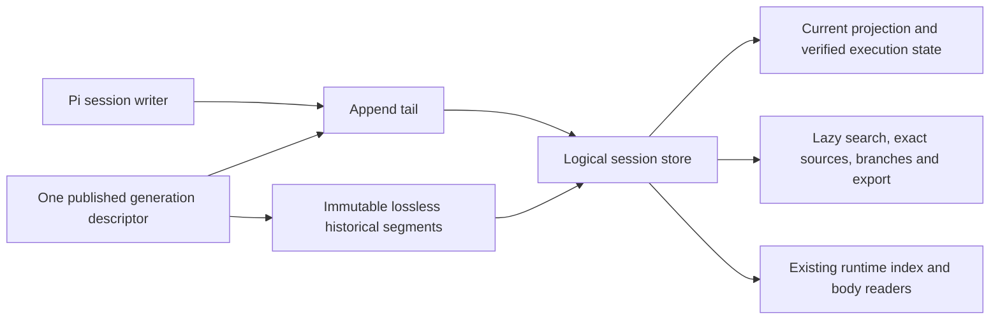

# Long-lived agent recall and transcript retention

**Proposal for operator approval. No production implementation is authorized or included.**

Owner: Kofi Bhattacharya. Independent investigations: Ciaran Gallo (evidence quality), Saskia Tuilagi (retention integrity). Date: 2026-11-02.

## Recommendation

1. **Improve evidence recovery before adding more memory machinery.** Repair missing searchable content and unreliable query/navigation behavior, then improve what a search result actually shows. Keep source availability, relevance, displayed evidence and successful agent use as separate measures.
2. **Keep one lossless logical transcript per person.** A hot/archive split must change Pi's session-storage boundary and all material consumers, not run an external job that truncates live JSONL. Keep Pi's compaction and the person's identity unchanged.
3. **Retain cold history until a separate deletion policy is approved.** Compression and paging can reduce disk/memory cost; they cannot make lifetime information growth finite. The proposal contains no invented day/MB cap and deletes nothing.

The immediate engineering priority is recall correctness and presentation, not embeddings or a new global memory service. A frozen six-question experiment did **not** improve after removing the issuing query alone. That small fix is useful hygiene, not an evidence-backed solution by itself.

## What is established

### The tool is useful, but first-response recall is weak in the checked cases

[Independent evaluation](independent-evaluation.md) inspected 31 actual historical call/result pairs: 24 session searches and seven notebook lookups. Six real questions received 38 source-episode labels and 30 top-five relevance labels.

| Question on these six cases | Result |
| --- | ---: |
| Did top five contain a relevant full entry? | 5/6 |
| What fraction of top-five entries were relevant? | 9/30, **30% precision@5** |
| How much of the labeled episode's evidence was retrieved? | 7/19, **36.8% episode-relative recall@5** |
| Did the displayed response suffice without another read? | 2/6 |

Today's production functions reproduced the 9/30 and 7/19 results at the original cutoffs. The independent evaluator also checked current snippets: still 2/6 sufficient. These are **purposive, single-rater, clustered cases**, not a product accuracy estimate. Episode-relative recall is not whole-transcript recall. No downstream coding-success conclusion follows.

Exact navigation fared better: four of five checked known-index/file expansions recovered useful requested evidence. The remaining agent requested wrong indices; the tool returned those real but irrelevant records. Historical file recovery is not current-file truth.

### The memory channels fail differently

| Channel | What it does well | Verified limit | Proposed treatment |
| --- | --- | --- | --- |
| `search_session` | Exact historical outputs, rationale, writes/edits and branch-aware discovery | Searchable-source gaps, lexical noise, issuer/recall echoes, snippet omission, regex surprises | Repair extraction/navigation and expose usable source context |
| `revisit_note` | Known-ID provenance navigation, including retired records | Five resolved cases included one unrelated and three only partly supporting source sets | Keep exact lookup; make resolved-reference status distinct from claim support |
| Notebook | Carries selected hard-won learning across compaction | A linked note is curated compression, not proof; old/retired note discovery is weak | Include note text in personal search with note ID and source drill-down; keep notebook authority in JSONL |
| Native compaction summary | Compact working context and continuity | Selective audit found an agent alleging loss although the active summary retained its eight-item checklist | Make summaries searchable and identifiable; improve recovery/use before blaming summarization |
| `search_messages` | Shared communication evidence with current-access checks and stable thread references | No historical direct-call quality sample; source uses literal substring and sequence order, not semantic ranking | Keep its authority/access boundary; evaluate separately on actual mail questions |

A resolved notebook lookup reported `ok`, `partial:false` and three existing sources while those sources did not support the learning. This is a **source-selection/support failure**, not broken ID resolution. Avoid treating a mechanical success status as epistemic confidence.

### Storage pressure is real, but three resources are different

[Measured evidence](evidence.md) inventories 2,045 JSONL files totaling **6.30 GB**, with 566,283 parsed entries and 1,610 compactions. Largest file: **268.7 MB / 58 compactions**. Longest observed timestamp span: 13 days. These histories do not establish months-long recall quality.

On 22 long, compacted histories (674 compactions, about 1.60 GB), current-function replay covered 308 observed search calls. Of 273 topical queries, 101 ranked the issuing assistant entry in the top five, 14 failed today's regex rules, and 49 had zero prior-history hits. These diagnostics are not relevance/recall estimates. Removing the issuer did **not** improve quality on the six labeled questions; the replacement hits were also irrelevant.

Warm full-tool reads on three large files took roughly **0.26-0.49 seconds**. Search alone had median 11 ms and p95 142 ms on preloaded historical prefixes. This proves repeated full-file work exists, not that it is the most important current bottleneck. Cold startup and peak RSS remain unmeasured.

| Resource | Today | What changes it |
| --- | --- | --- |
| Provider context | Pi compaction already selects summary/checkpoint/kept history | Keep native compaction; preserve append-only provider prefixes between compactions |
| Startup/resident history and repeated parsing | Pi retains the complete tree; search parses full JSONL each call | Paged logical storage and lazy state/history APIs; initially better readers |
| Total retained bytes | JSONL, private archives, runtime previews/events/commands and shared mail all grow | Compression reduces rate; finite retention requires deletion or moving an explicitly owned archive elsewhere |

Default gzip reduced the 22-file sample by **59.3%**, from 1.600 GB to 0.652 GB. This is whole-file sizing, not a validated archive codec/layout. A naive latest-kept physical suffix was only 2.97% of raw bytes, **but is not a safe hot set**: older identity, state, ancestry and citations still matter.

The runtime separately had a 329 MB main DB and 13 MB WAL, including 176,407 preview rows, 833,959 events and 7,346 thread messages. Rotating JSONL does not bound those stores. Preview rows are not a backup of raw historical evidence.

## Ranked `search_session` improvements

These ranks are engineering judgment from the diagnosed mechanisms, **not measured effect sizes**. The gold set is the fixed set of questions and independently assigned relevance labels described in the evaluation. Implement one coherent change at a time against frozen queries and labels; retain failed/negative cases and judge novel hits before scoring them.

### 1. Close evidence holes and repair exact addressing

**Change:** use one extraction path for direct/nested write and edit payloads, including modern `edits` arrays; include agent-visible custom messages, compaction/branch summaries and notebook text with explicit source-kind labels. Accept entry zero. Return original entry ID, date, branch/scope and message ordinal with every hit; expand by stable entry ID while preserving real historical ordinal addresses.

**Why first:** seven executed synthetic probes show default history search misses array-edit bodies, custom mail and compaction summaries; file mode finds the same edits. `expand:[0]` contradicts its schema. These are bounded correctness defects rather than speculative retrieval research.

**Boundary:** personal received mail and summaries remain personal transcript evidence. This does not union everyone else's mail into session search. Cross-thread search stays in `search_messages` with current authorization checks. Notes retain original notebook IDs; exact source lookup stays in `revisit_note`, not a new competing notebook store.

**Done when:** known terms from each supported record class are discoverable; exact ID/index/call/file payload recovery preserves bytes and scope; zero works; a summary/learning hit is visibly a summary/learning and links to available raw sources. No unsupported record is silently presented as raw primary evidence.

### 2. Return answer-bearing context, not only a matching line

**Change:** present the match with its original user/question or tool-result relationship and a useful local evidence window. Prefer the passage covering meaningful query terms over the first arbitrary match. Expand a turn/result by stable ID, with continuation for long evidence. Distinguish thinking, attempted calls, failed/successful results, summaries and repeated recall output. Exclude the current issuing entry from earlier-history search; keep older recall records addressable while avoiding their dominance in default discovery.

**Why:** five of six questions had relevant entries, but only two responses showed enough evidence. Q2/Q4 exposed a ranking-versus-visible-evidence gap. Notebook E14 returned about 245,000 characters across 51 sources; more output is not automatically better recovery.

**Done when:** the frozen questions improve visible-evidence sufficiency or reduce necessary expansions without losing relevant evidence. Issuer exclusion alone is explicitly insufficient on the current gold. Bound output through progressive continuation rather than silently clipping the decisive evidence or inventing an arbitrary new quota.

### 3. Make query semantics and ordering predictable

**Change:** literal text/path identifiers by default; an explicit regex form for intended patterns. Use one relevance pipeline across literal/regex matches instead of returning earliest regex matches before ranking. Support a small set of actual narrowing needs (time/episode, speaker/tool/source kind) and show the applied interpretation. Dates on hits let the model distinguish old authority from later corrections.

**Why:** dot-containing paths currently select regex (`alpha.ts` also matches `alphaXts`); supported regex is deliberately bounded, so some historical agent queries are now refused. Regex stops at the earliest 50 candidates, while the UI permits only 25 results. Broad natural-language OR ranking also hits the cap. Existing limits obscure whether evidence was absent, filtered, or merely unreachable.

**Done when:** literal paths are exact; intended safe regex still works; a recent relevant source cannot be eliminated solely because 50 older regex hits came first; reachable pagination/counts describe candidate limits honestly. Recheck safety and cancellation. Compare relevance/snippet measures, not hit count alone.

### 4. Add incremental private retrieval only after the above baseline

**Change:** build a rebuildable local text/locator index over the single logical history, updated from a verified append watermark. Cache normalized extraction rather than reparse/re-render the entire file per call. Keep full payload fetch lazy and results provenance-bound. Reuse existing runtime projections where their semantics fit; do not make preview text the source corpus.

**Why later:** measurable repeated parsing exists, but sub-second warm calls are less concerning than wrong/hidden evidence. Indexing first would accelerate existing omissions. This step becomes required for archival access, independent of current speed.

**Done when:** equal-work first/warm latency and peak-memory measurements improve, appends become searchable, invalid caches rebuild/refuse visibly, branch changes preserve scope, and results equal the unindexed oracle. Index growth is disclosed as retained state; paging bounds working memory, not total bytes.

### Not recommended now

- Embeddings, remote vector storage or a second LLM memory service: no evidence that lexical ranking alone is the dominant failure, and they add privacy/provenance/rebuild obligations.
- Replacing Pi's compactor: one checked loss explanation was false; no summary benchmark supports this change.
- More notebook prose or automatic semantic-success assertions: valid references did not guarantee support.
- A new global cross-person search tool: scope/access and evidence ownership are different from personal recall.

## Retention design

Full consumer inventory, counterexamples and protocol are in [retention-investigation.md](retention-investigation.md). The proposed boundary is **one logical transcript, multiple physical pieces**, not a new person or second transcript database.

### What stays hot

The exact current Pi projection: latest relevant compaction/system checkpoint, kept messages and context edits, plus the selected execution state required by each owner. This includes model/thinking, role/soul/mind/name/self, notebook fold/coverage, authenticated branch-local Monty checkpoint, all-branch delivery membership and accounting views. These are verified reducer caches with generation/watermark, not independently writable authorities.

A compaction summary alone is insufficient. The executed native synthetic probe changed four projected messages/high thinking into three/off after naive truncation. Arbitrary opaque custom state stays lossless until its consumer is supported; unsupported extensions block a bounded-memory claim.

### What goes cold and how recall reaches it

Older raw entries become immutable segments, retaining every entry ID/parent, original ordinal, timestamp, provider signature and custom payload. A small generation descriptor identifies ownership, segment order, lengths/digests and append tail. Rebuildable locators resolve IDs/ordinals to verified ranges. Source generation pins each search/body read so a cut cannot mix snapshots.

Search queries the logical history with the same lineage/all-branch semantics; exact `revisit_note`, entry/call/file payload recovery and old World/review pages lazily read cold bodies. Historical context reads never restore a code-context edit permission. A cold branch recomputes its original projection/state; missing or corrupt dependencies produce explicit unavailable/integrity errors, not a shortened branch.

Graph metadata itself also grows. Ordinary startup/bridge polling must move away from eager all-entry arrays to paged ancestry, selected-state, delta and streaming APIs. Leaving `getEntries()` consumers eager while moving payloads is not a lifetime memory bound.

### Existing people, indexes and migration

Preserve person UUID and all role/mind/self, task/thread/access/read-cursor facts. No replacement hire, new session identity or fabricated compaction. Keep native compaction responsible for provider context. Current loaders sometimes select state over all entries rather than a branch; preserve observed semantics or change them separately with tests.

First migration is **offline and writer-fenced**, after approval, on one dormant noncritical person. Every supported native/SDK open and append must honor the fence; runtime-idle is not proof that reflections stopped writing. Validate original bytes, ancestry, duplicate IDs and consumer equivalence. Report the corpus's existing parse failures/gaps instead of silently laundering them into a verified archive.

Flush and verify new objects, then atomically publish one descriptor generation; retain old objects for old readers. Logical sequence/ordinals continue. Runtime append-count indexing, cost and old-body lookup move to logical history; a shortened physical-file length would otherwise stall indexing and lose apparent cost. Runtime storage generation is not process incarnation generation.

Before new writes, rollback can select the old generation. Afterwards, rollback must export the complete logical history including new appends. Permanent departure must enumerate owned archives/indexes and preserve surviving forks; avoid cross-person archive deduplication initially. Shared threads have their own retention authority.

**Deployment dependency:** installed Pi expects JSONL paths and eager trees. A safe bounded-startup implementation therefore needs Pi storage changes and launch/version admission before extensions load, plus apple-pi integration. With stock Pi unchanged, keep canonical JSONL and optimize recall readers; explicitly do not claim bounded SessionManager memory. An extension-only archive janitor is rejected.

### Total-disk policy remains a decision

The recommended first storage version is lossless and local. It bounds hot work only when the above consumers are adapted; cold bytes/indexes still grow. A finite disk promise requires one of:

- approved expiry/deletion, with exact recall/export unavailable beyond that boundary; or
- an operator-owned external archive, with explicit privacy, access and outage/restore expectations.

Neither is silently selected. Shared runtime events, commands, previews and thread bodies also need a separately scoped retention policy if the goal is finite **all-state** storage. JSONL segmentation alone cannot meet that claim.

## Delivery sequence and approval gates

| Stage | Deliverable | Exit evidence |
| --- | --- | --- |
| 1 | Correct extraction/addressing and useful result presentation | Focused behavioral tests; six frozen questions plus new negative cases; exact retrieval parity; independently judged novel hits |
| 2 | Literal/regex ordering and narrowing | Relevance and visible-evidence comparison, safety/cancellation, honest pagination |
| 3 | Pi-owned storage prototype on disposable synthetic/private copies | Exact model-context/state/source/export equivalence, writer fencing and crash recovery, actual cold/warm startup RSS/latency |
| 4 | Dormant-person canary after storage approval | Same UUID/state/mail dedup/accounting/indexes; old readers refused; complete rollback and cleanup demonstrated |
| Separate | Any deletion/external archive policy | Explicit operator choice of loss, privacy and restore/availability obligations |

Do not migrate a live original to test a hypothesis. Fault tests must cover partial writes, ENOSPC, missing segments/checksums, stale cache, competing/slow writer, late reflection, restart/reload, mail persisted before lost receipt, fork then parent departure, and crash at every publication step. Outcome is complete old/new authority or explicit refusal.

For quality follow-up, freeze queries/cutoffs/labels before tuning. Add independent second-rater checks and truly unanswerable questions; distinguish retrieval, visible evidence, agent use and downstream task success. Expand beyond one-to-two-week corpus before making longer-horizon claims. No arbitrary accuracy/latency threshold is proposed without an agreed operating target.

## Decisions requested

1. **Approve recall work first, in the ranked order above?** Recommended. Keep the negative issuer-only result visible; no promise that each local fix improves every metric.
2. **Approve a Pi-owned lossless hot/archive prototype, rather than production truncation?** Recommended, with stock JSONL retained until parity/fault/memory evidence exists. If Pi changes are not acceptable, accept improved search but unbounded native startup as the honest smaller scope.
3. **Keep cold history indefinitely for now, or commission a finite total-state retention policy?** Recommend retaining it pending an explicit loss/storage-owner decision. That is not the same as claiming state stops growing.

## Handoff and verification

Proposal plus [measured evidence/scripts](evidence.md), [independent audit](independent-evaluation.md) and [retention trace](retention-investigation.md) are the deliverables. Relevant baseline: **86 tests in 10 files passed with one worker**; seven synthetic search-characterization checks and three native retention counterexamples passed. No full suite, live agent experiment, archive implementation, fault injection or cold-start RSS benchmark ran.

Private originals were read only. Raw questions, transcript excerpts, source-ID mappings and labels remain outside the repository; public artifacts contain aggregates, opaque cases and source-code references. No daemon restart, live truncation, migration, external data transfer or production source change occurred. Tadhg receives this proposal for the operator's decision; delivery is not approval.
