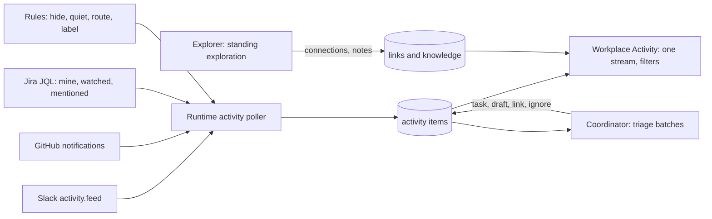

# Desk intelligence: proposal

## What the operator asked for (2026-11-02)

- Poll the activity APIs of Slack, GitHub and Jira at a cadence and stay on top of everything he should know about, as his own notification settings already define it.
- The coordinator acts on that activity proactively.
- The coordinator also explores the connected systems on its own, connects threads he would not have connected, and builds knowledge.
- The runtime owns this, not `remind_me` sweeps, so it works the same in the terminal; Workplace gives it the best interface.
- Activity shows one unified stream, with filters that people or agents can make.

## What exists today (checked 2026-11-02)

| Piece | State |
| --- | --- |
| GitHub notifications (`gh api notifications`) | Works. 50 unread now (36 review requests, 6 comments, 4 state changes, 3 author, 1 mention). `X-Poll-Interval: 60`, `Last-Modified` for cheap polling. |
| Jira (stored Atlassian token) | Works. JQL "assignee, reporter or watcher is me, updated in 7 days" returns 50 issues. |
| Slack (stored web session, `xoxc` + `d` cookie) | Expired: `invalid_auth`. Needs a new sign-in in Settings. With it, the web client's own `activity.feed` and `client.counts` are reachable: the feed is his Slack Activity tab, so it follows his Slack notification settings. |
| `ExternalThreads` in the runtime | Polls followed GitHub PRs/issues, watched repos and Jira issues into mail threads. The poll loop, cursors and commit-then-dispatch pattern are reusable. |
| Channel charters | A channel can have a listener with a standing policy; every post is pushed to it, and it wakes when away. |
| Schedules | Durable runtime mail on a cadence (`schedule_mail`). |
| Coordinator role | Slack sweep every 15 min and a morning brief, both by its own `remind_me`-style scheduling; never proven live. |

## Design

1. **Activity items, owned by the runtime.** One table of normalized items: source, kind (mention, reply, review request, assignment, comment, state change...), title, actor, time, link, short excerpt, and a conversation key that groups items about the same PR, issue or Slack thread. The poller runs each source on its own cadence (GitHub as its poll interval says, Slack and Jira each minute), commits cursors and items together, and never marks anything read outside.
2. **One stream in Activity.** Agent questions and finished work stay at the top; outside items join below, grouped by conversation, with source and kind filter chips and an unread state. Opening an item opens its page (PR, issue, Slack thread) in place where Workplace already can, otherwise in the browser.
3. **Rules.** A rule matches source, kind, place (repository, project, channel), person or words, and does one thing: hide, keep quiet (listed but no triage), route to a person, or label. The operator makes them from an item's menu ("Mute this repository", "Always send to the desk"); agents make them with a tool, and each rule shows who made it and why. Rules apply when an item arrives.
4. **The coordinator triages as items arrive.** New items that no rule quiets reach the coordinator as one batched message per poll, on its activity thread, waking it if it is away. For each item it does one of: answer or draft a reply in the desk, make or update a task, link the item to existing work, or let it pass with a one-line reason. Its decision is recorded on the item, so Activity shows "Task: Fix the webhook", "Drafted", "Linked to Review the schedules change" or "Passed: bot noise". This replaces the 15-minute sweep.
5. **Exploration.** A standing obligation, run on a schedule and whenever triage finds something worth following: read across the channels, repositories and projects the organization works in, find threads that are about the same thing (a Slack discussion, a Jira bug and a PR), and record each connection as a link with its evidence. Connections appear in Activity as their own kind and on the related threads.
6. **Knowledge.** What exploration learns that outlives one task (who owns what, how a system works, recurring problems) is written as notes, so later triage and exploration start from it.
7. **Same state everywhere.** Agents read the stream and make rules with native tools; the tmux sidebar can show the unread count; Workplace is the full interface.

## Build order

1. Runtime activity items plus the GitHub source (works today), shown in Activity with filters.
2. Jira source.
3. Slack source, after a new Slack sign-in.
4. Coordinator triage with recorded decisions; the role drops the `remind_me` sweep.
5. Rules, from the item menu and an agent tool.
6. Exploration, connections and knowledge notes.

Each step is usable on its own and is committed and activated before the next.
