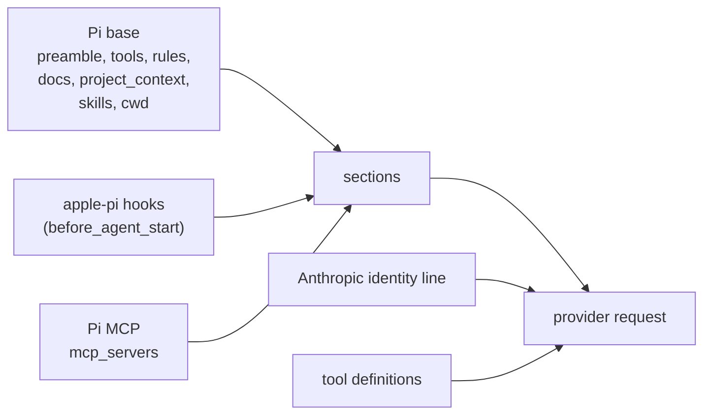

# The current system prompt

What the model receives today in a root session of this repository, captured from a real request rather than reconstructed from source.

- [system-prompt.md](system-prompt.md): the full system prompt, section by section, each with what writes it.
- [tools.md](tools.md): every tool definition sent with it.
- [system-prompt.txt](system-prompt.txt): the exact text, for diffing.

## Size

| | Characters | About |
|---|---:|---:|
| System prompt | 113,784 | 28,446 tokens |
| Tool definitions (87 tools) | 117,230 | 29,308 tokens |
| Together | 231,014 | 57,754 tokens |

Token counts are characters ÷ 4, an estimate.

## How it is put together

Pi builds the prompt from ordered, named sections (`buildSystemPromptSections` in `pi-coding-agent/dist/core/system-prompt.js`). It writes the base sections itself. Then, on every run, each extension's `before_agent_start` hook can add or replace a section in `systemPromptOptions.sections`. Pi wraps every section except the preamble in `<name>…</name>`. The transcript records the sections, and when one changes between runs Pi records only the change (`diffSystemPromptSections`). The provider still receives the whole prompt on every request, so a section whose text stays stable keeps the request prefix cacheable.



| # | Section | Written by | Characters | Tokens |
|---:|---|---|---:|---:|
| 1 | [`identity`](system-prompt.md#identity) | pi-ai, Anthropic provider | 57 | ~14 |
| 2 | [`preamble`](system-prompt.md#preamble) | apple-pi: system-prompt (Pi's text) | 169 | ~42 |
| 3 | [`cwd`](system-prompt.md#cwd) | Pi base | 51 | ~13 |
| 4 | [`tools`](system-prompt.md#tools) | apple-pi: system-prompt, from every tool (Pi's format) | 6,629 | ~1,657 |
| 5 | [`rules`](system-prompt.md#rules) | apple-pi: system-prompt, from every tool (Pi's format) | 15,517 | ~3,879 |
| 6 | [`docs`](system-prompt.md#docs) | apple-pi: system-prompt (Pi's text) | 1,379 | ~345 |
| 7 | [`pi-exec-peers`](system-prompt.md#pi-exec-peers) | apple-pi: pi_exec | 601 | ~150 |
| 8 | [`role-catalog`](system-prompt.md#role-catalog) | apple-pi: organization | 5,474 | ~1,369 |
| 9 | [`skills`](system-prompt.md#skills) | apple-pi: system-prompt, from Pi's skill discovery | 14,542 | ~3,636 |
| 10 | [`project_context`](system-prompt.md#project_context) | apple-pi: system-prompt, from Pi's context files | 52,501 | ~13,125 |
| 11 | [`project-learnings`](system-prompt.md#project-learnings) | apple-pi: notebook | 3,630 | ~908 |
| 12 | [`repo-rules`](system-prompt.md#repo-rules) | apple-pi: repo rules | 1,557 | ~389 |
| 13 | [`ledger-workbench`](system-prompt.md#ledger-workbench) | apple-pi: ledger | 983 | ~246 |
| 14 | [`wiki-workbench`](system-prompt.md#wiki-workbench) | apple-pi: wiki | 682 | ~171 |
| 15 | [`org`](system-prompt.md#org) | apple-pi: organization | 8,758 | ~2,190 |
| 16 | [`self`](system-prompt.md#self) | apple-pi: organization | 140 | ~35 |
| 17 | [`mcp_servers`](system-prompt.md#mcp_servers) | Pi base, native MCP | 701 | ~175 |

Pi offers three ways to own the prompt:

- **Replace the preamble:** `--system-prompt` or `customPrompt`. Pi then drops its own `tools`, `rules` and `docs`, and keeps `project_context`, `skills`, `cwd` and every extension section.
- **Replace one section:** an extension that sets a section of the same name in `before_agent_start` replaces it.
- **Replace everything:** `forceSystemPrompt`, or a `systemPrompt` returned from `before_agent_start`, sends that text alone.

## Sections this capture does not show

A fresh unroled root session does not get these; other sessions do.

| Section | Written by | When |
|---|---|---|
| `role` | apple-pi: organization | The role's charter, for a person hired into a role (`components/organization/src/session-role.ts`). |
| `manager` | apple-pi: organization | The management charter, for a person whose role manages. |
| `specialization` | apple-pi: organization | A focus within the role, when the person was hired with one. |
| `pair-protocol` | apple-pi: pair programmer | How to work with the pair, while the pair programmer is on. |
| `shell-output` | apple-pi: RTK | How RTK compresses command output, when `RTK_ENABLED=1`. |
| `addendum` | Pi base | Text from `--append-system-prompt`. |

## What changes from session to session

- **`org`** names the person (here a temporary one, in an empty organization made for the capture) and carries its id, its manager and its team channel. A person with a manager gets the reporting text; a root gets the manager tools text.
- **`self`** is empty for a new person. A long-lived person's self runs to several thousand words.
- **`pi-exec-peers` and `role-catalog`** appear only for people who manage: roles that manage, and unroled organization roots.
- **`project_context`, `project-learnings`, `repo-rules` and `cwd`** follow the repository. Outside this one, the repository's `AGENTS.md`, `.pi/LEARNINGS.md` and `.pi/rules/` are different or absent.
- **`mcp_servers`** lists the MCP servers that are connected. Their descriptions arrive while the servers connect, so an early request can list a server without its description.

## Provider differences

The same session on `openai/gpt-6.1-sol` gets the same sections (113,727 characters), with these differences:

- no Anthropic identity line;
- the core tools keep their lower-case names (`read`, `bash`, `edit`, `write`, `task`);
- the tool definitions travel in the input as an `additional_tools` item (87 tools) rather than in a `tools` field.

## Not in the system prompt

These reach the model as messages during a session, not as part of the system prompt:

- mail, channel posts and task notices from the organization;
- the pair programmer's findings and the notebook's learnings list (after each compaction);
- reflection prompts (change reflection, learning reflection, self reflection);
- `.context/<path>.md` files, appended to `read` results;
- skill files, read on demand;
- repo-rule and context-gate refusals, as tool results.

## How to capture again

```sh
node .ledger/202611032038-custom-system-prompt/current-prompt/capture.mjs
node .ledger/202611032038-custom-system-prompt/current-prompt/render.mjs
```

`capture.mjs` runs the installed `pi` in RPC mode in this repository with a temporary agent directory. That directory links to the real configuration (settings, `AGENTS.md`, skills, model profiles, roles, MCP) but has its own empty `state/` and `sessions/`. The capture session therefore runs in its own runtime and database and does not join the operator's organization. A one-line extension writes the `before_provider_request` payload to disk and throws, so no request is sent and no model is billed. The script stops the runtime it started and removes the temporary directory. `render.mjs` turns the two payloads in `capture/` into these files.
