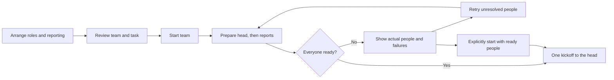

# Org chart and team setup

This records the original Org delivery at build39. Later Workplace iterations changed the launch default to Chat, added optional initial goals and refined naming/history interactions. [The current Workplace contract](../../../docs/workplace.md) owns those subsequent behaviors; the decisions and evidence below describe the original delivery.

Status: implemented, committed and activated. Build39 contains the team overview, fitted top-down focused chart, compact recorded work summaries with explicit history expansion, global metadata search, direct reporting confirmation and explicit profile Close. Focused checks passed, including Org 9/9, targeted profiles 2/2 (30 unrelated skipped), actual Electron, byte freshness and final Node/web typecheck. Runtime `34e57b59` and integrated app `7d7c3e30` are committed. The operator approved daemon activation and app relaunch; all 11 Pi processes and socket bridges survived, reporting/hire dates were preserved and 21 whole-team channels initialized. See evidence.md for logs and limits. No live test team or paid-model startup was used for validation.

## Decision

Build the approved Org tab described below. The operator chose **plan before starting**, **move across teams and split branches**, and **give the whole tree a shared channel**.

The implemented runtime work-safety rule is: **a reporting change must not newly strand unfinished assignments outside their task's organization.** Show the blocking work and require completion or an explicit handoff first, rather than silently changing or dropping it.

## Terms used here

- **Organization:** one independent reporting tree. Its **head** has no manager; another independent head means another organization.
- **Branch:** a person and everyone who reports to them, at any depth. Moving a branch keeps its internal reporting lines.
- **People at home:** existing teammates whose Pi processes are stopped, not people removed from the organization.
- **Task organization:** a task keeps its recorded organization head as its reference. Its current organization is the tree that head belongs to. Moving an individual assignee does not move that reference or reassign the work.

## Team overview, then one focused chart

Org sits beside Chat and Mail and shares their light/dark palette, avatars, compact status and profile pane. The operator rejected both the initial all-tree horizontal forest and the intermediate vertical outline. The current revision starts with a responsive overview, then opens one conventional top-down chart fitted to the selected team's viewport. Include people at home; keep temporary program peers and former/departed people outside the editable roster. The human operator is not invented as a Pi session or universal manager. Main World remains the app's default entry.

- Click a real person to open their existing profile, without reading or acknowledging their conversation.
- Open one team, pan its chart, zoom, fit and collapse branches. All teams returns to the overview; zoom/pan remain local to the selected chart.
- Drag onto an eligible manager to propose a reporting change. A manager's branch travels with them. Highlight valid targets; also offer a Reports to control without dragging.
- Selecting another manager or **Independent** in **Reports to** opens the confirmation directly. Cancel restores the actual manager selection. Dropping on ordinary empty canvas changes no reporting line.
- Keep roles and capabilities truthful. New team heads use managing roles; moving a nonmanaging role to the top does not grant it manager tools.

## Work gives teams context

Use actual registered task history, not an activity score. Overview cards and focused teams show compact recorded-team summaries with explicit View recorded work expansion. This leaves room for the focused chart until the operator opens the history. Team history uses recorded task anchors, while profiles show individual assignment participation across organizations. A finished assignment is distinct from a completed task. Global search uses current snapshot metadata across people, teams and work; reading task content remains an explicit action. The shared profile has a visible Close control. These observational views do not read transcripts or acknowledge conversations.

## Build the team for the work

Keep **Add person** separate from **New team**. Add person uses the existing immediate recruit/lifecycle path; it is not a planned-team position awaiting Start team. The immediate form uses catalog role, optional name, repository and concrete goal; uncertain starts retain the returned identity rather than offering a duplicate hire.

**New team** creates a clearly labelled draft. Choose a head role, repository and task; add positions from the actual role catalog, including several of one role; arrange their reporting lines. Show each role's mandate and whether it manages, writes or advises.

For example, assemble a coordinator, two implementation engineers, three selected quality roles and an architect. Planned positions open role/goal details, not invented personal biographies or hire dates. Optional names become real only when hired.

Support existing people too. Selecting a manager includes their branch. An existing person staged into an unstarted team still belongs to their live team until the change commits; show that distinction. Review which people will be hired, moved or called in, and each person's real goal before starting.

Drafts survive switching tabs. Closing/reloading discards unstarted plans, like the application's existing drafts. Reusable saved team templates are outside this pass.

## Start once, show what actually happened

Validate roles, managers, directory, identities, cycles and work blockers before opening processes. Prepare the head before reports so their tasks belong to the intended organization. Each new person gets real work context; avoid fake waiting assignments.

Before Start team, staged existing people stay in their current teams. After Start team, preparation is progressive, not one all-or-nothing transaction: when a planned manager is ready, commit the corresponding existing branch move or prepare its new report, then continue downward. Revalidate every move. Each applied change is live immediately; a later failure keeps those people and reporting changes intact. The progress view names what moved and what remains pending. This ordering also keeps newly assigned goals in the correct organization.

Use ordinary lasting-person starts with their automatic opening prompt withheld. Establish reporting and channel membership, then send **one automatic kickoff to the head** when the intended team is ready. Reports receive concrete work through the head's existing assignments and correspondence; the setup action does not launch every person's model at once.

This is not a universal pause: normal live mail and deliberate Chat/terminal instructions retain their existing behavior. Show someone already active rather than interrupting them or claiming they remained paused.

Before Start team, disclose that it joins the operator as a pull participant in the resulting whole-tree channel. Use the existing channel_membership command; joining does not read history or advance its cursor. This enables operator-authored readiness posts under ordinary membership rules, without an access bypass.

If startup is partial, show actual people, connections and failures. Retry under the same identities without duplicate goals or roles. A dropped connection means uncertain outcome, not confirmed failure. Reconcile receipts and actual incarnations before retrying. Default to waiting for the full team; offer **Start with ready teammates** only as an explicit choice after reviewing failures. Keep kickoff idempotent and address it only to the head, with the goal and initial ready-person roster. Compare late readiness against that roster and prior notices, not incarnation timestamps. If the operator started with a subset and a later retry makes more people ready, post an aggregate readiness update through its whole-tree channel, mentioning only the head. Report IDs/names stay out of the body so they do not accidentally trigger report turns; identities belong in the idempotency key. This is not a second kickoff. Closing the app does not delete people already created or roll back their work.

## Reporting changes preserve work

Changes use operator `organization_move { person, manager: string | null, branch: string[] }`; existing agent `move` stays limited to its own organization. Expected branch IDs describe the lasting people shown by Org. Temporary identities cannot be selected directly; hidden temporary descendants follow their parent and remain included in cycle/work checks. A confirmed boundary-changing move names the branch, old/new heads, channel changes and any blockers. Revalidate against current state before committing; stale drags must not move unexpected additional reports.

| Action | Result |
| --- | --- |
| Reparent inside one team while someone works | Keep tasks, focus and running work; change reporting and channels. |
| Move an entire organization under another head | Carry its people and original head together, so its task ownership remains connected to them; preserve historical records. |
| Split or transfer part of a team | Permit when unfinished assignments remain valid in the resulting organizations; otherwise show work requiring handoff. |
| Self/cycle, incapable manager, departed person or stale structure | Refuse with an actionable reason; keep the real chart unchanged. |

For example, Maya holds unfinished work belonging to Team A. Moving Maya alone to Team B would leave her assignment outside the task's organization. Finish the work, or explicitly unassign Maya and assign that same task to someone remaining in Team A through the existing work commands. The task's goal, files and recorded organization stay the same; changing its assignee is the handoff. Moving the task itself needs a separate work decision, not a reporting gesture. Moving Team A's head and everyone under it into Team B keeps the original head with its people and tasks, so it does not create that separation.

Splits must survive reconnect/call-in: a recorded null manager means intentionally independent, not permission for an old launch flag to reattach the person. Prompt identity, management capability and close notices follow the recorded structure. No move changes role, known hire date, task ownership or past history silently.

## Channels and person actions

The implemented whole-tree channel is `organization:<head-id>`; its ordinary membership follows the head's full lasting branch, including people at home. Temporary program peers stay outside its membership. Local manager/direct-report channels retain their `team:<manager-id>` IDs. Preserve history, cursors, audience events and explicit invitations. Keep existing manager/direct-report channels. The operator observes or explicitly joins through the current controls.

If an independent head moves under another head, retain its channel for its branch and add the branch's people to the larger team's channel. On a split, a branch keeps its existing local manager channel and that conversation history. It gets a separate whole-tree channel if its head has none, or reuses that head's existing whole-tree channel. Messages from the old organization's whole-team channel stay there; splitting does not copy or erase them. Structural edits reconcile ordinary membership while preserving explicit invitations.

**Send home / Call in** remain available through existing World controls, with their lifecycle behavior and busy-turn confirmation. They are outside the current requested Org UI lane, not a core completion blocker. Home keeps the person's reporting position and channel membership. Permanent departure remains a separate handoff operation.

## Delivery and proof

First make the actual Org entry usable with real trees/profiles and planned-role manipulation, labelling unconnected actions honestly. Then connect tested runtime reporting/channel operations and controlled startup. Keep the operator's chance to try the canvas ahead of supporting ceremony.

Acceptance:

- Several independent, nested and sleeping-person trees work in the real Electron host; Chat/Mail, drafts and read state retain their contracts.
- Drag and keyboard operations share validation. Cross-team moves, merges and splits preserve identity, work, hire dates and reconnect behavior.
- Planning opens no processes. Startup creates the intended people, structure and channel, with one head kickoff; failures/retries duplicate neither people nor assignments/kickoffs.
- Both themes exercise real chart states: profile, draft, valid/invalid drop, pending operation and failure. Check rendered geometry as well as behavior.
- Use focused tests with one worker and isolated state. No live validation hires/messages or full suite. Announce any required live daemon activation separately.

## Implemented source and current proof

[evidence.md](evidence.md) owns the focused check index, logs, screenshots and outstanding validation. These are bounded checks, not a full-suite or live-workplace claim.

The world snapshot supplies multiple roots, dormant people and authoritative temporary identity metadata. Existing lifecycle commands supply recruit/wake/close; the API supplies roles/profiles. `backend/org.ts` composes ordinary runtime commands through query-only reads, without another launch runtime or people/task store. Public Org types and Electron IPC source are on disk. Runtime `organization_move` supports cross-root moves and null splits with lasting-branch stale checks and full temporary-work safety. Hello and call-in retain an intentional null. Whole-tree channels coexist with local channels.

Current startup safety includes editable preflight rejection only before any recorded setup action; prepared role/directory/goal consistency; start and readiness receipt queries restricted to their command kinds; and initial-ready roster recovery. The actual-runtime test now proves the roster-bearing kickoff reaches only the head and late readiness does not reach the report. The latest controller/API and integrated typecheck results are indexed in evidence.md; earlier passing runs do not prove later source revisions.

Renderer reload loads only new renderer code; main/backend history API changes require fully quitting and relaunching Agent World. That does not stop Pi sessions but clears memory-only drafts. The shared runtime daemon is a separate activation boundary.

No live test-team startup or validation messages were performed. Controller preflight still refuses a missing whole-tree channel capability on an old daemon and reports restart requirements. After explicit operator approval and a fresh no-owned-children/no-pending-control preflight, the integration owner activated the daemon and relaunched the app; evidence.md records process and socket verification. Future daemon restarts retain that separate operational safety boundary.
