# apple-pi 🥧

This repository is my personal coding harness built on top of `pi`. It is not a product, a VC-backed framework seeking adoption, or a generalized starter kit for "agentic workflows." It is the cumulative result of spending months living inside terminal-based coding agents, hitting the exact same failure modes every afternoon, and building the mechanical back-pressure required to make them stop.

If you are looking for a zero-config wrapper that promises to turn your terminal into an autonomous software company while you sip an oat milk cortado on the beach, you are in the wrong place. If you spend six hours a day in `tmux` arguing with language models over diffs, and you want to inspect how another practitioner solved context rot, tool-call thrashing, unverified mutations, and subagent amnesia, read on.

I publish this in the spirit of **closed to pull requests, open to remix**. The code is here so you can inspect the decisions, steal the patterns, or point your own agent at this repo to extract what you need.

---

## What Working This Way Taught Me

I used to think the primary bottleneck in AI-assisted software engineering was model weights—that if we just waited for the next frontier checkpoint or wrote a sufficiently surgical `AGENTS.md`, the model would stop hallucinating imports, stop nuking adjacent functions, and remember why we rejected an architectural approach forty minutes ago.

That belief survived right up until the sessions got long and the codebases got real.

The models stopped being the primary constraint a long time ago. Language models are mirrors of operator skill and harness design. When an agent spirals on turn thirty-five, it is almost never because the underlying transformer lacks reasoning capacity. It spirals because **prevailing agent harnesses treat the model like an oracle and the context window like a dumpster.**

Think of an LLM's effective context window not as a 200k-token hard drive, but as RAM in an IBM 8086 XT. It is a scarce, volatile, high-contention resource. Yet watch how a standard coding agent operates: every raw `stdout` dump, every 4,000-line test trace, every 128-tool MCP schema, every dead-end file exploration, and every half-baked subagent tangent gets shoveled straight into the main transcript.

In DJing, there is an old saying: *if you are redlining the mixer, you aren't headlining.* Push the gain into the red and the audio clips into mud. The exact same physics apply to autoregressive models. Once you redline the context window past its effective attention threshold—or let a bad assumption pollute the prefix—the model becomes an autoregressive queen of failure. Every subsequent token is conditioned on the garbage already in the window. Once the bowling ball is in the gutter, no amount of screaming `"CRITICAL: DO NOT MAKE MISTAKES"` in the system prompt will bring it back onto the lane.

The industry’s standard response to this is either prompt superstition (selling influencer "skill packs" and bloated system instructions) or rigid orchestration DAGs that trap you in someone else's state machine. Both miss the root cause:

> **Software engineering with agents is no longer about typing syntax; it is about engineering back-pressure into the generative loop.**

When I audited my own discarded experiments and broken sessions, a single governing standard emerged: **if a constraint matters, it cannot live solely in the prompt.** Prompts are suggestions to a stochastic process. If a boundary actually matters, it must be enforced mechanically—at the tool-call gate, the execution sandbox, the epistemic fold, or the git worktree.

---

## System Topology at a Glance

Before diving into the arguments behind each subsystem, here is how the pieces fit together during a live session. The harness is organized around four concentric concerns: **Ingress & Mutation Back-Pressure**, **The Execution Substrate**, **Asynchronous Bicameral Oversight**, and **Epistemic State & Recall**.

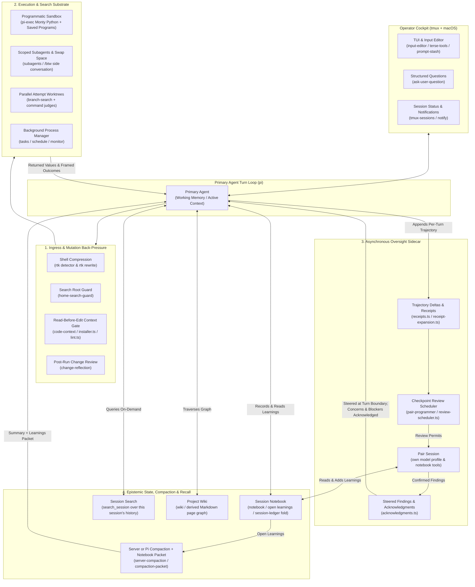

---

## Out of the Terminal: Pages for the Moments That Need a Human

Everything above keeps the *model's* attention clean. This section is about the other half of the loop: the moments where I have to judge, sign off on, or genuinely understand what the agent did. Those moments are visual, and a terminal is a hostile place for them. A nine-hunk change reviewed as a `git diff` scroll, a spec signed off by squinting at raw Markdown in a pager, a ticket graph reconstructed by grepping `Blocked by:` lines: that is how judgment quietly degrades into rubber-stamping.

So the harness grows a second surface. Four tools open a purpose-built page in the browser: one tool call, one self-contained HTML file, served on `127.0.0.1` behind a token (`components/browser-pages`). The division of labour is the whole trick. **The agent supplies the structure from what it knows; the page supplies the truth from git and disk.** The agent can tell the story of a change, order it, annotate it, and quiz me on it, but every line of code on the page is read by the server, so it can neither hide a hunk nor invent one.

I never call these tools by hand. I ask in plain words ("walk me through this branch", "let me sign off on the spec"), or the agent opens a page itself when its work needs my judgment. The three review tools wait until I press **Finish review** and return my feedback as their result; `explain_change` returns at once and leaves the page open for me to read.

### `review_code`: The Change as a Story

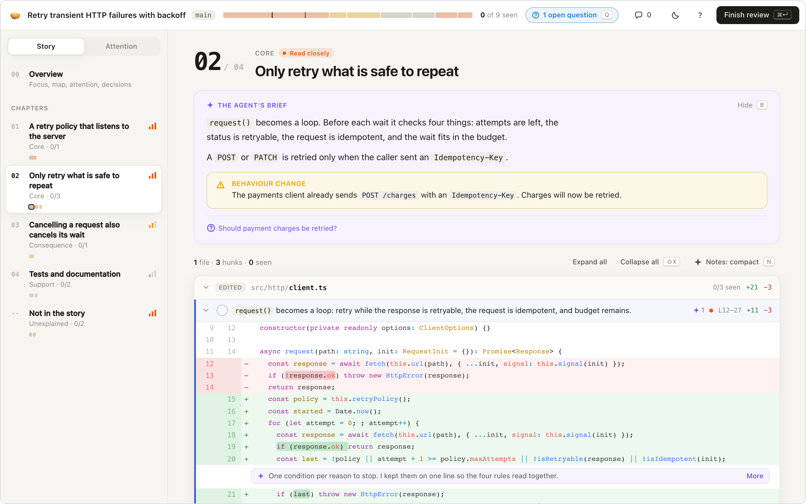

A raw diff is a pile of files in alphabetical order. `review_code` makes the agent tell the change the way it reasoned about it: chapters (core first, consequences next, tests and docs last), a brief for each, notes pinned to the lines where the code cannot speak for itself, and decisions for the judgment calls I may want to override. The server reads every hunk from git (`git-diff.ts`) and highlights it with Shiki (`highlight.ts`); any hunk the agent did not place lands in **Not in the story**, so a narrative can never launder a change past me. `J` and `K` step through hunks, `↵` marks one seen and moves on, and `A` **asks the agent** about the focused hunk without leaving the page: a read-only fork of the live conversation answers inline (`ask-agent.ts`). My verdict, line-anchored comments, and decision answers come back as the tool's result.

### `review_markdown`: Annotate the Document, Not a Diff of It

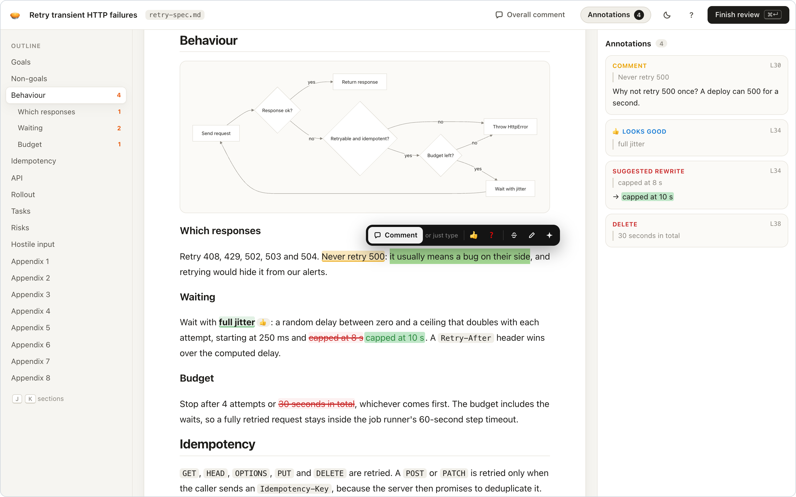

Specs and plans deserve to be read rendered, not reviewed as patches. The page shows the document as a document (outline, highlighted code, tables, GitHub alerts, Mermaid diagrams), and feedback means selecting text: comment (or just start typing), 👍 or ❓, strike it, suggest a rewrite as a tracked change, or rewrite a whole block and leave the diff for the agent. Every annotation returns with its `path:line` and the exact quote, and the file itself is never touched. Untrusted Markdown never runs script in a page that holds the session token (`render.ts`).

### `review_ledger_task`: The Shape of the Work

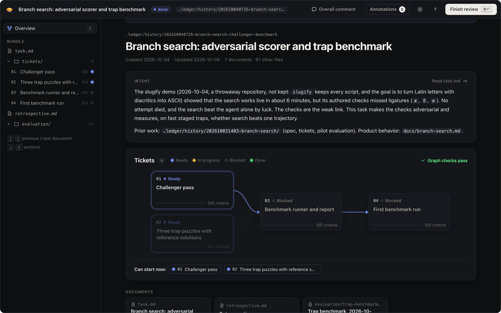

A ledger task is a folder of documents plus a dependency graph that only exists in prose. `review_ledger_task` reads the whole bundle and draws that graph: tickets in columns by dependency depth, the tickets that can start now ringed, and a hover lighting everything a ticket waits on and everything waiting on it. Graph checks catch what the `to-tickets` skill must never produce: a blocker that is not in the bundle, a blocker numbered after its dependent, a cycle, a graph with nowhere to start (`tickets.ts`). Every document opens in the same annotation reader, evidence files load only when opened, and the result tells the agent which documents I never opened, so it knows exactly what my approval does not cover.

### `explain_change`: Understanding Is the New Bottleneck

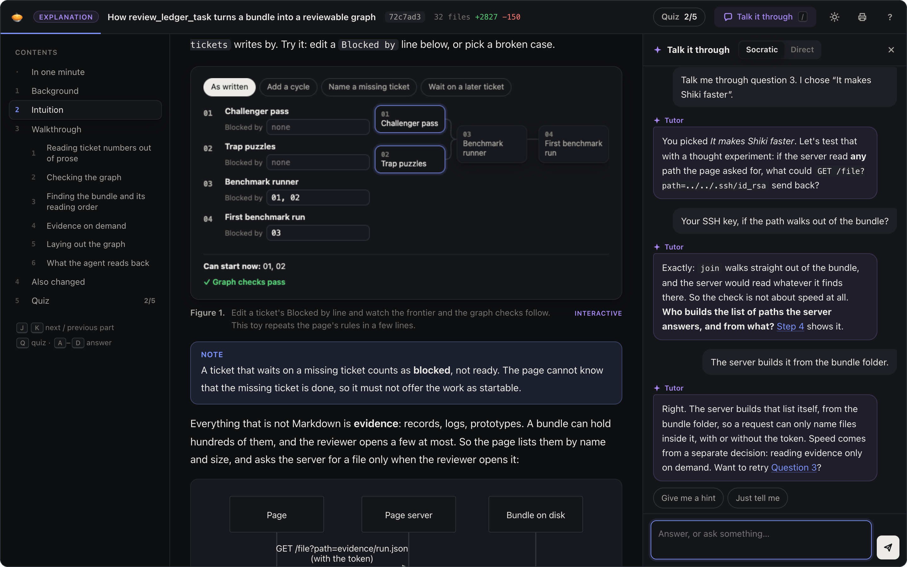

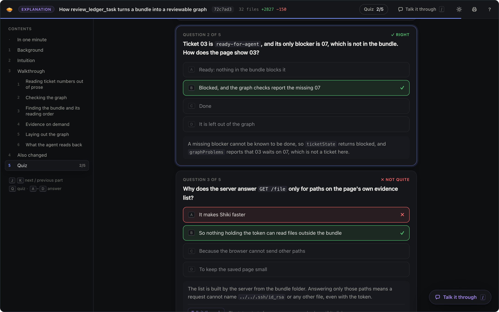

Geoffrey Litt put it better than I can: [understanding is the new bottleneck](https://www.geoffreylitt.com/2026/07/02/understanding-is-the-new-bottleneck). Verifying an agent's work is a thumbs-up or a thumbs-down; *participating* in what comes next requires actually understanding the system it just changed. `explain_change` turns any change (uncommitted work, a branch, or any commit or range in history) into an explanation packet: background with a primer for newcomers, intuition before details (toy data, Mermaid, and sandboxed interactive figures with no network access), a literate walkthrough over real lines from git, a list of every file the walkthrough skipped, and a five-question quiz written so that a skimmer fails and an understander passes.

The quiz is a speed regulator; the sidebar is a tutor. While the session lives, **Talk it through** opens a Socratic conversation with the agent that wrote the explanation: it answers with questions, offers hints before answers, starts from the misconception behind a missed question, and links back to the step that holds the answer. When I leave the page, a note of what I missed and what I asked waits for the agent's next turn.

**Every page is also an artifact.** Each one is saved as a single self-contained HTML file under `~/.pi/agent/artifacts/`, ready to attach to a pull request or a Confluence page. And every page degrades gracefully: opened without a live session behind it, a page hides whatever needs the agent and reads as a plain document. A shared explanation keeps its figures and its quiz; a saved review keeps its verdict. The full contract lives in [`docs/browser-pages.md`](docs/browser-pages.md).

---

## Deep Dive: Subsystems, Mechanics, and Emergent Implications

Every directory in `components/` exists because a specific recurring dysfunction forced me to write it. Below is how each subsystem works in the source code—followed by what happens when these mechanisms compound in practice.

---

### 1. `pi-exec`: From Tool-Call Thrashing to an Accumulating Executable Vocabulary

#### The Observed Dysfunction
Standard agent tool-calling is an absurdly chatty request-response protocol. To answer a moderately complex question about a codebase, the model emits a JSON tool call (`grep`), the harness dumps 400 lines of raw text into the transcript, the model reads it, emits a `read` call, gets another 300 lines, emits another `grep`, and repeats this twenty times.

You are using a frontier reasoning model as a $15-per-million-token `for`-loop. Worse, every intermediate false start is permanently etched into the conversation history, pushing the context window toward the redline before the agent has written a single line of production code.

#### The Mechanical Response (`components/pi-exec`)
Instead of forcing the model to chain individual tool calls across twenty round-trips, `pi_exec` gives the agent a bounded, type-checked Python runtime: a subset of Python executed by Monty in a worker subprocess (`program.ts`, `guest-api.ts`, `guest-functions.ts`), whose tool calls are served by the host harness (`host-calls.ts`). It has no third-party imports and no ambient Node or OS access, and every call shares explicit call, concurrency, agent, and wall-clock budgets.

1. **Host Tools as Awaitable Python Functions (`callable-tools.ts`, `core-tools.ts`):** Inside a single `pi_exec` snippet, the model can `await` host tools (`read`, `grep`, `bash`, MCP tools, or other extension tools), run independent calls concurrently with `asyncio.gather`, filter the results in Python memory, and discard the intermediate noise. Extension, MCP, and active core tools other than `bash` run through Pi's normal tool pipeline, so their hooks and guards still apply.
2. **Subagent Workers as Futures (`agent-workers.ts`, `worker-return.ts`):** A Python snippet can spawn scoped model workers, pass them structured context, await their completion, and programmatically inspect their status records or schema-shaped return values.
3. **Compact Results, Evidence Helpers, and Checkpoints (`evidence.ts`, `checkpoint.ts`, `envelope.ts`):** Only the snippet's last expression, which must be JSON-compatible, and its captured `print` output enter the conversation. Optional evidence helpers (`evidence.ts`) collect scoped Git changes and relevant tests, the interpreter's state is checkpointed along Pi's session tree (`checkpoint.ts`), and `envelope.ts` defines the resource limits each call runs under.
4. **Saved Programs (`saved-programs.ts`):** In a trusted project, a `.pi/programs/<name>.py` file with a leading docstring and `@param` tags (`python-schema.ts`) is registered as a `program_<name>` tool, turning a useful snippet into a named, reusable workspace procedure.

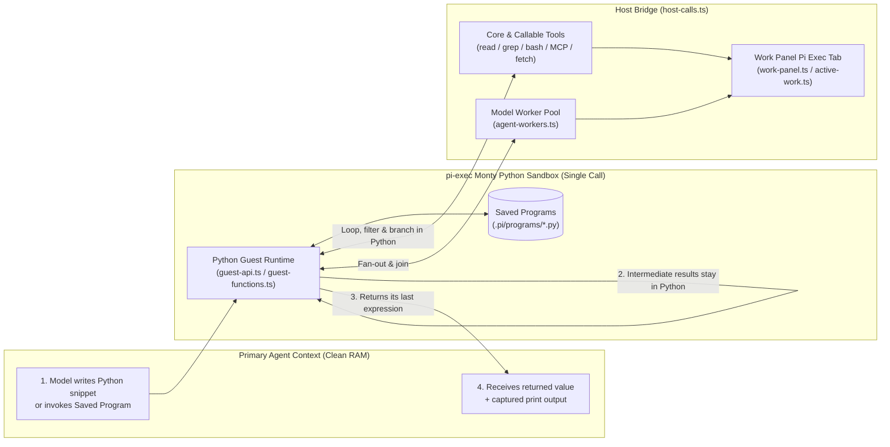

#### The Extrapolated & Emergent Implications
When I first wired `pi-exec`, I thought of it merely as a token-saving batch runner. In sustained use, three much larger behaviors emerged:

* **The Workspace Grows an Executable Vocabulary:** There is an old Lisp ideal where you grow an application by talking to it: you write a function, register it in the image, and never have to re-derive that capability again. Saved programs bring a version of that dynamic to the coding harness. When an agent writes a Python program to trace SQLMesh lineage, audit BigQuery schema drift, or verify Looker dashboard references, and it is saved to `.pi/programs/`, **ad-hoc reasoning crystallizes into a reusable tool**. Three days later, the agent doesn't "think" about how to audit the schema; it calls `program_<name>`. The repository accumulates its own library of project procedures through daily work.
* **Data-Dependent Work Graphs:** Static multi-agent frameworks force you to define orchestration graphs *ahead of time* in YAML or TypeScript. Because `pi_exec` exposes model workers inside Python, the model can synthesize **dynamic, data-dependent work graphs on the fly**, within Monty's Python subset and the call's budgets. A single 35-line snippet can parse a dependency tree, spin up five parallel workers for the leaf nodes, run a deterministic test suite as a barrier step, and conditionally spawn a repair worker only for the branch that failed—while the Pi Exec tab of the `/work` panel shows each host call as it runs.
* **Epistemic Compression:** Because the Python snippet acts as a loss-absorbing membrane between the messy filesystem and the primary context window, the root agent's transcript stays almost eerily quiet. A program can grep through megabytes of logs and return a few counts and excerpts; only what it returns or prints enters the context, so the program has to do the reducing.

---

### 2. `notebook`, `server-compaction`, & `session-search`: The Epistemic Fold

#### The Observed Dysfunction
Every long coding session eventually hits the wall. When the context window fills up, a harness typically falls back on one of two things, and both can fail:
1. **FIFO Truncation:** Drop the oldest messages, which immediately lobotomizes the original architectural constraints and causes the agent to re-introduce bugs you fixed an hour ago.
2. **Naive LLM Summarization:** Ask a cheap model to "summarize the conversation so far." This produces three paragraphs of corporate mush (*"The user and assistant discussed refactoring the authentication module and encountered several test failures..."*) that strips out every exact file path, falsified hypothesis, and subtle invariant.

#### The Mechanical Response (`components/notebook`, `components/server-compaction`, `components/session-search`)
`apple-pi` does not replace compaction with its own summarizer. It moves compaction to the provider's server where the provider supports it, keeps a separate notebook of hard-won learnings that survives every compaction, and gives the agent a search tool over the session's full history:

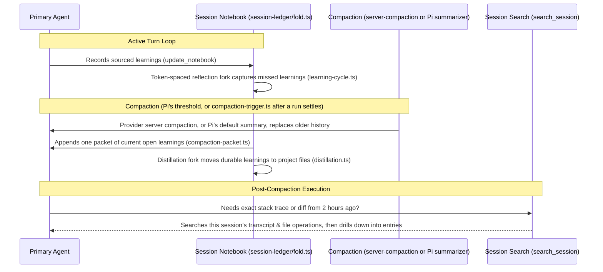

* **The Session Ledger (`components/notebook/src/session-ledger/`):** The notebook stores sourced observations and reflections in Pi's append-only session JSONL; `fold.ts`, `progress.ts`, and `sources.ts` fold them into the current set of open learnings and the transcript entries that support each one. Retired learnings stay recallable through `revisit_note` but are no longer live guidance. This ledger holds learnings, not task progress: status and plans belong to the `.ledger/` task workbench, docs, and git.
* **Two-Tier Learning Distillation (`hooks/learning-cycle.ts`, `hooks/open-learnings.ts`, `hooks/project-learnings.ts`, `distillation.ts`):** Discoveries made mid-session ("`WorkManager` requires an exclusive lease before mutating shared state") are captured first as open learnings, which last for one session. Distillation runs after each compaction, at ledger close, and on `/distill`; it moves a durable learning into a machine-owned project file—`.pi/LEARNINGS.md` (which `project-learnings.ts` loads into every root session's system prompt), a `.wiki/` page, a ledger task's `retrospective.md`, a reusable `.pi/programs/` composition, or a source file's context file—and retires it.
* **Compaction and the Learnings Packet (`hooks/compaction-packet.ts`, `components/server-compaction`):** Compaction has one hook owner, `server-compaction` (`anthropic.ts`, `responses.ts`, `convert.ts`, `hooks.ts`). On OpenAI (API key and Codex sign-in), xAI, and Anthropic it compacts on the provider's server and replays the newest result on later requests; every other route falls back to Pi's default summarizer. `extensions/auto-compact.ts` loads `extensions/compaction-safety.ts`, which aborts the run before the next provider request when an automatic compaction fails or is cancelled. The notebook may also request a compaction after a run settles past its token threshold (`compaction-trigger.ts`), and right after every compaction it appends one persisted packet of the current open learnings. The packet supplements the compacted history; it does not replace it.
* **Out-of-Band Recall (`components/session-search`):** Because compaction removes raw historical turns from working memory, the agent gets a dedicated search tool, `search_session` (`tool.ts`, `search-entries.ts`), over this session's persisted conversation, tool calls, and write/edit payloads. It follows the active branch by default (`lineage.ts`), can include other branches, can be scoped to file touchpoints (`recall-scope.ts`), and supports progressive `drill-down.ts` into the exact entry an event occurred in.

#### The Extrapolated & Emergent Implications
* **Anti-Fragile Long Horizons:** In a normal harness, an agent gets *dumber* the longer a session runs because signal-to-noise degrades monotonically. Here, a compaction cycle loses less of what matters. The compaction summary handles conversation history, the learnings packet keeps the falsified conclusions that were recorded as open learnings ("Approach X failed because of Y") right after it, and the dead-end `stdout` exhaust is gone from the window but still searchable through `search_session` when an exact detail matters again.
* **The Death of "Cold Start" Amnesia:** Because distillation writes durable learnings into `.pi/LEARNINGS.md`, wiki pages, and retrospectives, and coding subagents receive snapshots of the primary session's open learnings and add their own to the same notebook (`subagent-notebook-e2e.test.ts`), the harness stops acting like a contractor with an 8-second memory. A mistake made on Tuesday afternoon can become a standing instruction on Wednesday morning.

---

### 3. `pair-programmer`: The Bicameral Sidecar & Automated Back-Pressure

#### The Observed Dysfunction
When an agent is deep inside an implementation loop, it suffers from tunnel vision. Autoregressive models have strong forward momentum: once they commit to a flawed plan and edit three files, they will happily spend the next ten turns weakening test assertions or adding hacky workarounds to defend their sunk cost.

The obvious fix—putting a synchronous "Critic Agent" in the middle of every turn—is a UX disaster. It doubles time-to-first-token, stalls interactive flow, and usually results in two models politely agreeing with each other's hallucinations.

#### The Mechanical Response (`components/pair-programmer`)
`pair-programmer` (`extensions/pi-pair.ts`) decouples execution from critique by running an **asynchronous pair programming partner** in its own session, on the user-global `pair` model profile. No main-agent turn waits for it. Its usage, and that of the consultant it can ask for an independent opinion, is recorded (`components/shared/src/sidecar-usage.ts`) and shown by `/pair status`.

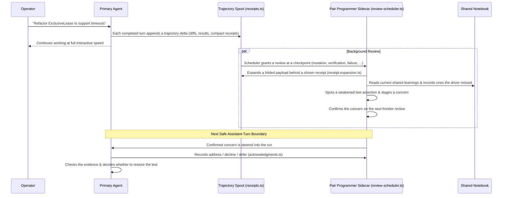

1. **Trajectory Deltas & Selective Expansion (`receipts.ts`, `receipt-expansion.ts`):** Each completed primary turn appends one delta to the pair's spool: the main agent's reasoning, text, tool calls, successful write previews, edit diffs, failures, and compact receipts for large payloads folded out of view. The pair expands a receipt (`receipt-expansion.ts`) only when the folded evidence could change its judgment. It cannot navigate the repository, search the transcript, or run commands.
2. **Checkpoint Review Scheduling (`review-scheduler.ts`, `session.ts`):** Reviews run asynchronously at meaningful checkpoints—the first step after new user direction, entry into mutation or verification, other phase transitions, a delegated result, a failure, unseen terminal evidence, frontier confirmation—plus a starvation safeguard after five active minutes or about 8,000 new trajectory tokens. Consecutive steps accumulate instead of producing one review each, and the primary turn loop never blocks.
3. **Notes, Delivery, and Acknowledgments (`acknowledgments.ts`, `escalation.ts`):** When the pair catches a smell—an unverified edge case, a learning the driver is ignoring, or a rationalization loop—it stages a `nit`, `concern`, `blocker`, or `question`. A finding it confirms on the next review is steered into the primary run at the next safe assistant-turn boundary. For each delivered concern or blocker, the main agent records consideration with `acknowledge_pair_findings` (`address`, `decline`, or `defer`, with a reason); the host sends one reminder after the run settles and then records any still open as unacknowledged. Separately, `escalation.ts` asks the consultant to investigate when the same bash command fails three times in recent work.

#### The Extrapolated & Emergent Implications
* **Bicameral Mind in a Single Terminal:** Human pair programming works because the driver is focused on *tactical syntax* (the next 5 lines) while the navigator is focused on *strategic invariants* (the system design). A single LLM context window cannot hold both postures simultaneously without blending them into mediocrity. The `pair-programmer` sidecar runs in **its own session with its own instructions**: it reads the driver's trajectory as an observer, not as the author of the plan, so it has no sunk cost to defend.
* **Cheap Fast Drivers + Deep Asynchronous Judges:** Because the pair always uses the user-global `pair` profile (resolved through `model-profiles.ts`), it can run on a different model than the primary. You can run a fast, high-throughput model as the primary driver for rapid edits while the background `pair-programmer` reviews the trajectory on another model and taps the driver on the shoulder only when it confirms the driver is drifting toward a cliff. The driver keeps the wheel.

---

### 4. `code-context`, `change-reflection`, `home-search-guard`, & `rtk`: Boundary Back-Pressure

#### The Observed Dysfunction
If you put a rule in `AGENTS.md` saying *"Always read a file's notes before editing it,"* the model will obey it for the first ten minutes. By turn twenty, when it is chasing a failing test, it will ignore the prompt and blind-patch the file anyway.

#### The Mistake I Made First
I originally over-engineered this. I built pre-flight context injection pipelines that tried to anticipate what the model was about to touch and silently stuff the relevant docs into the prompt behind the scenes. It was brittle, opaque, and wasted tokens on false positives.

#### The Mechanical Response: Block-and-Retry (`components/code-context`)
I ripped out the clever pre-computation and replaced it with a blunt **read-before-edit gate** (`components/code-context/src/installer.ts`), backed by per-file **context files** at `.context/<path>.md`. Reading a file delivers its context file with a hash marker, and that marker in the model's context is what the gate checks.

```mermaid
stateDiagram-v2
    [*] --> EditAttempt: Agent calls top-level edit / write on a file
    EditAttempt --> GateCheck: code-context intercepts tool call

    state GateCheck <<choice>>
    GateCheck --> Blocked: Context file exists and its current marker is not in context
    GateCheck --> Permitted: No context file, or its current marker is already in context

    Blocked --> ReadContext: Tool call FAILS with an instruction to read<br/>the file or its context file first (no content included)
    ReadContext --> ContextLoaded: Agent reads; the result carries the context file and its marker
    ContextLoaded --> EditAttempt: Agent replans and retries with the constraints in context

    Permitted --> MutationApplied: File written to disk
    MutationApplied --> Reflection: After the run completes, change-reflection forks one review
    Reflection --> [*]
```

* **`code-context` (`installer.ts`, `lint.ts`):** A context file at `.context/<path>.md` mirrors one source file and holds what its code cannot show: invariants, hazards, rationale, and cross-file couplings. A top-level `read` of the file appends the whole context file and a hash marker, unless that marker is already in context. A top-level `edit` or `write` of that file, or of its context file, **fails** only when the context file exists and its current marker is not in the model's context; a file with no context file is never blocked. The refusal does not contain the context file; it tells the model which file to read, and the model reads it, replans, and retries. A changed context file has a new hash, and a marker that compaction removed no longer counts. Only top-level calls are gated: nested calls from `pi_exec` and shell commands are outside it, so it is a workflow guardrail, not a sandbox. `lint.ts` implements the separate `context_lint` check for orphaned context files, unknown headings and symbols, and dead `Coupled:`, `Verify:`, and wiki links. Change reflection and `/distill` may create a missing context file for a non-obvious invariant the work revealed, and name it in their reply for review.
* **`home-search-guard` (`components/home-search-guard`):** Intercepts Pi's `grep`, `find`, and `glob` tools and recognized bash searches (`rg`, `grep`, `find`, `fd`, ...) rooted at `/`, `$HOME`, or a configured protected root, and asks for a specific repository, worktree, or subdirectory instead. Bash detection is best-effort.
* **`rtk` (`components/rtk`):** When the `rtk` binary is installed (`detector.ts`), passes each bash command that is not marked `verbatim` to `rtk rewrite` (`rewrite.ts`) and runs RTK's rewritten command when it returns one (`git status`, test runners, build tools), so RTK's own filters compress the output. Without RTK, or with `RTK_DISABLED=1`, the original command runs.
* **`change-reflection` (`components/change-reflection`):** After a completed run with successful `edit` or `write` calls, starts one review of the changed files in a forked continuation: tests are checked for asserting behavior the user wants, other code for a simpler shape and for which commands ran after its last change, prose for reader clarity, and context files for staying true to the change. The fork may apply a clear improvement and revalidate it, and its one-line reply joins the conversation. Coding subagents run the same review in-band before they hand off.

#### The Extrapolated & Emergent Implications
* **Documentation Becomes an Executable Lock:** In almost every software company, architecture docs rot because they are passive artifacts disconnected from the edit loop. With `code-context`, a context file is no longer passive advice—it is **a lock on the file it describes**. An agent cannot make a top-level edit to that file without the current version of its invariants in context, and `context_lint` catches structural rot in them (orphaned files, unknown symbols, dead paths and links), though not whether an invariant is still true.
* **Zero-Waste In-Context Learning:** Failing a tool call with a prescriptive retry instruction doesn't fight the LLM's autoregressive nature; it uses it. The failure costs one extra read, and that read puts the exact architectural rules into the conversation right before the agent replans the diff.

---

### 5. `subagents`, `branch-search`, `ralph`, & `history-eval`: Swap Space, Tournaments, and Loops

#### The Observed Dysfunction
Most multi-agent setups are theatrical roleplay ("You are a Senior PM arguing with a QA Engineer"). They burn 5x the tokens to produce the exact same bugs a single agent produces, while creating race conditions on the git working tree.

Meanwhile, when you genuinely *do* need multiple agents—either to offload a noisy investigation, explore two competing approaches in parallel, or grind through a 50-file migration—standard harnesses give you no isolation primitives.

#### The Mechanical Response
`apple-pi` treats multi-agent execution as a systems engineering problem—providing **Swap Space** (`subagents`), **Speculative Branch Tournaments** (`branch-search`), **Fresh-Context Loops** (the `ralph` skill), and **Replay on Closed Tasks** (`history-eval`).

```mermaid
flowchart TB
    subgraph SwapSpace["A. Context Swap Space (components/subagents)"]
        Parent["Primary Agent"] -->|Spawns scoped teammate| Child["Subagent Session<br/>(agent-manager.ts / agent-runner.ts)"]
        Parent -.->|Private read-only side conversation| BTW["/btw<br/>(btw.ts / btw-viewer.ts)"]
        Child -->|Works in its own persisted Pi session| Child
        Child -->|"Final report after in-band review<br/>(completion-reflection.ts / outcome-framing.ts)"| Parent
    end

    subgraph Tournament["B. Speculative Tournaments (components/branch-search)"]
        Prompt["Goal + Gates + Judge Commands"] --> Orch["Orchestrator<br/>(orchestrator.ts)"]
        Orch -->|Conversation fork in worktree A| WTA["Attempt A (approach 1)"]
        Orch -->|Conversation fork in worktree B| WTB["Attempt B (approach 2)"]
        Orch -->|Conversation fork in worktree C| WTC["Attempt C (approach 3)"]
        WTA & WTB & WTC -->|Gates, then judge medians| Judge["Ranking + Optional Judge Model<br/>(judge.ts / report.ts)"]
    end

    subgraph LoopAndEval["C. Fresh-Context Loops & Replay (skills/ralph + history-eval)"]
        Ralph["ralph pi_exec program<br/>(ralph-simple.py / ralph-ledger.py)"] <-->|One increment per fresh worker| LState[("Repository<br/>+ optional .ledger task")]
        Hist["history-eval<br/>(tasks.ts / clone.ts / run.ts)"] -->|Clones repo at a closed task's base<br/>& runs the agent on its task.md| Report["Oracle-Test Report<br/>(report.ts)"]
    end
```

1. **Subagents as Context Swap Space (`components/subagents`):**
   * When the main agent needs to investigate a gnarly bug or audit a subsystem, it brings in a named teammate (`agent-manager.ts`, `agent-runner.ts`) in its own foreground or background Pi session, with tool scope, skills, and model profile set by the teammate's definition and an optional turn limit.
   * The child works in its own persisted session context, and hands the parent a framed result (`outcome-framing.ts`). A child with `edit` or `write` tools first reviews its own changes and records learnings in the primary notebook (`completion-reflection.ts`).
   * For the human operator, `/btw` (`btw.ts`, `ui/btw-viewer.ts`) opens a private, read-only side conversation seeded with recent parent text, so you can ask a tangent question without adding its turns to the main agent's context. You can inject an answer into the main conversation when you want it there.
2. **Parallel Branch Tournaments (`components/branch-search`):**
   * Ousterhout’s *A Philosophy of Software Design* argues that you should **Design It Twice**—because your first design is rarely the cleanest. When creation is cheap, why only *design* it twice when you can *implement* it three times in parallel?
   * The `search_branches` tool (`orchestrator.ts`, `workspace.ts`) snapshots the workspace, asks a fork of the conversation for distinct approaches, and runs each one as its own conversation fork in an isolated git worktree. It then runs the agent's gate commands (such as the test suite) and numeric judge commands (time, size, any score a command can print), ranks the attempts that pass by the judges' medians, optionally lets a `judge.profile` model choose among them (`judge.ts`), applies the winner's diff, and keeps a `record.json` of every attempt (`record.ts`). It stays off until `~/.pi/agent/branch-search.json` exists (copy `branch-search.example.json`).
3. **Ledger-Backed Ralph Loops (`skills/ralph`):**
   * A raw `while true; do agent; done` loop ("Ralph loop") works great until context resets cause the agent to thrash on the same half-finished item. The `ralph` skill guides the agent to write a `pi_exec` program that runs bounded, sequential, fresh coding workers, one increment each. `skills/ralph/references/ralph-simple.py` works over any caller-owned goal with no ledger, and `ralph-ledger.py` (`ledger-increment.md`) works over a prepared `.ledger` task as its durable memory, stopping when that task is `done` or `blocked`. Every worker boots with a fresh context; the repository and ledger carry the state, and the caller keeps review and integration authority.
4. **Replay on Closed Ledger Tasks (`components/history-eval`):**
   * How do you know if a new skill, system prompt tweak, or compaction rule actually improves the harness? Folklore and vibes aren't engineering. `history-eval` (`tasks.ts`, `clone.ts`, `session.ts`, `run.ts`) measures one agent on closed `.ledger` tasks of a repository: it derives each task's base and final commits from the commits its closed bundle cites, picks oracle tests that fail on the base and pass on the final commit, runs the agent in a fresh clone at the base with the closed `task.md` as its prompt, and then runs the oracle tests. It is a maintainer tool on real models, not part of the package or `npm test`.

#### The Extrapolated & Emergent Implications
* **Stochastic Search with Deterministic Selection:** When you combine `branch-search` with Ralph, you stop treating the LLM as a deterministic compiler that must get the answer right on the first try. Instead, you use `branch-search` to sample the solution space across multiple isolated git worktrees, let your gates and judge commands select the survivor, and then let a Ralph loop grind out the remaining increments of a ledger task with clean-context workers.
* **Your Own History Becomes the Harness's Test Suite:** Every closed ledger task with cited commits and oracle tests is a reproducible benchmark. You change a harness mechanism (e.g., a `code-context` rule, a skill, or a `pair-programmer` threshold) and rerun `history-eval` on the same tasks to compare solved tasks, tokens, and cost.

---

### 6. The Operator Cockpit: Multiplexing Attention Across Panes

#### The Observed Dysfunction
Once your harness is reliable enough to run 15-minute `pi-exec` work graphs, `ralph` loops, and `branch-search` tournaments, the bottleneck moves out of the terminal pane and into your own skull. Babysitting a streaming terminal spinner is a terrible use of human attention; conversely, alt-tabbing away to another `tmux` window usually means an agent sits idle for twenty minutes waiting on a permission prompt or clarification.

#### The Mechanical Response (`tmux-sessions`, `notify`, `terse-tools`, `input-editor`, `prompt-stash`, `wiki`)

An illustrative layout; the work panel (`/work` or `Ctrl+W`) and the `/btw` overlay open on demand:

```
┌──────────────────────────────────────────────────────────────────────────────┐
│ tmux status: [0:floqast-api ●] [1:apple-pi ⏳(2 subagents)] [2:dbt-osmosis 🔔]│
├──────────────────────────────────────┬───────────────────────────────────────┤
│ Primary Turn Stream (terse-tools)    │ Live Inspection & Sidecars            │
│                                      │                                       │
│ ▸ read components/notebook/fold.ts   │ ┌─ Agent / Work Panel ──────────────┐ │
│ ▸ pi-exec: audit_ledger_tokens.py    │ │ ● worker-1 (research)    [12.4s]  │ │
│   └─ ✓ 14 files checked, 0 leaks     │ │ ● worker-2 (test-verify) [ 8.1s]  │ │
│ ● CONCERN token cap edge case is     │ │ ○ worker-3 (lint)        [queued] │ │
│   untested                           │ └───────────────────────────────────┘ │
│ ▸ edit src/model-budget.ts (+18/-4)  │ ┌─ /btw Side Conversation ──────────┐ │
│ ▸ bash (rtk): vitest run             │ │ Q: Does fold.ts preserve source   │ │
│   └─ ✓ 42 passed (1.2s)              │ │    IDs across 2 compactions?      │ │
│                                      │ │ A: Yes, via serialize.ts refs...  │ │
│                                      │ └───────────────────────────────────┘ │
├──────────────────────────────────────┴───────────────────────────────────────┤
│ [input-editor] > _                        (Ctrl+S: stash · Ctrl+E: $EDITOR)  │
└──────────────────────────────────────────────────────────────────────────────┘
```

* **Dense, Inspectable TUI (`components/terse-tools`):** Monkey-patches default verbose tool blocks (`patch.ts`, `formatters.ts`) into compact, single-line summaries with tree-style expansion and a read-only inspector (`inspector.ts`, `tool-viewer.ts`). In fullscreen mode you click a tool name to inspect it or its header to toggle it; in a regular terminal, `/inspect-tool` is the entry point. You see the *shape* of the agent's actions at a glance without scrolling past 800 lines of JSON.
* **Focus-Aware Native Notifications (`components/notify` & `components/tmux-sessions`):** When a run settles or the `ask_user_question` tool (`components/ask-user-question`) starts waiting on you, `notify` sends a native macOS notification. It stays silent, best-effort, when Ghostty is frontmost and the most recently active tmux client is showing the window that contains the Pi pane (`focus-check.sh`). Clicking the notification focuses Ghostty and selects the original tmux pane (`focus-tmux.sh`). Separately, `tmux-sessions` publishes each session's busy/idle/waiting status for its session picker (`picker.sh`, `agents.sh`) and handles bells (`bell.sh`).
* **Frictionless Prompt Composition (`components/prompt-stash`, `components/input-editor`):** Halfway through writing a complex architectural spec in the prompt box and realize you need to ask the agent a quick question first? `prompt-stash` (`stash.ts`) stashes your draft in memory and pops it back into Pi's prompt when you're ready, and `Ctrl+E` or `/edit-prompt` (`external-editor.ts`) opens the current prompt in `$VISUAL`/`$EDITOR` (Neovim/Vim) for real editing and writes the result back.
* **Graph-Backed Local Wiki (`components/wiki` & `skills/llm-wiki`):** `.wiki/` Markdown pages persist across months of work, and the interlinked page graph is derived from them on each tool call (`graph.ts`); nothing else is stored. When `.wiki/` exists, a compact workbench contract is added to the system prompt (`system-prompt.ts`), and the `llm-wiki` skill routes to ingest, maintain, and query procedures under `references/`.

---

## Architectural Inventory

The codebase enforces a strict separation between **implementation machinery** (`components/`), **thin registration entrypoints** (`extensions/`), and **procedural workflows** (`skills/`).

### Core Components & Extensions

| Component (`components/`) | Extension (`extensions/`) | Primary Mechanism & Boundary |
| :--- | :--- | :--- |
| `pi-exec` | `pi-exec.ts` | Bounded Monty Python guest runtime (`program.ts`, `guest-api.ts`), host call bridge (`host-calls.ts`), model worker fan-out (`agent-workers.ts`), resource limits (`envelope.ts`), evidence helpers (`evidence.ts`), session checkpoints (`checkpoint.ts`), and saved programs (`saved-programs.ts`). |
| `notebook` | *(installed by `pi-pair.ts`)* | Session learnings folded from sourced observations and reflections (`session-ledger/fold.ts`, `progress.ts`), learning reflection (`learning-cycle.ts`), distillation into project files (`distillation.ts`), `.pi/LEARNINGS.md` loading (`project-learnings.ts`), and the post-compaction learnings packet (`compaction-packet.ts`). |
| *(none)* | `auto-compact.ts` → `compaction-safety.ts` | Fail-closed automatic compaction: a failed or cancelled automatic compaction aborts the run before the next provider request. |
| *(none)* | `ledger.ts` | `ledger_add` and `ledger_status` tools and the `.ledger` workbench prompt contract. |
| `pair-programmer` | `pi-pair.ts` | Asynchronous pair programming partner. Turn deltas and receipts (`receipts.ts`), receipt expansion (`receipt-expansion.ts`), checkpoint review scheduling (`review-scheduler.ts`), repeated-failure consultant requests (`escalation.ts`), and finding acknowledgments (`acknowledgments.ts`). |
| `subagents` | `subagents.ts` | Scoped child agent lifecycle (`agent-manager.ts`, `agent-runner.ts`), outcome framing (`outcome-framing.ts`), completion reflection (`completion-reflection.ts`), the private read-only `/btw` side conversation (`btw.ts`), clarify dialogs, and TUI conversation viewers. |
| `branch-search` | `branch-search.ts` | `search_branches`: parallel approach attempts as conversation forks in isolated git worktrees (`workspace.ts`, `orchestrator.ts`), scored by caller-written gates and numeric judge commands, with an optional judge-profile model (`judge.ts`, `report.ts`). |
| `code-context` | `code-context.ts` | Delivers `.context/<path>.md` context files on top-level reads and blocks a top-level `edit`/`write` of a file only while its context file exists and its current marker is not in context (`installer.ts`); `context_lint` (`lint.ts`). |
| `session-search` | `context.ts` (via `session-search.ts`) | `search_session` over this session's transcript, tool calls, and write/edit payloads: active lineage by default (`lineage.ts`), file scopes (`recall-scope.ts`), and progressive drill-down (`drill-down.ts`). |
| `server-compaction` | `server-compaction.ts` | Provider server-side compaction for OpenAI and Codex Responses, xAI Responses (`responses.ts`), and Anthropic (`anthropic.ts`), with message conversion and replay of the newest result (`convert.ts`, `hooks.ts`); other routes fall back to Pi's summarizer. |
| `tasks` | `tasks.ts`, `work.ts` | Asynchronous bash process manager (`task-manager.ts`, `process-killer.ts`), output capture (`output-buffer.ts`), one-shot scheduling (`schedule-tool.ts`), monitoring (`monitor-tool.ts`), and the `/work` panel commands. |
| `terse-tools` | `terse-tools.ts` | TUI renderer patches (`patch.ts`, `formatters.ts`) that compress verbose tool output into dense one-liners, mouse-navigable in fullscreen mode, with an interactive modal inspector (`inspector.ts`, `tool-viewer.ts`). |
| `rtk` | `rtk.ts` | RTK binary detector (`detector.ts`) and `rtk rewrite` wrapper (`rewrite.ts`) that routes eligible bash commands through `rtk` for token compression. |
| `wiki` | `wiki.ts` | Project-local Markdown knowledge base with a derived page-link graph (`graph.ts`), `wiki_lint` and `wiki_references` tools (`installer.ts`), and a compact workbench prompt (`system-prompt.ts`). |
| `change-reflection` | `change-reflection.ts` | After a completed run with successful `edit`/`write` changes, one forked review of the changed files with a lens per file kind. |
| `home-search-guard` | `home-search-guard.ts` | Blocks searches rooted at `/`, `$HOME`, or configured protected roots (`config.ts`, `index.ts`). |
| `input-editor` | `input-editor.ts` | Custom TUI input editor widget (`ui/input-editor.ts`). |
| `prompt-stash` | `prompt-stash.ts` | In-memory prompt draft stash (`stash.ts`) and `$EDITOR` bridge (`external-editor.ts`). |
| `browser-pages` | `browser-pages.ts` | `review_code`: a code review page in the browser. The agent supplies the structure (`code-review.ts`); the server reads the diff from git and highlights it (`git-diff.ts`, `highlight.ts`), serves the page on 127.0.0.1 behind a token (`page-server.ts`), and returns the verdict and comments. `review_markdown`: a rendered Markdown document the user annotates and signs off (`markdown-review.ts`). `review_ledger_task`: a ledger task bundle with its ticket graph and graph checks (`ledger-review.ts`, `tickets.ts`), every document annotatable, other files read on demand. `explain_change`: an explanation of any change (`explain-change.ts`) with real code from git, figures, a quiz, and a Socratic tutor sidebar; it returns at once with a shareable copy. Every submitted review is saved as a self-contained HTML page (`saved-page.ts`). The React pages (`web/`) are built into committed single files in `dist/`. See [`docs/browser-pages.md`](docs/browser-pages.md). |
| `ask-user-question` | `ask-user-question.ts` | Structured TUI/RPC disambiguation dialog (`dialog.ts`, `rpc.ts`) when human judgment is required mid-turn. |
| `tmux-sessions` | `tmux-sessions.ts` | Tmux session manager plugin (`pi_session_manager.tmux`), per-session status records (`state.ts`), bell handler (`bell.sh`), and interactive session picker (`picker.sh`). |
| `notify` | `notify.ts` | Native macOS completion notifications, optional `Pi Notifier.app` setup (`install-notifier-app.sh`, run by `/notify-setup`), and best-effort focus detection with click-to-focus (`focus-check.sh`, `focus-tmux.sh`). |
| `vroom` | `vroom.ts` | `/fast`: priority service tier for OpenAI, Codex, and xAI requests. |
| `xai-hosted-tools` | `xai-hosted-tools.ts` | Injects xAI's hosted web and X search tools into eligible xAI Responses requests (`payload.ts`). |
| `history-eval` | *(maintainer script: `npm run eval:history`)* | Runs an agent on closed ledger tasks in fresh clones and checks the result with oracle tests (`tasks.ts`, `clone.ts`, `run.ts`, `report.ts`). Not in the package. |
| `shared` | *(Internal library)* | Cross-component primitives: `work-manager.ts`, `exclusive-lease.ts`, `forked-continuation.ts`, `fork-context.ts`, `model-profiles.ts`, `sidecar-usage.ts`, `file-changes.ts`, and `git.ts`. |

### Optional Extensions (`optional-extensions/`)
Excluded from the default autoload path, enabled when I want self-contained in-session tracking without external issue trackers:
* **`backlog`**: In-terminal backlog state store and TUI manager (`ui/backlog-manager.ts`).
* **`todos`**: Session todo controller with configurable reminder cadence (`reminder-cadence.ts`), auto-clear (`auto-clear.ts`), and TUI widget (`ui/todo-widget.ts`).

---

## Skills: Codified Procedural Judgment (`skills/`)

A lot of public "skill packs" are cargo-culted prompt fluff—3,000 words telling the model to "write clean, maintainable, bug-free TypeScript." Delete those. Models already know how to write TypeScript; it is in their weights.

What models *don't* do naturally is **resist their own eagerness to emit code prematurely**. The skills in `skills/` are task-specific procedures that add sequencing, epistemic hygiene, and independent verification where an unguided model would rush straight into generating slop. Some include explicit checkpoints; none of them is a universal pipeline.

One possible path from idea to delivery:

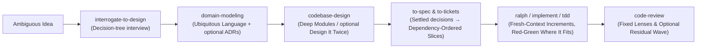

| Skill | Scripts & Reference Machinery | What It Does |
| :--- | :--- | :--- |
| `code-review` | `multi-lens-review.py`, `plan-review-verify.py`, `residual-review-loop.py`, `planner.md`, `reviewer.md`, `verifier.md`, `smell-baseline.md` | Reviews changes against repository standards and originating intent. Adaptable `pi_exec` programs run fixed-lens, planned, or residual investigations; planner, reviewer, and verifier roles appear only where the chosen program needs them, a residual wave is one bounded extra pass, and reviewers report findings rather than fix them. |
| `ralph` | `ralph-ledger.py`, `ralph-simple.py`, `ledger-increment.md`, `simple-increment.md` | Adaptable `pi_exec` programs that run bounded, sequential fresh-worker increments: the ledger variant over a prepared `.ledger` task, the simple variant over any goal without a ledger. |
| `codebase-design` & `improve-codebase-architecture` | `deepening.md`, `design-it-twice.md`, `html-report.md` | Teaches Ousterhout's deep-module vocabulary (radically simple interfaces hiding deep implementation), with optional Design It Twice exploration of alternative interfaces; the architecture survey produces an HTML report of deepening opportunities rather than production changes. |
| `interrogate-to-design` & `to-spec` | `SKILL.md` | Stops the contractor anti-pattern ("build whatever satisfies the literal prompt"). `interrogate-to-design` interviews you to resolve open decisions and unstated assumptions; `to-spec` synthesizes already-settled decisions into a task-local specification without an interview. |
| `to-tickets` | `SKILL.md` | Breaks a plan or specification into approved tracer-bullet tickets with explicit blocking edges. |
| `domain-modeling` | `ADR-FORMAT.md`, `DOMAIN-LANGUAGE-FORMAT.md` | Sharpens the project's ubiquitous domain terminology as terms resolve, and offers an Architecture Decision Record for a durable, surprising trade-off when you approve it. |
| `diagnosing-bugs` | `SKILL.md` | Replaces shotgun debugging (mutating three files based on a stack trace guess) with systematic hypothesis generation, reproduction, and root-cause isolation. |
| `tdd` | `mocking.md`, `tests.md` | Red-green cycles at confirmed seams where behavior suits test-first work, with explicit guardrails against tautological mock-heavy tests; refactoring is a separate later step. |
| `llm-wiki` | `references/initialize.md`, `references/ingest.md`, `references/maintain.md`, `references/query.md` | Procedures for curating and querying the repository's local knowledge graph (`components/wiki`). |
| `prototype` | `logic.md`, `ui.md` | Explicitly separates throwaway spike rules (fast feedback, exploratory UI/logic) from production hardening. |
| `resolving-merge-conflicts` | `SKILL.md` | Intent-aware git conflict resolution—reconstructing the semantic goal of both branches rather than blind `ours`/`theirs` picking. |
| `wayfinder`, `research`, `implement`, `skill-authoring` | `SKILL.md` | Mapping work too large for one session as decision tickets and resolving them one at a time, grounded technical research, disciplined implementation execution, and authoring new procedural skills. |

---

## What Is Deliberately Excluded (And What Still Hurts)

A system's character is defined by what it refuses to include.

* **No theatrical agent swarms.** There is no "CEO Agent" delegating to a "Product Manager Agent" in a simulated Slack channel. Subagents here are scoped functional workers with explicit tasks, scoped tools, optional turn limits, and outcome framing.
* **No vector-database RAG over source code.** Chunking source files into 512-token embeddings destroys call graphs, type definitions, and lexical precision. Between live file and search tools, `code-context` context files, `session-search`, the `wiki` page graph, and `pi-exec` programs that compose those tools, exact structural and lexical lookup is what I reach for.
* **No silent auto-remediation magic.** When a guard triggers (`home-search-guard`, `code-context`), it fails loudly and tells the model *why* so the model updates its plan in-context. Invisible retry middleware just burns tokens in the dark while hiding architectural friction.
* **No lowest-common-denominator OS abstractions.** The cockpit layer (`notify`, `tmux-sessions`) is built unapologetically for macOS, `tmux`, and a terminal-first workflow.

### The Honest Trade-Offs & Unsolved Problems

I want to be candid about where this architecture pinches:

1. **The Token & Latency Tax of Oversight:** Running the `pair-programmer` and its consultant, notebook reflection and distillation forks, change-review forks, and `branch-search` attempts consumes real background tokens. `/pair status` shows pair and consultant usage (`sidecar-usage.ts`), and each branch search records its cost in its `record.json`. Creation is cheap, and verification is where I choose to spend my budget—but if you are optimizing for minimum API spend per keystroke rather than defect prevention, this setup will feel heavy.
2. **Model Routing Still Requires Operator Taste:** Switching primary models mid-project is like firing a developer and hiring a new one—you have to re-learn their failure modes. My example profiles (`model-profiles.anthropic.json`, `model-profiles.openai.json`) are what I copy into the user-global `~/.pi/agent/model-profiles.json`, which maps fixed profile names for specific cognitive postures (the `pair` sidecar, `deep` architectural judgment, `coding` daily drivers, cheap `background` work) to specific models and thinking levels. Whenever a lab ships a new weight update or silently quantizes an endpoint, those mappings require recalibration.
3. **Context Files Only Help Where Someone Wrote Them:** The `code-context` gate costs nothing on a file without a context file—nothing is blocked—but its value depends entirely on high-signal context files existing. On a massive, undocumented legacy repository, bootstrapping them still requires human editorial taste so the agent doesn't enshrine existing code smells on the kitchen floor as "local conventions."

---

## Operating Handbook

[`docs/setup.md`](docs/setup.md) takes a new macOS machine from nothing to a working environment.

### Prerequisites
* **Runtimes:** Node.js 22.19.0 or later (the `engines` field in `package.json`) and the `pi` coding agent CLI 1.2.0 or later. TypeScript checks use `tsc` and tests use Vitest; Pi Exec runs on the bundled Monty runtime (`@pydantic/monty`), so no system Python is required.
* **Host CLI Tools:** `git` (`branch-search` uses worktrees), `tmux` 3.2 or later plus `fzf` and `jq` for the `tmux-sessions` session picker, Ghostty and `terminal-notifier` for macOS notifications with click-to-focus, and `rtk` (optional; detected automatically by `components/rtk`).

### Installation & Workspace Verification

From a cloned checkout, install dependencies and activate the package in Pi:

```bash
git clone https://github.com/z3z1ma/apple-pi.git
cd apple-pi
npm install
pi install "$PWD"
```

To use the harness without hacking on it, `pi install git:github.com/z3z1ma/apple-pi` installs it as a Pi git package instead.

Because a broken harness mid-session destroys active working state, the repository carries focused component and integration tests, a pair-programmer harness, and a package-load smoke test. Coverage varies by feature. The normal proof sequence:

```bash
# Biome formatting check (non-writing)
npm run format:check

# Biome lint
npm run lint

# TypeScript compiler checks (tsc --noEmit)
npm run typecheck

# Vitest unit suites, the pair-programmer harness (expects `pi` on PATH), and the package-load test
npm test

# Print npm's dry-run package contents
npm run pack:check
```

`npm run check` runs the first three in sequence. `npm run test:loader` alone loads the manifest's extension entrypoints from the checkout and checks the exposed tool and command surface.

### Model Profiles & Tournament Configuration

Model routing lives only in the user-global `~/.pi/agent/model-profiles.json`; project files are never read. The repository root carries provider-specific examples to copy there:
* `model-profiles.anthropic.json` — Example profile mappings for Anthropic models.
* `model-profiles.openai.json` — Example profile mappings for OpenAI models.

```bash
cp model-profiles.anthropic.json ~/.pi/agent/model-profiles.json   # or model-profiles.openai.json
```

Branch search stays off until a configuration exists:
* `branch-search.example.json` — Example with the attempt count, per-attempt limits, and ignored directories cloned into each worktree. Copy it to `~/.pi/agent/branch-search.json`; the optional `judge.profile` key is documented in [`docs/branch-search.md`](docs/branch-search.md).

### Auditing, Evaluation, & Smoke Testing

```bash
# Summarize prompt-cache reads and writes, uncached input, and recorded cost from Pi session logs
npm run audit:cache

# Run the history evaluation on real models over closed ledger tasks (components/history-eval)
HISTORY_EVAL_CONFIG=eval.json HISTORY_EVAL_OUT=.ledger/<task-id> npm run eval:history
```

See [`docs/history-eval.md`](docs/history-eval.md) for the `eval.json` keys.

`.pi/programs/rpc_smoke.py` is a saved `pi_exec` program, not a standalone Python script. In a Pi session in this trusted checkout, ask the agent to call `program_rpc_smoke` with a `prompt`: it sends that prompt through the real installed Pi in RPC mode in a temporary directory and reports custom messages and usage. It calls the real default model.

### Installing Tmux & macOS Notification Integrations

To wire up focus-aware macOS notifications and the `tmux` session manager:

```bash
# Add the session manager plugin to your ~/.tmux.conf, then restart the tmux server:
# run-shell "/absolute/path/to/apple-pi/components/tmux-sessions/pi_session_manager.tmux"
```

Then, inside Pi, run `/notify-setup` to create the optional `~/Applications/Pi Notifier.app` and `/notify-test` to check delivery and click-to-focus.

---

## Provenance & Remixing

Built and maintained by **Alexander Butler** for daily production use.

Behavior across `extensions/`, `components/`, and `optional-extensions/` is pinned by tests in `tests/` and `components/*/tests/`; coverage varies by feature, and the procedural workflows in `skills/` are prose rather than tested code. If you disagree with an architectural judgment here—whether it is how `notebook` folds learnings, how `pi-exec` isolates tool loops, or how `pair-programmer` schedules reviews—you don't have to take my word for it. Read the test fixtures, inspect the state transitions, and remix whichever parts survive contact with your own work.
