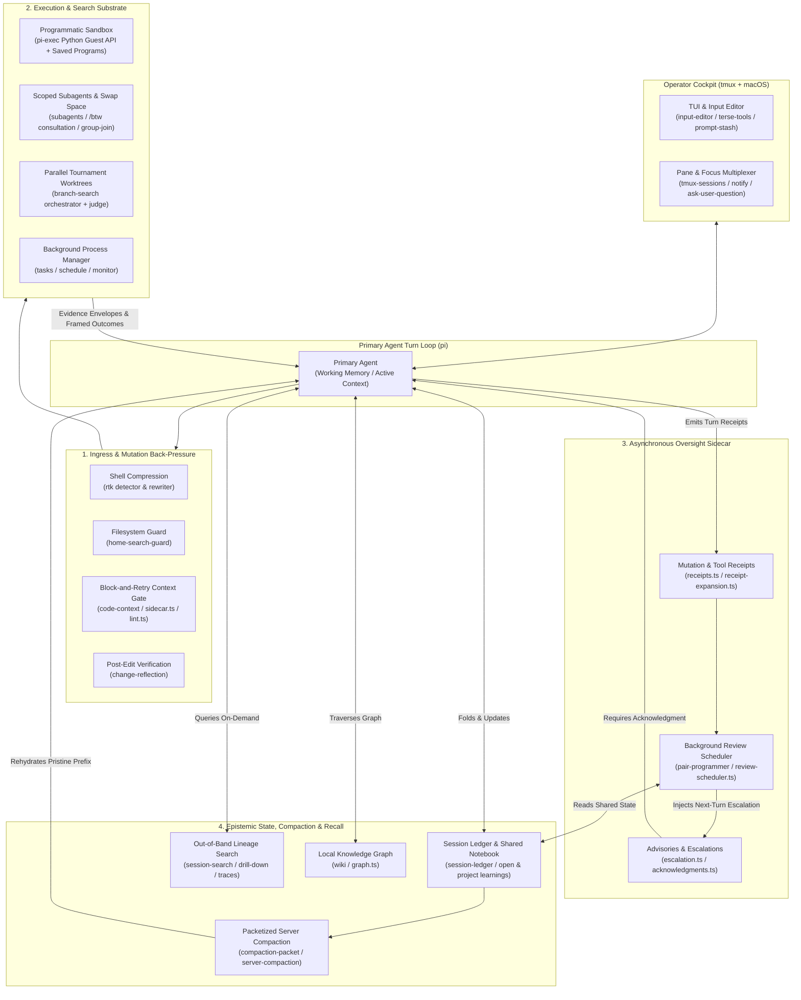
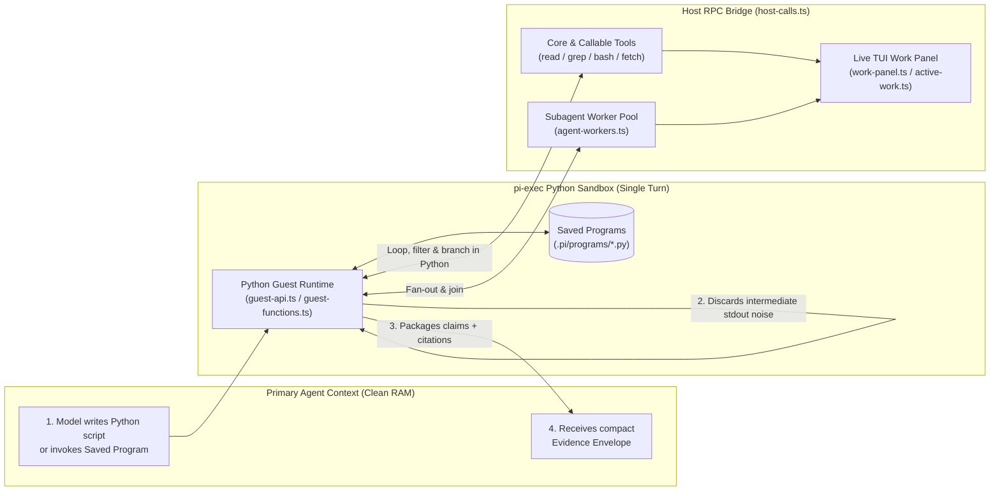
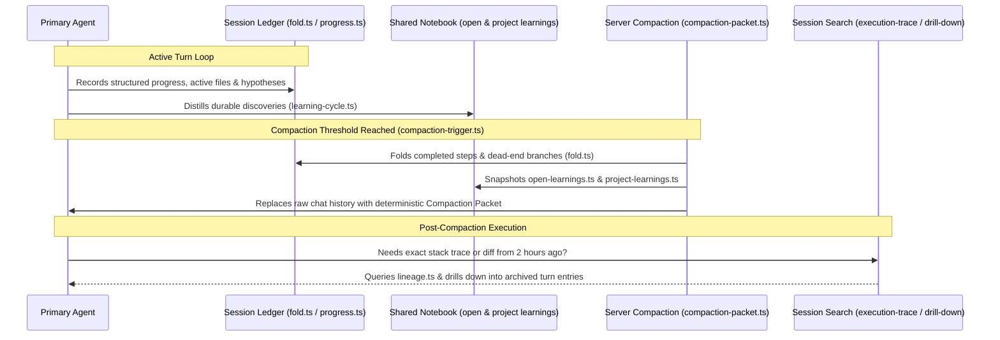
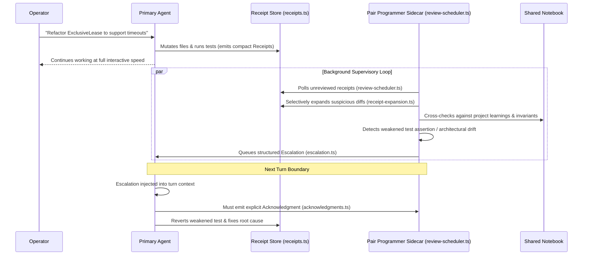
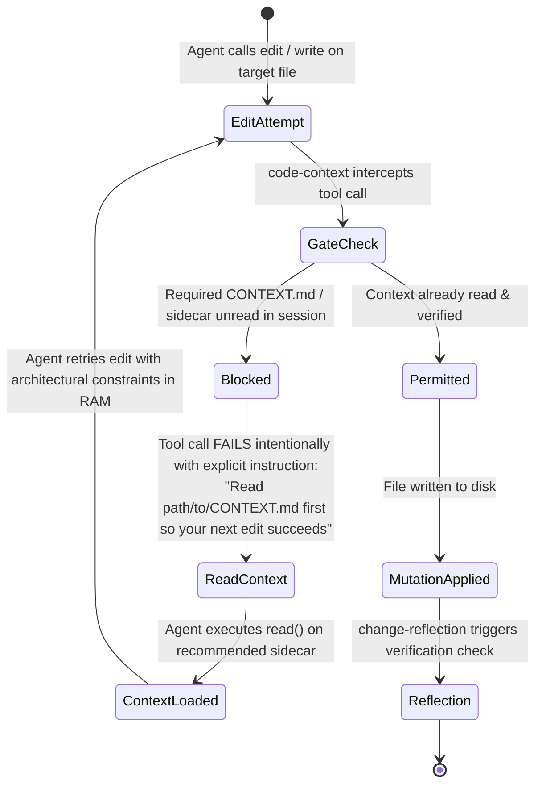
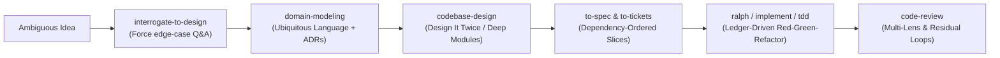

# apple-pi

This repository is my personal coding harness built on top of `pi`. It is not a product, a VC-backed framework seeking adoption, or a generalized starter kit for "agentic workflows." It is the cumulative result of spending months living inside terminal-based coding agents, hitting the exact same failure modes every afternoon, and building the mechanical back-pressure required to make them stop.

If you are looking for a zero-config wrapper that promises to turn your terminal into an autonomous software company while you sip an oat milk cortado on the beach, you are in the wrong place. If you spend six hours a day in `tmux` arguing with language models over diffs, and you want to inspect how another practitioner solved context rot, tool-call thrashing, unverified mutations, and subagent amnesia, read on.

I publish this in the spirit of **closed to pull requests, open to remix**. The code is here so you can inspect the decisions, steal the patterns, or point your own agent at this repo to extract what you need.

---

## What Working This Way Taught Me

I used to think the primary bottleneck in AI-assisted software engineering was model weights—that if we just waited for the next frontier checkpoint or wrote a sufficiently surgical `AGENTS.md`, the model would stop hallucinating imports, stop nuking adjacent functions, and remember why we rejected an architectural approach forty minutes ago.

That belief survived right up until the sessions got long and the codebases got real.

The models stopped being the primary constraint a long time ago. Language models are mirrors of operator skill and harness design. When an agent spirals on turn thirty-five, it is almost never because the underlying transformer lacks reasoning capacity. It spirals because **prevailing agent harnesses treat the model like an oracle and the context window like a dumpster.**

Think of an LLM's effective context window not as a 200k-token hard drive, but as RAM in an IBM 8086 XT. It is a scarce, volatile, high-contention resource. Yet watch how a standard coding agent operates: every raw `stdout` dump, every 4,000-line test trace, every 128-tool MCP schema, every dead-end file exploration, and every half-baked subagent tangent gets shoveled straight into the main transcript.

In DJing, there is an old saying: *if you are redlining the mixer, you aren't headlining.* Push the gain into the red and the audio clips into mud. The exact same physics apply to autoregressive models. Once you redline the context window past its effective attention threshold—or let a bad assumption pollute the prefix—the model becomes an autoregressive queen of failure. Every subsequent token is conditioned on the garbage already in the window. Once the bowling ball is in the gutter, no amount of screaming `"CRITICAL: DO NOT MAKE MISTAKES"` in the system prompt will bring it back onto the lane.

The industry’s standard response to this is either prompt superstition (selling influencer "skill packs" and bloated system instructions) or rigid orchestration DAGs that trap you in someone else's state machine. Both miss the root cause:

> **Software engineering with agents is no longer about typing syntax; it is about engineering back-pressure into the generative loop.**

When I audited my own discarded experiments and broken sessions, a single governing standard emerged: **if a constraint matters, it cannot live solely in the prompt.** Prompts are suggestions to a stochastic process. If a boundary actually matters, it must be enforced mechanically—at the tool-call gate, the execution sandbox, the epistemic fold, or the git worktree.

---

## System Topology at a Glance

Before diving into the arguments behind each subsystem, here is how the pieces fit together during a live session. The harness is organized around four concentric concerns: **Ingress & Mutation Back-Pressure**, **The Execution Substrate**, **Asynchronous Bicameral Oversight**, and **Epistemic State & Recall**.



---

## Deep Dive: Subsystems, Mechanics, and Emergent Implications

Every directory in `components/` exists because a specific recurring dysfunction forced me to write it. Below is how each subsystem works in the source code—followed by what happens when these mechanisms compound in practice.

---

### 1. `pi-exec`: From Tool-Call Thrashing to an Accumulating Executable Vocabulary

#### The Observed Dysfunction
Standard agent tool-calling is an absurdly chatty request-response protocol. To answer a moderately complex question about a codebase, the model emits a JSON tool call (`grep`), the harness dumps 400 lines of raw text into the transcript, the model reads it, emits a `read` call, gets another 300 lines, emits another `grep`, and repeats this twenty times.

You are using a frontier reasoning model as a $15-per-million-token `for`-loop. Worse, every intermediate false start is permanently etched into the conversation history, pushing the context window toward the redline before the agent has written a single line of production code.

#### The Mechanical Response (`components/pi-exec`)
Instead of forcing the model to chain individual tool calls across twenty HTTP round-trips, `pi-exec` gives the agent a sandboxed Python execution environment (`program.ts`, `guest-api.ts`, `guest-functions.ts`) wired back to the host harness over a bidirectional RPC bridge (`host-calls.ts`, `.pi/programs/rpc_smoke.py`).

1. **Host Tools as Callable Python Functions (`callable-tools.ts`, `core-tools.ts`):** Inside a single `pi-exec` script, the model can invoke host tools (`read`, `grep`, `bash`, MCP tools, or custom extensions) as synchronous or concurrent Python function calls, filter the results in standard Python memory, and discard the intermediate noise.
2. **Subagent Workers as Futures (`agent-workers.ts`, `worker-return.ts`):** A Python script can spawn scoped subagent workers, pass them structured payloads, await their completion, and programmatically inspect their return values.
3. **Structured Evidence Envelopes (`envelope.ts`, `evidence.ts`, `checkpoint.ts`):** When the script finishes, it does not dump raw `stdout` back into the chat. It returns a typed `envelope.ts` containing distilled conclusions paired with verifiable `evidence.ts` pointers and `checkpoint.ts` state.
4. **Saved Programs (`saved-programs.ts`):** Scripts that prove useful are persisted into `.pi/programs/` with typed schemas (`python-schema.ts`), turning one-off exploratory scripts into named, reusable workspace procedures.



#### The Extrapolated & Emergent Implications
When I first wired `pi-exec`, I thought of it merely as a token-saving batch runner. In sustained use, three much larger behaviors emerged:

* **The Workspace Grows an Executable Vocabulary:** There is an old Lisp ideal—recently revived in experiments like `jiti`—where you grow an application by talking to it: the model writes a function, registers it in the image, and never has to spend inference re-deriving that capability again. `saved-programs.ts` brings that exact dynamic to the coding harness. When an agent writes a Python program to trace SQLMesh lineage, audit BigQuery schema drift, or verify Looker dashboard references, and saves it to `.pi/programs/`, **ad-hoc reasoning crystallizes into deterministic software**. Three days later, the agent doesn't "think" about how to audit the schema; it calls the saved program. The repository accumulates its own custom CLI/RPC stdlib through daily work.
* **Turing-Complete Call Graphs & Dynamic Work Graphs:** Static multi-agent frameworks force you to define orchestration graphs *ahead of time* in YAML or TypeScript. Because `pi-exec` exposes `agent-workers.ts` inside Python, the model can synthesize **dynamic, data-dependent work graphs on the fly**. A single 35-line Python script can parse a dependency tree, spin up five parallel worker agents for the leaf nodes, run a deterministic test suite as a barrier synchronization step, and conditionally spawn a repair worker only for the branch that failed—all while `work-panel.ts` renders the live execution tree in the TUI.
* **Epistemic Compression:** Because the Python script acts as a loss-absorbing membrane between the messy filesystem and the primary context window, the root agent's transcript stays almost eerily quiet. Twenty megabytes of log inspection collapse into a 400-token evidence envelope.

---

### 2. `notebook`, `server-compaction`, & `session-search`: The Epistemic Fold

#### The Observed Dysfunction
Every long coding session eventually hits the wall. When the context window fills up, conventional harnesses do one of two things:
1. **FIFO Truncation:** Drop the oldest messages, which immediately lobotomizes the original architectural constraints and causes the agent to re-introduce bugs you fixed an hour ago.
2. **Naive LLM Summarization:** Ask a cheap model to "summarize the conversation so far." This produces three paragraphs of corporate mush (*"The user and assistant discussed refactoring the authentication module and encountered several test failures..."*) that strips out every exact file path, falsified hypothesis, and subtle invariant.

#### The Mechanical Response (`components/notebook`, `components/server-compaction`, `components/session-search`)
`apple-pi` treats memory not as a flat transcript, but as a tiered hierarchy with explicit promotion, folding, and out-of-band retrieval:



* **The Session Ledger (`components/notebook/src/session-ledger/`):** Instead of hoping the model remembers where it is by reading back through chat bubbles, `progress.ts`, `sources.ts`, and `fold.ts` maintain a structured ledger of what has been tried, what succeeded, what failed, and what remains open.
* **Two-Tier Learning Distillation (`hooks/learning-cycle.ts`, `open-learnings.ts`, `project-learnings.ts`, `distillation.ts`):** Discoveries made mid-session ("` WorkManager ` requires an exclusive lease before mutating shared state") are captured first as `open-learnings.ts` and distilled into durable `project-learnings.ts` and `shared-notebook.ts` entries, governed by strict token budgets (`model-budget.ts`, `tokens.ts`, `serialize.ts`).
* **Deterministic Compaction Packets (`hooks/compaction-packet.ts`, `components/server-compaction`):** When `compaction-trigger.ts` fires (guarded by `extensions/compaction-safety.ts` so it never amputates active in-flight tool work), the harness doesn't just ask for a prose summary. It folds the ledger, serializes the budgeted notebook sources (`tools/notebook-source.ts`), and coordinates with provider-native server compaction (`anthropic.ts`, `responses.ts`, `convert.ts`).
* **Out-of-Band Recall (`components/session-search`):** Because raw historical turns are evicted from working memory during compaction, the agent gets a dedicated surgical search tool (`tool.ts`, `search-entries.ts`) that queries across session lineages (`lineage.ts`), execution traces (`execution-trace.ts`), and file touchpoints (`recall-scope.ts`), allowing progressive `drill-down.ts` into the exact turn an event occurred.

#### The Extrapolated & Emergent Implications
* **Anti-Fragile Long Horizons:** In a normal harness, an agent gets *dumber* the longer a session runs because signal-to-noise degrades monotonically. Here, a compaction cycle actually makes the agent **sharper**. Why? Because the compaction fold (`fold.ts`) acts as garbage collection for dead-end explorations while keeping the falsified conclusions ("Approach X failed because of Y") pinned in the ledger packet. After compaction, the model wakes up with a 15k-token context window that contains 100% of the distilled institutional learnings of a 300k-token session and 0% of the dead-end `stdout` exhaust.
* **The Death of "Cold Start" Amnesia:** Because `project-learnings.ts` and `shared-notebook.ts` persist across sessions and feed into subagents (`subagent-notebook-e2e.test.ts`), the harness stops acting like a contractor with an 8-second memory. Mistakes made on Tuesday afternoon become permanent architectural guardrails on Wednesday morning.

---

### 3. `pair-programmer`: The Bicameral Sidecar & Automated Back-Pressure

#### The Observed Dysfunction
When an agent is deep inside an implementation loop, it suffers from tunnel vision. Autoregressive models have strong forward momentum: once they commit to a flawed plan and edit three files, they will happily spend the next ten turns weakening test assertions or adding hacky workarounds to defend their sunk cost.

The obvious fix—putting a synchronous "Critic Agent" in the middle of every turn—is a UX disaster. It doubles time-to-first-token, stalls interactive flow, and usually results in two models politely agreeing with each other's hallucinations.

#### The Mechanical Response (`components/pair-programmer`)
`pair-programmer` (`extensions/pi-pair.ts`) decouples execution from critique by running an **asynchronous supervisory sidecar** on its own background schedule and token budget (`sidecar-usage.ts`).



1. **Receipt Tracking & Selective Expansion (`receipts.ts`, `receipt-expansion.ts`):** Every file edit, command run, and tool outcome in the primary session generates a lightweight receipt. The pair programmer doesn't ingest the primary agent's bloated chat transcript; it inspects the receipt stream and selectively expands (`receipt-expansion.ts`) only the diffs and outputs it needs to verify.
2. **Cadenced Review Scheduling (`review-scheduler.ts`, `session.ts`):** Reviews trigger asynchronously based on mutation volume, risk signals, and cadence rules (`config.ts`) without blocking the primary turn loop.
3. **Ordered Advisories, Escalations, and Handshakes (`escalation.ts`, `acknowledgments.ts`):** When the sidecar catches a smell—an unverified edge case, a violated convention in `shared-notebook.ts`, or a rationalization loop—it queues a prioritized advisory or escalation. On the next turn, that escalation is injected directly into the primary agent's context, and the primary agent is mechanically required to register an explicit acknowledgment (`acknowledgments.ts`) addressing the critique.

#### The Extrapolated & Emergent Implications
* **Bicameral Mind in a Single Terminal:** Human pair programming works because the driver is focused on *tactical syntax* (the next 5 lines) while the navigator is focused on *strategic invariants* (the system design). A single LLM context window cannot hold both postures simultaneously without blending them into mediocrity. Because the `pair-programmer` sidecar has a **clean context window** unpolluted by the primary agent's tactical struggle, it has zero emotional or statistical attachment to the primary agent's sunk-cost code.
* **Cheap Fast Drivers + Deep Asynchronous Judges:** Combined with `model-profiles.ts`, this enables asymmetric model routing. You can run a fast, high-throughput model as the primary driver for rapid edits while routing the background `pair-programmer` sidecar to a deep-reasoning model that periodically audits the receipt log and yanks the steering wheel only when the driver drifts toward a cliff.

---

### 4. `code-context`, `change-reflection`, `home-search-guard`, & `rtk`: Boundary Back-Pressure

#### The Observed Dysfunction
If you put a rule in `AGENTS.md` saying *"Always read the local `CONTEXT.md` before editing files in `components/`,"* the model will obey it for the first ten minutes. By turn twenty, when it is chasing a failing test, it will ignore the prompt and blind-patch the file anyway.

#### The Mistake I Made First
I originally over-engineered this. I built pre-flight context injection pipelines that tried to anticipate what the model was about to touch and silently stuff the relevant docs into the prompt behind the scenes. It was brittle, opaque, and wasted tokens on false positives.

#### The Mechanical Response: Block-and-Retry (`components/code-context`)
I ripped out the clever pre-computation and replaced it with a blunt **block-and-retry gate** (`components/code-context/src/installer.ts`, `sidecar.ts`, `lint.ts`).



* **`code-context` (`sidecar.ts`, `lint.ts`):** When an `edit` or `write` tool call is attempted, the harness checks whether the agent has actually read the governing context files for that directory tree during the current session. If not, **the tool call fails**. It returns an explicit error message telling the model exactly which context file to read so that its next attempt will succeed. Once the model reads the file, the constraints are freshly loaded at the very bottom of its working memory—right before it generates the diff.
* **`home-search-guard` (`components/home-search-guard`):** Intercepts `grep`, `rg`, `find`, and `bash` calls that accidentally target `$HOME`, `/`, or massive unindexed parent directories before they hang the subprocess and dump gigabytes of garbage.
* **`rtk` (`components/rtk`):** Automatically detects and rewrites verbose shell invocations (`git status`, test runners, build logs) to route through `rtk` (`rewrite.ts`, `detector.ts`), stripping ANSI noise and boilerplate at the shell boundary.
* **`change-reflection` (`components/change-reflection`):** Hooks into post-mutation turns to force the agent to pause and verify its diff against tests and sidecar contracts before moving on.

#### The Extrapolated & Emergent Implications
* **Documentation Becomes an Executable Lock:** In almost every software company, architecture docs rot because they are passive artifacts disconnected from the edit loop. With `code-context` + `lint.ts`, a `CONTEXT.md` sidecar is no longer passive advice—it is **a mechanical lock on the directory**. An agent literally cannot mutate a module without first pulling its local invariants into the highest-attention region of its context window.
* **Zero-Waste In-Context Learning:** Failing a tool call with a prescriptive retry instruction doesn't fight the LLM's autoregressive nature; it uses it. The failure + read + retry sequence happens in two seconds and leaves the exact architectural rules sitting immediately adjacent to the code generation step.

---

### 5. `subagents`, `branch-search`, `ralph`, & `history-eval`: Swap Space, Tournaments, and Loops

#### The Observed Dysfunction
Most multi-agent setups are theatrical roleplay ("You are a Senior PM arguing with a QA Engineer"). They burn 5x the tokens to produce the exact same bugs a single agent produces, while creating race conditions on the git working tree.

Meanwhile, when you genuinely *do* need multiple agents—either to offload a noisy investigation, explore two competing architectures in parallel, or grind through a 50-file migration—standard harnesses give you no isolation primitives.

#### The Mechanical Response
`apple-pi` treats multi-agent execution as a systems engineering problem—providing **Swap Space** (`subagents`), **Speculative Branch Tournaments** (`branch-search`), **Ledger-Driven Monolithic Loops** (`ralph`), and **Counterfactual Replay** (`history-eval`).

```mermaid
flowchart TB
    subgraph SwapSpace["A. Context Swap Space (components/subagents)"]
        Parent["Primary Agent"] -->|Spawns scoped worker| Child["Subagent Runner<br/>(child-context.ts)"]
        Parent -.->|Zero-footprint side query| BTW["/btw Consultation<br/>(btw.ts / btw-viewer.ts)"]
        Child -->|Burns 50k tokens in isolated RAM| Child
        Child -->|outcome-framing.ts +<br/>completion-reflection.ts| Parent
    end

    subgraph Tournament["B. Speculative Tournaments (components/branch-search)"]
        Prompt["Ambiguous Architectural Task"] --> Orch["Orchestrator<br/>(orchestrator.ts)"]
        Orch -->|Clone Worktree A| WTA["Branch A (Profile: Opus)"]
        Orch -->|Clone Worktree B| WTB["Branch B (Profile: GPT)"]
        Orch -->|Clone Worktree C| WTC["Branch C (Profile: Sonnet)"]
        WTA & WTB & WTC -->|Diffs + Test Traces + Records| Judge["Adversarial Judge<br/>(judge.ts / report.ts)"]
    end

    subgraph LoopAndEval["C. Autonomous Loops & Replay (skills/ralph + history-eval)"]
        Ralph["ralph-ledger.py<br/>(Monolithic Increment Loop)"] <-->|Reads/Writes Increment| LState[("Session Ledger")]
        Hist["history-eval<br/>(clone.ts / run.ts)"] -->|Clones past session checkpoint<br/>& replays under new harness| Report["Empirical Benchmark<br/>(report.ts)"]
    end
```



1. **Subagents as Context Swap Space (`components/subagents`):**
   * When the main agent needs to investigate a gnarly bug or audit a subsystem, it spawns a child agent (`agent-manager.ts`, `agent-runner.ts`, `child-context.ts`) with scoped tools (`nested-tools.ts`) and sharedexclusive work leases (`components/shared/src/exclusive-lease.ts`).
   * Crucially, when the child finishes, its raw transcript is **not** dumped into the parent. It passes through `completion-reflection.ts` and `outcome-framing.ts`, returning only the verified answer and updating `shared-notebook.ts`.
   * For the human operator, `/btw` (`btw.ts`, `ui/btw-viewer.ts`) opens an ephemeral side-channel conversation Forked from the current context (`fork-context.ts`) so you can ask a tangent question without adding a single token to the main session's history.
2. **Parallel Branch Tournaments (`components/branch-search`):**
   * Ousterhout’s *A Philosophy of Software Design* argues that you should **Design It Twice**—because your first design is rarely the cleanest. When creation is cheap, why only *design* it twice when you can *implement* it three times in parallel?
   * `branch-search` (`orchestrator.ts`, `workspace.ts`) clones isolated git workspaces, dispatches competing agent runs across configurable model profiles (`branch-search.example.json`), records every step (`record.ts`), and passes the resulting git diffs and test outcomes to an independent `judge.ts` to synthesize a comparative `report.ts`.
3. **Ledger-Backed Ralph Loops (`skills/ralph`):**
   * A raw `while true; do agent; done` loop ("Ralph loop") works great until context resets cause the agent to thrash on the same half-finished item. `skills/ralph/references/ralph-ledger.py` (`ledger-increment.md`) couples the monolithic outer loop to the `notebook` session ledger—each loop iteration claims a single increment, verifies it via tests, records the state transition in the ledger, and exits cleanly so the next iteration boots with zero context rot.
4. **Counterfactual Session Replay (`components/history-eval`):**
   * How do you know if a new skill, system prompt tweak, or compaction rule actually improves the harness? Folklore and vibes aren't engineering. `history-eval` (`clone.ts`, `session.ts`, `tasks.ts`, `run.ts`) clones real historical sessions from your own past work at specific turn boundaries and replays them against the modified harness to measure the delta empirically.

#### The Extrapolated & Emergent Implications
* **Stochastic Search with Deterministic Selection:** When you combine `branch-search` with `ralph-ledger.py`, you stop treating the LLM as a deterministic compiler that must get the answer right on the first try. Instead, you use `branch-search` to sample the solution space across multiple isolated git worktrees, let `judge.ts` and your test suite select the surviving architecture, and then let `ralph-ledger.py` grind out the remaining mechanical tickets with clean-context loops.
* **Your Own Failures Become the Harness's Test Suite:** Every time a real coding session goes sideways, `history-eval` lets you capture that exact session lineage as a reproducible fixture (`sessions.fixture.ts`). You fix the harness mechanism (e.g., tightening a `code-context` gate or adjusting `pair-programmer` escalation thresholds) and replay the historical failure to prove the harness now catches it.

---

### 6. The Operator Cockpit: Multiplexing Attention Across Panes

#### The Observed Dysfunction
Once your harness is reliable enough to run 15-minute `pi-exec` work graphs, `ralph` loops, and `branch-search` tournaments, the bottleneck moves out of the terminal pane and into your own skull. Babysitting a streaming terminal spinner is a terrible use of human attention; conversely,alt-tabbing away to another `tmux` window usually means an agent sits idle for twenty minutes waiting on a permission prompt or clarification.

#### The Mechanical Response (`tmux-sessions`, `notify`, `terse-tools`, `input-editor`, `prompt-stash`, `wiki`)

```
┌──────────────────────────────────────────────────────────────────────────────┐
│ tmux status: [0:floqast-api ●] [1:apple-pi ⏳(2 subagents)] [2:dbt-osmosis 🔔]│
├──────────────────────────────────────┬───────────────────────────────────────┤
│ Primary Turn Stream (terse-tools)    │ Live Inspection & Sidecars            │
│                                      │                                       │
│ ▸ read components/notebook/fold.ts   │ ┌─ Agent / Work Panel ──────────────┐ │
│ ▸ pi-exec: audit_ledger_tokens.py    │ │ ● worker-1 (research)    [12.4s]  │ │
│   └─ ✓ 14 files checked, 0 leaks     │ │ ● worker-2 (test-verify) [ 8.1s]  │ │
│ ▸ pair-programmer [advisory]:        │ │ ○ pair-review            [queued] │ │
│   "Acknowledge token cap edge case"  │ └───────────────────────────────────┘ │
│ ▸ edit src/model-budget.ts (+18/-4)  │ ┌─ /btw Ephemeral Viewer ───────────┐ │
│ ▸ bash (rtk): vitest run             │ │ Q: Does fold.ts preserve source   │ │
│   └─ ✓ 42 passed (1.2s)              │ │    IDs across 2 compactions?      │ │
│                                      │ │ A: Yes, via serialize.ts refs...  │ │
│                                      │ └───────────────────────────────────┘ │
├──────────────────────────────────────┴───────────────────────────────────────┤
│ [input-editor] > _                              (Ctrl+S: prompt-stash / $EDITOR) │
└──────────────────────────────────────────────────────────────────────────────┘
```

* **Dense, Inspectable TUI (`components/terse-tools`):** Monkey-patches default verbose tool blocks (`patch.ts`, `formatters.ts`) into compact, single-line summaries with interactive drill-down (`inspector.ts`, `tool-viewer.ts`) and mouse support. You see the *shape* of the agent's actions at a glance without scrolling past 800 lines of JSON.
* **Focus-Aware Native Notifications (`components/notify` & `components/tmux-sessions`):** When an agent finishes a turn, hits an `ask-user-question` RPC dialog (`components/ask-user-question`), or triggers a bell, `notify` runs `focus-check.sh` and `focus-tmux.sh`. If you are already looking at that exact `tmux` pane in your active macOS terminal window, it stays silent. If you are in another window or pane, it fires a native macOS notification that, when clicked, focuses the exact terminal and switches `tmux` directly to the waiting session (`picker.sh`, `agents.sh`).
* **Frictionless Prompt Composition (`components/prompt-stash`, `components/input-editor`):** Halfway through writing a complex architectural spec in the prompt box and realize you need to ask the agent a quick question first? `prompt-stash` (`stash.ts`, `external-editor.ts`) stashes your draft onto a stack or pops it straight into `$EDITOR` (Neovim/Vim) for real editing, then restores it when you're ready.
* **Graph-Backed Local Wiki (`components/wiki` & `skills/llm-wiki`):** Maintains a persistent, interlinked local knowledge graph (`graph.ts`, `ingest.md`, `maintain.md`, `query.md`) injected into the system prompt (`system-prompt.ts`) so domain concepts and cross-cutting architecture survive across months of work.

---

## Architectural Inventory

The codebase enforces a strict separation between **implementation machinery** (`components/`), **thin registration entrypoints** (`extensions/`), and **procedural workflows** (`skills/`).

### Core Components & Extensions

| Component (`components/`) | Extension (`extensions/`) | Primary Mechanism & Boundary |
| :--- | :--- | :--- |
| `pi-exec` | `pi-exec.ts` | Sandboxed Python guest runtime (`guest-api.ts`), host tool RPC bridge (`host-calls.ts`), subagent worker fan-out (`agent-workers.ts`), evidence envelopes (`envelope.ts`), and reusable saved programs (`saved-programs.ts`). |
| `notebook` | `ledger.ts`, `auto-compact.ts`, `compaction-safety.ts` | Structured session ledger (`session-ledger/fold.ts`, `progress.ts`), two-tier learning distillation (`open-learnings.ts`, `project-learnings.ts`), token budgeting (`model-budget.ts`), and deterministic compaction packets (`compaction-packet.ts`). |
| `pair-programmer` | `pi-pair.ts` | Asynchronous supervisory sidecar. Tracks mutation/tool receipts (`receipts.ts`), selectively expands diffs (`receipt-expansion.ts`), schedules background reviews (`review-scheduler.ts`), and enforces escalation acknowledgments (`escalation.ts`, `acknowledgments.ts`). |
| `subagents` | `subagents.ts` | Scoped child agent lifecycle (`agent-manager.ts`, `agent-runner.ts`), outcome framing (`outcome-framing.ts`), completion reflection (`completion-reflection.ts`), `/btw` zero-footprint side consultations (`btw.ts`), clarify dialogs, and TUI conversation viewers. |
| `branch-search` | `branch-search.ts` | Parallel tournament engine. Clones isolated git worktrees (`workspace.ts`), orchestrates competing model profiles (`orchestrator.ts`), and runs an adversarial judge (`judge.ts`, `report.ts`). |
| `code-context` | `code-context.ts`, `context.ts` | Block-and-retry mutation gate (`installer.ts`, `sidecar.ts`, `lint.ts`). Fails `edit`/`write` calls when governing `CONTEXT.md` sidecars haven't been read in-session. |
| `session-search` | `session-search.ts` | Out-of-band historical search engine. Queries session lineages (`lineage.ts`), execution traces (`execution-trace.ts`), and file scopes (`recall-scope.ts`) with progressive drill-down (`drill-down.ts`). |
| `server-compaction` | `server-compaction.ts` | Provider-native server compaction adapters for Anthropic (`anthropic.ts`) and OpenAI Responses (`responses.ts`) with message conversion and replay safety (`convert.ts`, `hooks.ts`). |
| `tasks` | `tasks.ts`, `work.ts` | Asynchronous bash process manager (`task-manager.ts`, `process-killer.ts`), ring-buffered output capture (`output-buffer.ts`), scheduling (`schedule-tool.ts`), and monitoring (`monitor-tool.ts`). |
| `terse-tools` | `terse-tools.ts` | TUI renderer patches (`patch.ts`, `formatters.ts`) that compress verbose tool output into dense, mouse-navigable one-liners with an interactive modal inspector (`inspector.ts`, `tool-viewer.ts`). |
| `rtk` | `rtk.ts` | Shell command detector (`detector.ts`) and AST/command rewriter (`rewrite.ts`) that routes noisy CLI commands through `rtk` for token compression. |
| `wiki` | `wiki.ts` | Local graph-structured knowledge base (`graph.ts`, `installer.ts`) for domain concepts, architecture maps, and cross-session synthesis. |
| `change-reflection` | `change-reflection.ts` | Post-mutation hook that enforces verification and reflection checkpoints after file modifications. |
| `home-search-guard` | `home-search-guard.ts` | Intercepts and blocks runaway search/find commands targeting `$HOME` or unindexed root directories (`config.ts`, `index.ts`). |
| `input-editor` | `input-editor.ts` | Custom TUI input editor widget (`ui/input-editor.ts`). |
| `prompt-stash` | `prompt-stash.ts` | Prompt draft stack (`stash.ts`) and `$EDITOR` bridge (`external-editor.ts`). |
| `ask-user-question` | `ask-user-question.ts` | Structured TUI/RPC disambiguation dialog (`dialog.ts`, `rpc.ts`) when human judgment is required mid-turn. |
| `tmux-sessions` | `tmux-sessions.ts` | Tmux session manager plugin (`pi_session_manager.tmux`), pane state tracker (`state.ts`), bell handler (`bell.sh`), and interactive session picker (`picker.sh`). |
| `notify` | `notify.ts` | Native macOS notification bundler (`install-notifier-app.sh`) with terminal/tmux focus detection (`focus-check.sh`, `focus-tmux.sh`). |
| `vroom` | `vroom.ts` | Fast-path execution and throughput tuning utilities. |
| `xai-hosted-tools` | `xai-hosted-tools.ts` | Payload construction and summarization adapters for xAI hosted tools (`payload.ts`). |
| `history-eval` | *(via `scripts/eval-run.mjs`)* | Counterfactual evaluation suite (`clone.ts`, `run.ts`, `session.ts`, `tasks.ts`) that replays historical session checkpoints to benchmark harness changes. |
| `shared` | *(Internal library)* | Cross-component primitives: `work-manager.ts`, `exclusive-lease.ts`, `forked-continuation.ts`, `fork-context.ts`, `model-profiles.ts`, `sidecar-usage.ts`, `file-changes.ts`, and `git.ts`. |

### Optional Extensions (`optional-extensions/`)
Excluded from the default autoload path, enabled when I want self-contained in-session tracking without external issue trackers:
* **`backlog`**: In-terminal backlog state store and TUI manager (`ui/backlog-manager.ts`).
* **`todos`**: Session todo controller with configurable reminder cadence (`reminder-cadence.ts`), auto-clear (`auto-clear.ts`), and TUI widget (`ui/todo-widget.ts`).

---

## Skills: Codified Procedural Judgment (`skills/`)

A lot of public "skill packs" are cargo-culted prompt fluff—3,000 words telling the model to "write clean, maintainable, bug-free TypeScript." Delete those. Models already know how to write TypeScript; it is in their weights.

What models *don't* do naturally is **resist their own eagerness to emit code prematurely**. The skills in `skills/` exist strictly to enforce sequencing, epistemic hygiene, and multi-perspective verification where an unguided model would rush straight into generating slop.



| Skill | Scripts & Reference Machinery | What It Enforces |
| :--- | :--- | :--- |
| `code-review` | `multi-lens-review.py`, `plan-review-verify.py`, `residual-review-loop.py`, `planner.md`, `reviewer.md`, `verifier.md`, `smell-baseline.md` | Orchestrates adversarial multi-lens reviews and iterative residual-fix loops until defects converge to zero, separating the *planner*, *reviewer*, and *verifier* roles. |
| `ralph` | `ralph-ledger.py`, `ralph-simple.py`, `ledger-increment.md`, `simple-increment.md` | Runs autonomous outer-loop iterations where each pass claims one increment from the session ledger, lands it with tests, updates the ledger, and resets the context window. |
| `codebase-design` & `improve-codebase-architecture` | `deepening.md`, `design-it-twice.md`, `html-report.md` | Enforces Ousterhout's deep-module principles (radically simple interfaces hiding deep implementation) and forces the agent to synthesize competing designs before touching production files. |
| `interrogate-to-design` & `to-spec` | `SKILL.md` | Stops the contractor anti-pattern ("build whatever satisfies the literal prompt"). Forces the agent to interrogate unstated assumptions, failure modes, and invariants before writing a spec. |
| `to-tickets` | `SKILL.md` | Decomposes approved specifications into small, verifiable, dependency-ordered implementation tickets. |
| `domain-modeling` | `ADR-FORMAT.md`, `DOMAIN-LANGUAGE-FORMAT.md` | Locks down ubiquitous domain terminology and Architecture Decision Records before implementation begins. |
| `diagnosing-bugs` | `SKILL.md` | Replaces shotgun debugging (mutating three files based on a stack trace guess) with systematic hypothesis generation, reproduction, and root-cause isolation. |
| `tdd` | `mocking.md`, `tests.md` | Strict red-green-refactor sequencing with explicit guardrails against tautological mock-heavy tests. |
| `llm-wiki` | `initialize.md`, `ingest.md`, `maintain.md`, `query.md` | Procedures for curating and querying the repository's local knowledge graph (`components/wiki`). |
| `prototype` | `logic.md`, `ui.md` | Explicitly separates throwaway spike rules (fast feedback, exploratory UI/logic) from production hardening. |
| `resolving-merge-conflicts` | `SKILL.md` | Intent-aware git conflict resolution—reconstructing the semantic goal of both branches rather than blind `ours`/`theirs` picking. |
| `wayfinder`, `research`, `implement`, `skill-authoring` | `SKILL.md` | High-signal codebase navigation, grounded technical research, disciplined implementation execution, and authoring new procedural skills. |

---

## What Is Deliberately Excluded (And What Still Hurts)

A system's character is defined by what it refuses to include.

* **No theatrical agent swarms.** There is no "CEO Agent" delegating to a "Product Manager Agent" in a simulated Slack channel. Subagents here are scoped functional workers with explicit context budgets, leases, and outcome framing.
* **No vector-database RAG over source code.** Chunking source files into 512-token embeddings destroys call graphs, type definitions, and lexical precision. Between `session-search`, `code-context` sidecars, the `wiki` graph, and programmatic `pi-exec` Python scripts, exact structural and lexical traversal wins every time.
* **No silent auto-remediation magic.** When a guard triggers (`home-search-guard`, `code-context`), it fails loudly and tells the model *why* so the model updates its plan in-context. Invisible retry middleware just burns tokens in the dark while hiding architectural friction.
* **No lowest-common-denominator OS abstractions.** The cockpit layer (`notify`, `tmux-sessions`) is built unapologetically for macOS, `tmux`, and a terminal-first workflow.

### The Honest Trade-Offs & Unsolved Problems

I want to be candid about where this architecture pinches:

1. **The Token & Latency Tax of Oversight:** Running `pair-programmer` receipt expansions, distilling `notebook` learnings, and spinning up `branch-search` worktrees consumes real background tokens (`sidecar-usage.ts`). Creation is cheap, and verification is where I choose to spend my budget—but if you are optimizing for minimum API spend per keystroke rather than defect prevention, this setup will feel heavy.
2. **Model Routing Still Requires Operator Taste:** Switching primary models mid-project is like firing a developer and hiring a new one—you have to re-learn their failure modes. My routing configs (`model-profiles.anthropic.json`, `model-profiles.openai.json`) map specific cognitive postures (fast sidecars, deep architectural judges, daily drivers) to specific checkpoints. Whenever a lab ships a new weight update or silently quantizes an endpoint, those profiles require recalibration.
3. **The Cold-Start Tax on Legacy Brownfield Repos:** The `code-context` block-and-retry gate is phenomenal once high-signal `CONTEXT.md` sidecars exist. On a massive, undocumented legacy repository, bootstrapping those sidecars still requires human editorial taste so the agent doesn't enshrine existing code smells on the kitchen floor as "local conventions."
4. **Skills Can Calcify If You Don't Prune Them:** Any procedural skill is a patch over a habit the model or workflow didn't naturally exhibit at the time. Every few months, you have to ask: *"Did I try this without the skill?"* I periodically audit and prune `skills/` to make sure I'm not constraining a newer model with last quarter's workarounds.

---

## Operating Handbook

### Prerequisites
* **Runtimes:** Node.js (ES2022+ / TypeScript via `tsx` & `vitest`) and Python 3.10+ (for `pi-exec` guest programs and `skills/` orchestration scripts).
* **Host CLI Tools:** `pi` coding agent CLI, `git` (with `worktree` support for `branch-search`), `tmux` (for `tmux-sessions`), and `rtk` (optional; automatically detected and wired by `components/rtk`).

### Installation & Workspace Verification

```bash
npm install
```

Because a broken harness mid-session destroys active working state, every component, hook, TUI widget, and compaction adapter is covered by unit, integration, and end-to-end tests:

```bash
# Run TypeScript compiler checks across all components and extensions
npm run typecheck

# Run Biome linter and formatting checks
npm run check

# Verify extension entrypoints and package load boundaries
npm run verify:load

# Run the full Vitest test suite
npm test
```

### Model Profiles & Tournament Configuration

Model routing and tournament parameters live at the repository root:
* `model-profiles.anthropic.json` — Profile mappings for Anthropic primary loops, subagent tiers, and background sidecars.
* `model-profiles.openai.json` — Profile mappings for OpenAI Responses and reasoning models.
* `branch-search.example.json` — Reference configuration for parallel branch tournaments, workspace clone strategies, and judge model selection.

### Auditing, Evaluation, & Smoke Testing

```bash
# Audit prompt cache hit rates, sidecar overhead, and token economics across sessions
node scripts/cache-audit.mjs

# Run counterfactual historical session evaluations (components/history-eval)
node scripts/eval-run.mjs
# Or invoke directly via the dedicated Vitest eval config:
npx vitest run --config vitest.eval.config.ts

# Smoke-test the pi-exec Python guest-to-host RPC bridge
python3 .pi/programs/rpc_smoke.py
```

### Installing Tmux & macOS Notification Integrations

To wire up focus-aware macOS notifications and the `tmux` session manager:

```bash
# Build and install the native macOS notifier app bundle
./components/notify/scripts/install-notifier-app.sh

# Add the session manager plugin to your ~/.tmux.conf:
# run-shell "/absolute/path/to/apple-pi/components/tmux-sessions/pi_session_manager.tmux"
```

---

## Provenance & Remixing

Built and maintained by **Alexander Butler** for daily production use.

Every extension in `extensions/`, component in `components/`, and procedural workflow in `skills/` is backed by an executable specification in `tests/` and `components/*/tests/`. If you disagree with an architectural judgment here—whether it is how `notebook` folds context packets, how `pi-exec` isolates tool loops, or how `pair-programmer` schedules interrupts—you don't have to take my word for it. Read the test fixtures, inspect the state transitions, and remix whichever parts survive contact with your own work.
